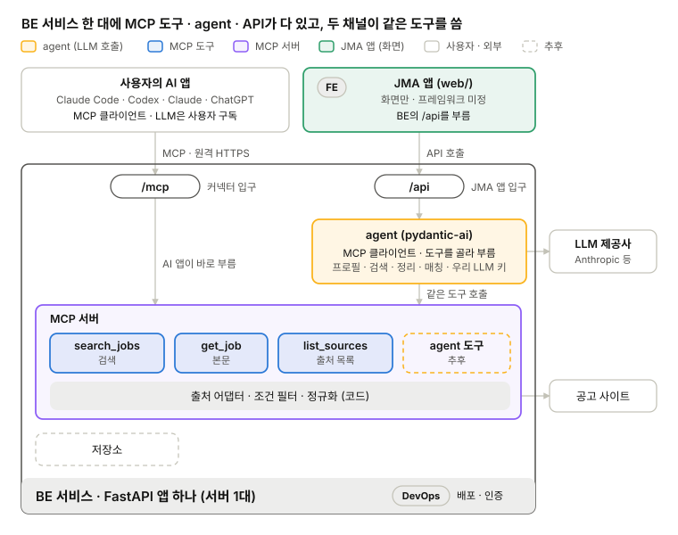

# job-matching-agent

job-matching-agent는 이력서에 맞는 채용 공고를 찾아 주는 AI agent입니다. Claude, ChatGPT 같은 AI 앱에 MCP 서버로 추가해 쓰거나, 웹 앱인 JMA(Job Matching Agent)에서 쓸 수 있습니다. 어느 쪽에서 쓰든 같은 MCP 도구로 공고를 검색합니다.

[](https://github.com/ai-agent-study-group/job-matching-agent/actions/workflows/ci.yml)


<br>


## 구조



| 경로 | 사용하는 곳 | 동작 | LLM 비용 |
|---|---|---|---|
| `/mcp` | Claude Code, Codex, claude.ai, ChatGPT | AI 앱이 MCP 도구로 공고를 검색하고 이력서와 비교 | 사용자의 AI 앱 구독 |
| `/api` | JMA 앱 (`web/`) | 서버의 agent가 이력서에서 직무명과 희망 근무지를 뽑고, 같은 MCP 도구로 공고를 검색 | 서버의 API 키 |

그림과 표는 목표 구조입니다. 두 경로를 FastAPI 앱 하나가 처리하도록 만들고 있으며, 구현 상황은 [Wiki 진행상황](https://github.com/ai-agent-study-group/job-matching-agent/wiki/진행상황)에서 확인할 수 있습니다.

agent는 MCP 도구로 제공하지 않습니다. 제공하면 AI 앱이 agent를 부를 때마다 LLM 비용이 서버의 API 키로 나가기 때문입니다.

## MCP 도구

| 도구 | 내용 |
|---|---|
| `list_sources()` | 출처 목록과 출처별 설명 (가장 먼저 호출) |
| `get_usage(source)` | 출처별 `search_jobs` 검색 조건 (JSON 스키마) |
| `search_jobs(source, params)` | 공고 목록: 회사, 직무명, 근무지, id |
| `get_job(source, posting_id)` | 공고 하나의 링크와 본문 |

네 도구 모두 읽기 전용입니다. 사용자가 "베를린 Data Analyst 공고 찾아줘"라고 하면 AI 앱은 도구를 다음 순서로 부릅니다.

```
→ list_sources()
    arbeitsagentur   독일 연방고용청: 독일 전 업종, 대부분 독일어
    freehire         freehire.me: 회사 채용 페이지에서 모은 공고, 전 세계
→ get_usage("arbeitsagentur")
    keywords, locations, umkreis(반경 km), befristung(기간제 · 무기한) ...의 JSON 스키마
→ search_jobs("arbeitsagentur", {"keywords": ["Data Analyst"], "locations": ["Berlin"]})
    공고 목록
→ get_job("arbeitsagentur", "<id>")
    공고 링크와 본문
```

출처마다 검색 조건이 달라서 `search_jobs`는 조건을 `params` 하나로 받습니다. 출처별 형식은 `get_usage`가 알려 줍니다. 자세한 호출 흐름은 [출처 목록과 출처 고르기](docs/be/ticket-9.md) 작업 메모에 있습니다.

## 공고 출처

| 출처 | `source` | 공고 | 검색 결과 상한 |
|---|---|---|---|
| [연방고용청 jobsuche API](https://jobsuche.api.bund.dev) | `arbeitsagentur` | 독일 전 업종, 대부분 독일어 | 300건 |
| [freehire](https://freehire.me) | `freehire` | 회사 채용 페이지에서 모은 전 세계 공고 | 100건 |

검색 결과가 상한을 넘으면 `search_jobs`가 조건을 좁히라는 오류를 돌려줍니다.

새 출처는 `port/outbound/source.py`의 `JobSource` 인터페이스를 구현하고, `src/bootstrap.py`의 출처 목록에 한 줄 추가합니다. MCP 도구 코드는 고치지 않아도 됩니다. 구현 예는 [연방고용청 어댑터](docs/be/ticket-11.md)와 [freehire 어댑터](docs/be/ticket-15.md) 작업 메모에 있습니다.

## 폴더 구조

`src/`는 헥사고날(포트 · 어댑터) 구조입니다. `domain`과 `service`는 FastAPI, MCP, 출처 API에 의존하지 않고, `port`에 정한 인터페이스로만 바깥과 연결됩니다.

```
src/
  domain/       공용 데이터 형식: JobPosting, Profile, Source
  port/
    inbound/    mcp · api가 부르는 인터페이스: JobServicePort, RegistryServicePort
    outbound/   출처 어댑터가 구현하는 인터페이스: JobSource
  service/      포트 구현: JobService(출처 하나), RegistryService(출처 목록)
  adapter/
    inbound/    api/ (FastAPI 경로), mcp/ (MCP 도구), agent/ (pydantic-ai agent)
    outbound/   source/api/arbeitsagentur/, source/api/freehire/
  bootstrap.py  출처 클라이언트를 만들어 registry에 넣는 곳
  main.py       앱 시작점: /api와 /mcp를 FastAPI 앱 하나에 올림
test/           src/와 같은 구조의 테스트
web/            JMA 앱 (Next.js)
docs/           설계 문서, 작업 메모, 회의 기록
```

설계 설명은 [BE 구조](docs/structure/be.md)에 있습니다.

## 로컬 실행

백엔드는 [uv](https://docs.astral.sh/uv/), 프론트엔드는 Node.js 20 이상이 필요합니다.

### 백엔드

```bash
uv sync                            # 의존성과 개발 도구 설치
uv run pre-commit install          # 커밋 전 ruff 검사 hook 설치 (clone 후 한 번)
```

앱을 띄우기 전에 저장소 루트의 `.env`에 LLM 모델과 API 키를 적습니다. `LLM_MODEL`이 없으면 앱이 시작되지 않습니다. `.env`는 git에 올라가지 않습니다.

```env
LLM_MODEL=openai:gpt-4.1-mini
OPENAI_API_KEY=<API 키>
```

Anthropic 모델을 쓰려면 `LLM_MODEL=anthropic:claude-haiku-5-5`와 `ANTHROPIC_API_KEY`를 적습니다.

```bash
uv run --env-file .env uvicorn main:app --reload   # http://localhost:8000/health
```

앱을 띄우면 MCP 서버도 `http://localhost:8000/mcp`에서 함께 열립니다. 다른 터미널에서 도구 목록을 보거나 도구 하나를 불러 볼 수 있습니다.

```bash
uv run fastmcp list http://localhost:8000/mcp
uv run fastmcp call http://localhost:8000/mcp --target list_sources
```

Claude Code에서 쓰려면 이 주소를 MCP 서버로 등록합니다.

```bash
claude mcp add --transport http jobs http://localhost:8000/mcp
```

테스트와 린트는 아래 명령으로 실행합니다. CI도 PR마다 같은 검사를 돌립니다.

```bash
uv run pytest
uv run ruff check . && uv run ruff format --check .
```

- 의존성 추가: `uv add <라이브러리>` (개발 도구는 `uv add --dev <라이브러리>`)
- `src/` 바로 아래에 패키지(폴더)를 새로 만들면 `pyproject.toml`의 `module-name` 목록에도 추가 (`main.py`는 파일이라 제외)

Docker로 실행할 수도 있습니다.

```bash
docker build -t jma:dev .
docker run --rm -p 8000:8000 jma:dev
curl localhost:8000/health   # {"status":"ok"}
```

### 프론트엔드

```bash
cd web
npm install
npm run dev   # http://localhost:3000
```

명령 목록과 폴더 구조는 [web/README.md](web/README.md)에 있습니다.

## 문서

| 문서 | 내용 |
|---|---|
| [현재 구조와 기술](docs/STRUCTURE.md) | 목표, 전체 구조, 구현 범위, 역할 분담 |
| 영역별 설계 | [BE](docs/structure/be.md) · [LLM](docs/structure/llm.md) · [FE](docs/structure/fe.md) · [DevOps](docs/structure/devops.md) · [QA](docs/structure/qa.md) |
| 직군별 작업 공간 | [기획](docs/po/README.md) · [프론트엔드](docs/fe/README.md) · [백엔드](docs/be/README.md) · [AI · LLM](docs/ai-llm/README.md) · [데이터 수집](docs/data/README.md) · [인프라](docs/infra/README.md) |
| [프로젝트 역할](docs/TEAM.md) | 직군별 역할과 정기 모임 |
| [회의 기록](docs/meetings/README.md) | 주간 회의 안건과 결정 |
| [문서 작성 안내](docs/GITHUB_GUIDE.md) | 문서 쓰고 고치는 법, 로컬 미리보기 |
| [문서 사이트](https://ai-agent-study-group.github.io/job-matching-agent/) | `docs/`를 GitHub Pages로 보는 사이트 |
| [Wiki](https://github.com/ai-agent-study-group/job-matching-agent/wiki) | 진행 상황, 문서 모음 |

## 기여

브랜치 이름, PR, 리뷰 규칙은 [기여 규칙](CONTRIBUTING.md)에 있습니다.
