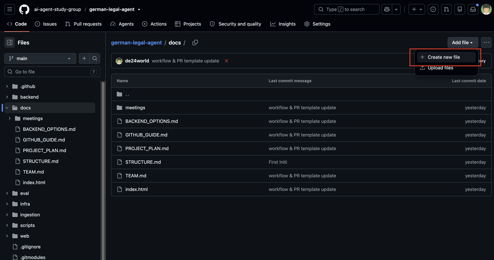
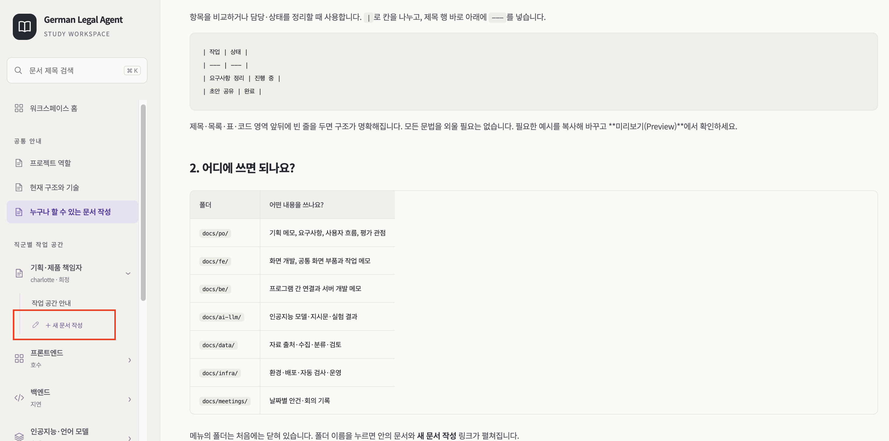
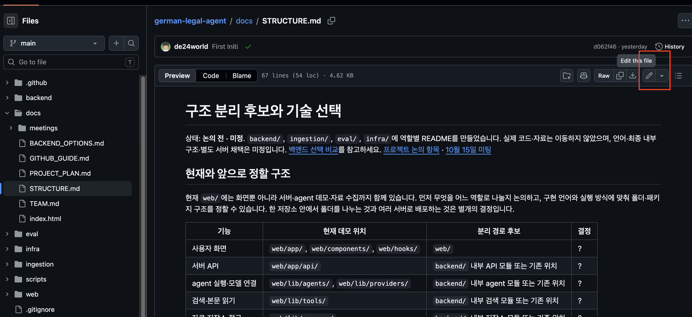
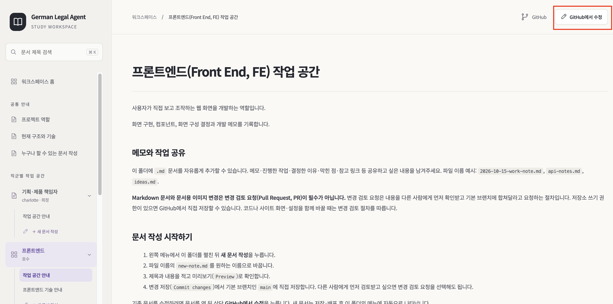

# 누구나 할 수 있는 문서 작성

> **문서 작성·수정에는 변경 검토 요청(Pull Request, PR)이 필수가 아닙니다.**
> Markdown 문서와 문서용 이미지만 바꾼다면, 쓰기 권한이 있는 팀원은 GitHub에서 `main`에 직접 저장할 수 있습니다.
> 코드·`docs/index.html`·실행/자동화 설정을 바꾸거나 코드와 문서를 함께 바꾸면 변경 검토 요청을 사용합니다.

이 문서는 개발 도구를 설치하지 않고 GitHub 웹사이트에서 메모와 작업 내용을 남기는 방법을 설명합니다.

## 1. 새 문서 만들기

GitHub 저장소와 문서 사이트 중 편한 곳에서 시작하면 됩니다. 두 방법 모두 최종 작성·저장은 GitHub에서 진행합니다.
이미지의 빨간 테두리는 눌러야 할 버튼을 표시합니다. 화면 속 프로젝트명과 문서 목록은 원본 프로젝트에서 촬영한 예시입니다. 실제 작업은 job-matching-agent 저장소에서 진행합니다.

### 1.1. GitHub에서 시작하기

1. GitHub 저장소에서 문서를 추가할 폴더를 엽니다. 예: `docs/po/`.
2. **Add file(파일 추가) → Create new file(새 파일 만들기)** 을 누릅니다.
3. 파일 이름을 입력합니다. 예: `2026-10-15-user-flow.md`. 끝의 `.md`는 유지합니다.
4. 아래의 기본 템플릿을 복사해 붙여넣고 내용을 작성합니다. GitHub에서 직접 시작하면 템플릿은 자동 입력되지 않습니다.



### 1.2. 문서 사이트에서 시작하기

1. 왼쪽 메뉴에서 원하는 직군 폴더를 펼칩니다.
2. **＋ 새 문서 작성**을 누릅니다. GitHub 작성 화면이 새 탭으로 열립니다. 필요하면 로그인합니다.
3. 파일 이름의 `new-note.md`를 원하는 이름으로 바꿉니다. 폴더 경로와 `.md` 확장자는 유지합니다.
4. 자동으로 채워진 한글 템플릿의 제목·설명과 본문을 바꿉니다. 필요 없는 항목은 지워도 됩니다.



### 1.3. 작성한 문서 저장하기 — 두 방법 공통

1. **Preview(미리보기)** 를 눌러 실제로 보일 모양을 확인합니다.
2. **Commit changes(변경 저장)** 를 누르고 저장 설명을 적습니다. 예: `사용자 흐름 메모 추가`.
3. **Commit directly to the main branch(기본 브랜치에 직접 저장)** 를 선택해 저장합니다.

**Markdown 문서와 문서용 이미지만 바꾼 경우 변경 검토 요청(Pull Request, PR)은 필수가 아닙니다.**
폴더 경로와 파일 이름을 함께 쓰면 새 폴더 안에도 문서를 만들 수 있습니다.

## 2. 기존 문서 수정하기

### 2.1. GitHub에서 시작하기

1. GitHub 저장소에서 수정할 `.md` 파일을 엽니다.
2. 문서 오른쪽 위의 **연필 아이콘 — Edit this file(이 파일 수정)** 을 누릅니다.
3. 편집 화면에서 내용을 수정합니다.



### 2.2. 문서 사이트에서 시작하기

1. 사이트에서 수정할 문서를 엽니다.
2. 오른쪽 위의 **GitHub에서 수정**을 누릅니다.
3. 해당 파일의 GitHub 편집 화면이 새 탭으로 열리면 내용을 수정합니다.



### 2.3. 수정한 문서 저장하기 — 두 방법 공통

1. **Preview(미리보기)** 로 내용을 확인합니다.
2. **Commit changes(변경 저장)** 를 누르고 수정 이유를 적습니다.
3. **Commit directly to the main branch(기본 브랜치에 직접 저장)** 를 선택해 저장합니다.

`Commit`(커밋)은 변경 내용과 이유를 이력으로 저장하는 작업입니다. `Pull Request`(풀 리퀘스트)는 저장할 변경을 다른 사람에게 먼저 검토해달라고 요청하는 절차입니다.
**문서는 직접 저장하거나 필요할 때 변경 검토 요청을 선택하면 됩니다. 코드 변경에는 검토 요청이 필요합니다.**

직접 저장 선택지가 없거나 권한·브랜치 보호 안내가 나오면 저장소 관리자에게 문서 쓰기 권한과 직접 저장 가능 여부를 확인해주세요.
이 문서의 규칙을 바꾸는 것만으로 GitHub 접근 권한이나 브랜치 보호 설정이 자동 변경되지는 않습니다.

## 문서 상단 정보와 기본 템플릿

**새 문서 작성**을 누르면 아래 템플릿이 GitHub 편집 화면에 자동으로 들어갑니다. 회의록 작성 버튼은 같은 상단 정보와 회의용 본문을 채워줍니다.
GitHub 저장소에서 직접 새 파일을 만들 때는 아래 예시를 복사해서 사용하세요.

맨 위의 `---` 사이를 **문서 상단 정보(Front matter)** 라고 합니다. YAML(자료를 항목과 값으로 적는 형식)을 사용합니다.
시작하는 `---`는 파일의 첫 줄에 두고, 마지막 `---` 아래부터 Markdown 본문을 작성합니다.

| 항목 | 작성할 내용 |
| --- | --- |
| `제목` | 문서 내용을 알아볼 수 있는 한글 제목. 본문의 첫 제목도 함께 맞춰주세요. |
| `유형` | 작업 메모, 참고 자료, 사용 안내, 결정 기록, 회의 기록 등 |
| `설명` | 어떤 내용을 다루고 언제 읽으면 좋은지 쉬운 말로 설명 |
| `관련문서` | 꼭 필요한 관련 문서가 있을 때만 경로를 적습니다. 없으면 `[]`로 둡니다. |

```markdown
---
제목: "문서 제목"
유형: "작업 메모"
설명: "언제 읽으면 좋은지, 어떤 내용을 다루는지 한두 문장으로 적어주세요."
관련문서: []
---

# 문서 제목

## 배경과 목적

이 문서가 필요한 이유와 처음 읽는 사람이 알아야 할 배경을 적어주세요.

## 주요 내용

진행한 작업이나 공유할 내용을 쉬운 말로 설명해주세요.
전문 용어는 전체 이름과 뜻을 함께 적고, 필요하면 예시나 이미지를 넣어주세요.

## 결정 사항과 미정 사항

- 확정: ?
- 제안 또는 미정: ?

## 다음 할 일

- [ ] 할 일 작성
```

관련 문서가 필요한 경우에만 다음처럼 적습니다. 아래 경로는 예시이므로 실제 파일 이름으로 바꿔주세요.

```yaml
관련문서:
    - "../data/source-review.md"
    - "work-note.md"
```

제목·설명처럼 한 줄로 적는 값은 예시처럼 큰따옴표로 감싸면 `:` 같은 기호가 들어가도 구분하기 쉽습니다.
상단 정보는 사이트의 본문에는 표시되지 않으며, `관련문서` 경로도 자동으로 링크 목록으로 바뀌지는 않습니다.
독자가 눌러야 하는 링크는 필요한 위치에 `[읽기 쉬운 이름](주소)` 형식으로 작성하세요.

## 문서 작성 필수 원칙

**배경지식이 없는 사람도 읽고 이해할 수 있도록, 충분히 설명하고 쉬운 말로 작성해주세요.**

- 전문 용어와 약어는 처음 나올 때 전체 이름과 쉬운 설명을 함께 적습니다.
- 무엇을 하는지뿐 아니라 왜 필요한지, 어떻게 사용하는지도 설명합니다. 이해를 돕는 예시나 이미지가 있으면 함께 넣습니다.
- 이전 대화나 회의에 참여하지 않은 사람도 이해할 수 있도록 필요한 배경과 맥락을 적습니다.
- 확정된 내용과 제안·미정 사항을 구분합니다. 아직 정하지 않은 것은 `미정` 또는 `?`로 표시합니다.
- 저장하기 전에 처음 읽는 사람의 입장에서 읽어보고, 설명이 빠졌거나 어려운 표현이 없는지 확인합니다.

## 먼저 알아둘 GitHub 용어

영어 버튼을 외울 필요는 없습니다. 화면에서 아래 표현이 보이면 오른쪽 설명처럼 이해하면 됩니다.

| 화면의 말 · 전체 이름 | 쉬운 설명 |
| --- | --- |
| GitHub (깃허브) | 팀의 파일을 보관하고 함께 수정하는 웹사이트 |
| Repository (저장소, 줄여서 Repo) | 이 프로젝트의 문서와 코드가 모여 있는 공간 |
| Branch (브랜치) | 원본과 별도로 변경을 준비할 수 있는 작업 갈래 |
| `main` (메인) | 이 저장소에서 기준으로 사용하는 기본 브랜치의 이름 |
| Commit (커밋) | 변경 내용과 저장 이유를 이력으로 남기는 작업 |
| Commit changes (변경 저장) | 수정 내용을 저장하는 버튼 |
| Pull Request (풀 리퀘스트, PR) | 변경 내용을 먼저 검토하고 기본 브랜치에 합쳐달라고 요청하는 절차. 이 저장소에서는 문서만 바꿀 때 선택 사항 |
| Merge (병합) | 다른 작업 갈래의 변경 내용을 기본 브랜치에 합치는 작업 |
| Push (푸시) | 내 컴퓨터에 저장한 변경을 GitHub 저장소로 보내는 작업. GitHub 웹에서 직접 저장하면 별도로 실행하지 않음 |
| Preview (미리보기) | 저장하기 전에 문서가 어떻게 보일지 확인하는 화면 |
| Add file → Create new file | 파일 추가 → 새 파일 만들기 |
| Commit directly to the main branch | 검토 요청을 따로 만들지 않고 기본 브랜치에 직접 저장 |
| 배포 (Deployment) | 저장한 문서를 공개 사이트에서 볼 수 있게 반영하는 과정 |
| 로컬 (Local) | GitHub 서버가 아니라 내 컴퓨터에서 실행하는 환경 |

**문서만 바꾸는 경우:** 글 작성 → 미리보기 → 기본 브랜치에 직접 저장 → 사이트 반영을 기다립니다.

**코드도 바꾸는 경우:** 별도 작업 갈래에서 수정 → 변경 검토 요청 → 검토·자동 검사 → 병합 순서로 진행합니다.

## 4. Markdown은 무엇인가요?

Markdown은 **평소처럼 글을 쓰면서 간단한 기호로 제목·목록·강조를 표시하는 문서 형식**입니다.
파일 이름이 `.md`로 끝납니다. 프로그래밍을 몰라도 사용할 수 있습니다.

| 하고 싶은 것 | 이렇게 작성 | 보이는 모습 |
| --- | --- | --- |
| 큰 제목 | `# 문서 제목` | 큰 제목 |
| 소제목 | `## 진행한 작업` | 소제목 |
| 강조 | `**중요한 내용**` | **중요한 내용** |
| 목록 | `- 공유할 내용` | 항목 목록 |
| 체크 목록 | `- [ ] 할 일` / `- [x] 완료` | 할 일·완료 표시 |
| 링크 | `[이름](https://example.com)` | 클릭할 수 있는 링크 |
| 이미지 | `` | 이미지와 대체 설명 |

문단을 나누려면 빈 줄을 한 줄 넣습니다. 완벽한 형식을 맞추기보다 공유할 내용을 먼저 적어보세요.

### 4.1. 제목 — Headers

줄 앞에 `#`과 공백을 넣습니다. `#`의 개수가 많을수록 하위 제목이며, 1~6단계까지 사용할 수 있습니다.
한 문서의 대표 제목은 `#`, 주요 항목은 `##`, 그 안의 세부 항목은 `###`으로 쓰면 됩니다.

```markdown
# 문서 제목
## 주요 항목
### 세부 항목
#### 더 작은 항목
##### 5단계 제목
###### 6단계 제목
```

`#######`처럼 7개를 쓰면 제목으로 인식하지 않습니다.
다음처럼 글자 아래에 `=` 또는 `-`를 반복해도 1단계·2단계 제목이 됩니다. 처음에는 `#` 방식을 사용하면 편합니다.

```markdown
문서 제목
=========

문서 부제목
-----------
```

### 4.2. 인용문 — Blockquote

다른 사람이 한 말이나 강조해 구분할 안내 앞에 `>`와 공백을 넣습니다.

```markdown
> 회의에서 나온 의견입니다.
>
> 다음 문단도 같은 인용문입니다.
>> 인용문 안에 인용문을 넣을 수도 있습니다.
```

표시 예시:

> 회의에서 나온 의견입니다.
>
> 다음 문단도 같은 인용문입니다.
>> 인용문 안에 인용문을 넣을 수도 있습니다.

인용문 안에서도 제목·목록·강조 등을 사용할 수 있습니다.

### 4.3. 목록과 할 일

**순서가 있는 목록**은 숫자 뒤에 점과 공백을 넣습니다.

```markdown
1. 문서 작성
2. 미리보기 확인
3. 저장
```

숫자를 `1.`, `3.`, `2.`처럼 적어도 화면에서는 첫 번호부터 차례대로 번호가 붙습니다. 작성할 때도 순서대로 쓰는 편이 읽기 쉽습니다.

**순서가 없는 목록**은 `-`, `*`, `+` 중 하나와 공백을 사용합니다.
하위 항목은 들여쓰기합니다. 아래 예시처럼 공백 4칸으로 단계를 구분할 수 있습니다.

```markdown
- 화면 개발
    - 질문 입력창
    - 답변 표시
- 자료 수집
```

기호를 섞을 수도 있지만, 같은 단계에서는 한 가지 기호를 일관되게 사용하는 것이 좋습니다.

**할 일 목록**은 빈 대괄호로 미완료를, `x`로 완료를 표시합니다.

```markdown
- [ ] 회의 안건 작성
- [x] 초안 공유
```

표시 예시:

- [ ] 회의 안건 작성
- [x] 초안 공유

### 4.4. 코드와 문법 예시

파일 이름·명령어·기호처럼 글자 그대로 보여줄 짧은 내용은 백틱 한 쌍으로 감쌉니다.
예: `` `note.md` `` → `note.md`.

여러 줄은 백틱 3개로 감쌉니다. 안의 내용은 Markdown으로 변환되지 않아 문법 자체를 보여줄 때도 유용합니다.

````markdown
```
여기에 명령어나 예시를 적습니다.
```
````

여는 백틱 뒤에 `python`, `javascript`, `markdown` 등 언어 이름을 쓰면, 지원하는 화면에서는 문법에 따라 색을 구분할 수 있습니다.

````markdown
```python
print("안녕하세요")
```
````

문단 뒤에 빈 줄을 두고 공백 4칸 또는 탭으로 들여써도 코드 영역이 됩니다.
목록 안에서는 들여쓰기가 하위 항목으로 해석될 수 있으므로, 처음에는 백틱 3개 방식을 권장합니다.

```markdown
일반 문단입니다.

    이 줄은 코드 영역입니다.

다시 일반 문단입니다.
```

HTML(HyperText Markup Language, 웹페이지 구조를 표시하는 언어)의 `<pre><code>내용</code></pre>`로도 표현할 수 있지만, 일반 문서 작성에는 백틱이면 충분합니다.

### 4.5. 구분선

내용을 시각적으로 나누려면 빈 줄 사이에 `---`, `***`, `___` 중 하나를 적습니다.
인쇄할 때 새 페이지를 시작하는 기능은 아닙니다.

```markdown
첫 번째 내용

---

두 번째 내용
```

### 4.6. 링크 넣기

`[클릭할 글자](연결할 주소)` 형식으로 작성합니다. 대괄호 안에는 읽기 쉬운 이름을, 소괄호 안에는 주소를 넣으세요.
외부 웹사이트는 브라우저 주소창의 전체 주소를 복사합니다.

```markdown
[GitHub 도움말](https://docs.github.com/)
```

마우스를 올렸을 때 보일 설명을 넣으려면 주소 뒤에 공백과 따옴표로 감싼 설명을 적습니다. 주소와 설명 사이에 쉼표는 넣지 않습니다.

```markdown
[GitHub 도움말](https://docs.github.com/ "GitHub 사용 방법")
```

**같은 저장소의 문서**는 현재 작성 중인 파일을 기준으로 경로를 적을 수 있습니다.
예를 들어 `docs/fe/note.md`를 작성 중이라면:

```markdown
[같은 폴더의 작업 메모](work-note.md)
[상위 폴더의 문서](../shared-note.md)
```

`../`는 폴더를 한 단계 위로 올라간다는 뜻입니다. 예시의 파일 이름은 실제 연결할 문서 이름으로 바꿔주세요.
내 컴퓨터에서만 열리는 `localhost` 주소는 공개 문서의 링크로 사용하지 않습니다.

**참조 링크**는 본문과 주소를 나누어 적는 방식입니다. 같은 주소를 반복해서 사용할 때 편리합니다.

```markdown
사용 방법은 [GitHub 도움말][github-help]에서 확인합니다.

[github-help]: https://docs.github.com/ "GitHub 사용 방법"
```

**주소 자체를 표시**하려면 꺾쇠로 감쌉니다. 이메일도 같은 형식으로 적을 수 있습니다.

```markdown
<https://example.com/>
<address@example.com>
```

링크는 독자가 내용을 이해하는 데 필요한 자료에만 넣으세요. 공개 문서에는 개인 이메일 등 개인정보를 올리지 않습니다.

### 4.7. 강조와 취소선

| 원하는 표시 | 작성 방법 | 결과 |
| --- | --- | --- |
| 기울임 | `*강조*` 또는 `_강조_` | *강조* |
| 굵게 | `**중요**` 또는 `__중요__` | **중요** |
| 취소선 | `~~취소한 내용~~` | ~~취소한 내용~~ |

기호와 강조할 글자 사이에는 공백을 넣지 않습니다. 문장 중간에서는 `이것은 **중요한 내용** 입니다.`처럼 강조 구간 앞뒤를 띄우면 구분하기 쉽습니다.

### 4.8. 이미지

링크 앞에 느낌표 `!`를 붙이면 이미지를 표시합니다. 대괄호 안에는 이미지가 무엇인지 설명하고, 소괄호 안에는 실제 이미지 주소나 파일 경로를 적습니다.

```markdown


```

이미지 설명은 이미지가 보이지 않을 때나 화면 읽기 도구를 사용할 때도 도움이 됩니다.
GitHub 편집 화면에 이미지를 드래그하거나 붙여넣는 방법은 아래의 ‘이미지 첨부하기’ 항목을 따라 하세요.

기본 Markdown 문법에는 크기 지정이 없습니다. 크기를 조절해야 한다면 HTML의 `img` 태그를 쓸 수 있습니다.
다음 예시의 `450`은 가로 폭을 픽셀 단위로 지정합니다. 세로 크기는 원래 비율을 따릅니다.

```html

```

HTML 지원 범위는 표시하는 서비스에 따라 다를 수 있으니 미리보기로 확인하세요.

### 4.9. 문단과 줄바꿈

**새 문단**은 사이에 빈 줄을 넣습니다.

```markdown
첫 번째 문단입니다.

두 번째 문단입니다.
```

**같은 문단 안에서 줄만 바꾸려면** 줄 끝에 공백을 2칸 이상 넣고 Enter를 누릅니다.
일반 문서에서는 Enter만 눌러 줄을 나누면 화면에서 한 줄로 이어질 수 있습니다.

아래 예시의 `␠`는 공백을 보여주기 위한 표시입니다. 실제로 작성할 때는 `␠` 대신 스페이스 키를 눌러주세요.
눈으로 확인하기 어려우면 `<br>`를 사용할 수도 있습니다.

```markdown
첫 번째 줄입니다.␠␠
두 번째 줄입니다.
```

```markdown
첫 번째 줄입니다.<br>
두 번째 줄입니다.
```

### 4.10. 표

항목을 비교하거나 담당·상태를 정리할 때 사용합니다. `|`로 칸을 나누고, 제목 행 바로 아래에 `---`를 넣습니다.

```markdown
| 작업 | 상태 |
| --- | --- |
| 요구사항 정리 | 진행 중 |
| 초안 공유 | 완료 |
```

제목·목록·표·코드 영역 앞뒤에 빈 줄을 두면 구조가 명확해집니다.
모든 문법을 외울 필요는 없습니다. 필요한 예시를 복사해 바꾸고 **미리보기(Preview)** 에서 확인하세요.

## 3. 어디에 쓰면 되나요?

| 폴더 | 어떤 내용을 쓰나요? |
| --- | --- |
| `docs/po/` | 기획 메모, 요구사항, 사용자 흐름, 평가 관점 |
| `docs/fe/` | 화면 개발, 공통 화면 부품과 작업 메모 |
| `docs/be/` | 프로그램 간 연결과 서버 개발 메모 |
| `docs/ai-llm/` | 인공지능 모델·지시문·실험 결과 |
| `docs/data/` | 자료 출처·수집·분류·검토 |
| `docs/infra/` | 환경·배포·자동 검사·운영 |
| `docs/meetings/` | 날짜별 안건·회의 기록 |

메뉴의 폴더는 처음에는 닫혀 있습니다. 폴더 이름을 누르면 안의 문서와 **새 문서 작성** 링크가 펼쳐집니다.

## 5. 이미지 첨부하기

GitHub의 Markdown 편집 화면에 이미지를 드래그하거나 복사해 붙여넣으면 이미지 주소와 문법이 만들어집니다.
``의 설명을 알아보기 쉽게 고치고 미리보기(`Preview`)에서 확인합니다.

이미지를 파일로 관리하고 싶다면 `docs/assets/` 등에 업로드한 뒤 상대 경로로 연결할 수도 있습니다.
예를 들어 `docs/po/note.md`에서 `docs/assets/flow.png`를 표시하려면 ``라고 씁니다.

이름은 성을 제외한 이름만 사용하며, 개인 계정·연락처·실제 개인정보가 담긴 자료는 공개 문서에 올리지 않습니다.

## 6. 언제 사이트에 보이나요?

| 보는 곳 | 반영 시점 |
| --- | --- |
| GitHub 저장소 | `Commit changes`로 저장한 뒤 |
| 공개 문서 사이트 | `main` 반영 후 GitHub Pages 배포가 끝난 뒤 |
| 로컬 미리보기 | 내 컴퓨터의 파일을 저장하면 자동 갱신 |

새 문서는 해당 직군이나 회의 폴더 메뉴에 자동으로 나타납니다. 메뉴 코드를 고칠 필요가 없습니다.
새 회의록은 `docs/meetings/TEMPLATE.md`를 복사해 `docs/meetings/YYYY-MM-DD.md`에 작성하세요.

## 7. 개발 도구로 로컬 미리보기

이 부분은 로컬에서 확인하려는 사람만 따라 하면 됩니다. 프로젝트 루트에서 Node.js 20 이상(문서 도구를 실행하는 프로그램)과 npm(필요한 도구를 설치·실행하는 프로그램)을 사용합니다.

```bash
npm install
npm run docs:dev
```

[http://localhost:4173](http://localhost:4173)을 엽니다. 파일 저장 시 자동 갱신되며 종료는 `Ctrl+C`입니다.
포트를 바꿔야 한다면 `DOCS_PORT=4175 npm run docs:dev`로 실행합니다.
내 컴퓨터의 미리보기와 공개 사이트는 문서를 변환하는 프로그램이 달라 세부 서식에는 차이가 있을 수 있습니다.

## 배포 설정과 공식 도움말

문서 사이트는 `index.html` 하나로 화면·메뉴·스타일을 구성합니다.
Pages 설정은 `Deploy from a branch → main → /docs`를 사용합니다. 새 문서는 한글 상단 정보가 포함된 기본 템플릿으로 시작합니다. 기존 문서에 상단 정보가 없어도 계속 표시됩니다.

- [GitHub 파일 만들기](https://docs.github.com/en/repositories/working-with-files/managing-files/creating-new-files)
- [GitHub 파일 수정](https://docs.github.com/en/repositories/working-with-files/managing-files/editing-files)
- [Markdown 기본 문법·이미지](https://docs.github.com/en/get-started/writing-on-github/getting-started-with-writing-and-formatting-on-github/basic-writing-and-formatting-syntax)

## 직군과 개발 문서에 나오는 말

| 약어 · 전체 이름 | 쉬운 설명 |
| --- | --- |
| PO · Product Owner | 제품 책임자. 무엇을 만들지와 우선순위를 정리하는 역할 |
| FE · Front End | 프론트엔드. 사용자가 직접 보는 화면을 개발하는 역할 |
| BE · Back End | 백엔드. 화면 뒤에서 요청 처리와 자료 저장 등을 담당하는 역할 |
| AI · Artificial Intelligence | 인공지능 |
| LLM · Large Language Model | 대규모 언어 모델. 질문과 문장을 이해하고 답변을 생성하는 모델 |
| Infra · Infrastructure | 인프라. 프로그램 실행에 필요한 서버·네트워크 등의 기반 환경 |
| DevOps · Development and Operations | 개발과 운영을 연결하는 작업. 배포·실행 환경·자동 검사 등을 관리 |
| UI · User Interface | 사용자 인터페이스. 버튼·입력창처럼 사용자가 조작하는 화면 요소 |
| API · Application Programming Interface | 프로그램 사이에서 요청과 결과를 주고받는 연결 규칙 |
| DB · Database | 데이터베이스. 자료를 저장하고 조회하는 저장소 |
| CI · Continuous Integration | 지속적 통합. 변경할 때마다 코드 검사·테스트를 자동 실행해 문제를 확인하는 방식 |
| MVP · Minimum Viable Product | 최소 기능 제품. 핵심 사용자 흐름을 확인할 수 있도록 처음 만드는 작은 제품 |
| SDK · Software Development Kit | 외부 서비스의 기능을 개발에 사용할 수 있게 제공하는 도구 묶음 |
| JSON · JavaScript Object Notation | 프로그램이 자료를 주고받거나 저장할 때 사용하는 텍스트 형식 |
| HTML · HyperText Markup Language | 웹페이지의 제목·문단·링크 같은 구조를 표시하는 언어 |

기술 선택은 각 직군 폴더에서 확인하세요. 이 용어 설명 자체가 특정 기술을 채택했다는 뜻은 아닙니다.
