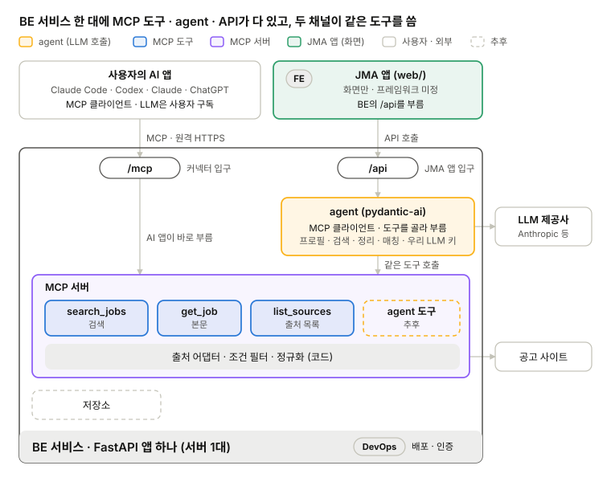
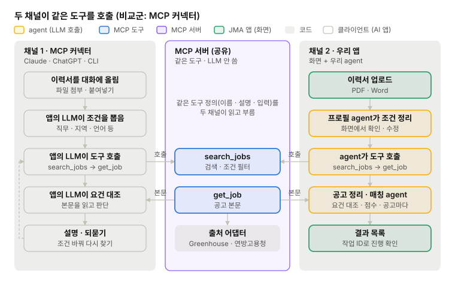
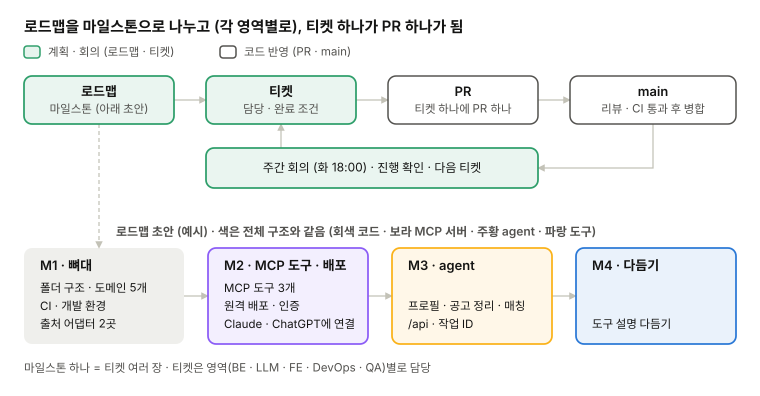
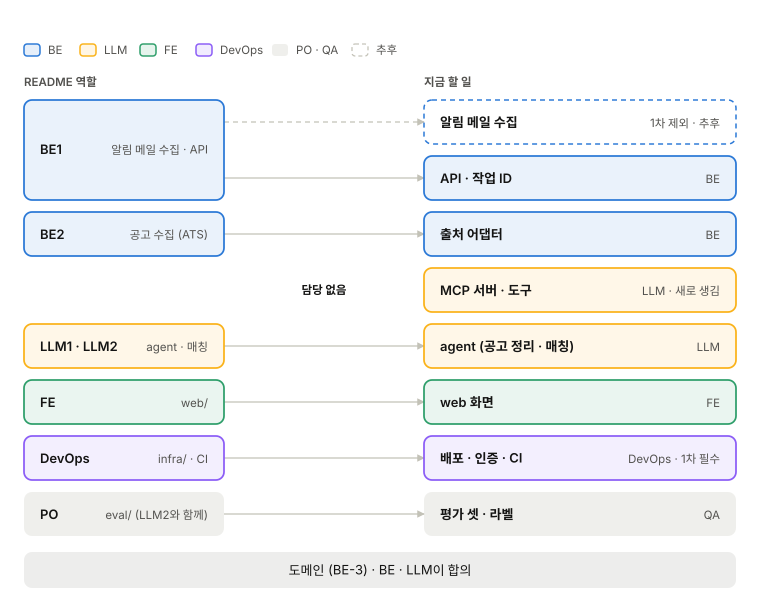

# 현재 구조와 기술

영역별 설계: [BE](structure/be.md) · [LLM](structure/llm.md) · [FE](structure/fe.md) · [DevOps](structure/devops.md) · [QA](structure/qa.md)

1차 목표는 MCP 커넥터(CLI · Claude · ChatGPT)와 JMA(Job Matching Agent) 앱, 두 입구에서 같은 매칭 기능을 쓰게 하는 것

## 전체 구조

*전체 구조 · BE 서비스 한 대에 MCP 도구 · agent · API*

1. **Two 채널 방식 :**
    1. 사용자의 AI 앱                       -> MCP 서버 도구 호출 (\*사용자 AI 앱: Claude Code · Codex · Claude · ChatGPT)
    2. JMA 앱 → API → agents -> MCP 서버 도구 호출 (\*agent가 Claude · Codex 역할을 함)
2. **한 서비스로 배포:** MCP 엔드포인트와 API를 같은 FastAPI 앱에 둠 (https://우리서버/mcp, https://우리서버/api/... )
3. **agent는 JMA 앱만:** 프로필 · 공고 정리 · 매칭 agent는 `run_matching()` 안에서 돌고, AI앱에서는 이 역할을 클라이언트 LLM (Claude, ChatGPT) 이 함
    1. **MCP에 agent 도구를 두지 않는 이유:** agent 도구는 우리 서버 키로 LLM을 불러서 비용이 우리에게 듦. 1차에는 데이터 도구만 둠

## 1. 첫 구현 범위

*첫 구현 범위 · 커넥터 · 서버 · JMA 앱 흐름*

- **커넥터 흐름:** 사용자가 Claude · ChatGPT 대화에 이력서를 올리면, 클라이언트가 이력에서 조건을 뽑아 검색 도구를 부르고, 공고 본문을 읽어 요건을 대조·설명함. 판단과 되묻기는 커넥터(ChatGPT, Claude)가 함
- **JMA 앱 흐름:** 이력서 업로드 → 프로필 agent가 정리 →<mark> 화면에서 확인 · 수정(추후)</mark> → 매칭 시작 → agent가 도구로 공고를 찾아 정리 · 매칭 → 결과 목록
- **1차 범위:** 위 세 흐름. 출처는 PoC에서 쓴 2곳(Greenhouse, 연방고용청) 외 기타 API, <mark>데이터베이스 유무 (추후)</mark>
- **추후:** <mark>JMA 앱의 대화 보충(채팅 화면)</mark>, 출처 추가
- **제외:** 구인 사이트 알림 메일(Gmail) 수집
- **남은 질문:**

## 2. 협업 방식

1차: 10.20(화) ~ 10.26(월)

2차: 10.27(화) ~ 11.2(월)

3차: 11.3(화) ~ 11.9(월)

4차: 11.10(화)~11.16(월)

<mark>1차 목표까지 (2차 시작 전까지) 무엇을 어떤 순서로 만들지(로드맵)를 먼저 정하고, 그걸 티켓으로 쪼개 진행함</mark>

### 진행 방식 (로드맵 → 티켓 → PR)

*진행 방식 · 로드맵 → 티켓 → PR · 로드맵은 초안*

티켓을 만드는 방식

| 방식 | 어떻게 | 좋은 점 | 아쉬운 점 |  |
| --- | --- | --- | --- | --- |
| A. 전체 회의에서 다 같이 | 화요일 회의에서 로드맵을 보며 티켓을 함께 씀 | 모두가 전체 그림을 앎. 영역 사이에 빠지는 일이 적음 | 회의가 길어짐. 남의 영역 티켓은 깊이 못 씀 |   |
| <mark>B. 영역별로 만들고 전체 회의에서 확인</mark> | <mark>BE · LLM · FE · DevOps · QA가 각자 티켓을 만들고, 전체 회의에서는 겹침과 빠짐만 봄</mark> | <mark>티켓이 구체적. 전체 회의가 짧음</mark> | <mark>영역 사이 연결(도구 입출력, 스키마)이 빠지기 쉬움</mark> | <mark>결정됨</mark> <mark>먼저 각자 개별 티켓을 만들고 로드맵을 구체화 함</mark> |

- **티켓 한 장:** 목표 한 줄, 완료 조건, 관련 안건(예: LLM-4), 담당. 크기는 PR 하나(400줄 권장)에 맞춤
- **회의:** 화요일 18:00 전체 회의에서 지난주 티켓 확인 · 막힌 것 · 다음 티켓. 영역별 회의는 필요할 때 따로
- <mark>시간대를 다르게 설정하여 자유롭게 참여</mark>

### 코드 규칙

CONTRIBUTING의 규칙(브랜치 이름, PR 병합 조건, semi-linear 히스토리, 설명할 수 있는 코드)은 이미 main에 있고, 아래 ①~④을 더함. ④ 문서 위치는 `docs/` 에 기록.

| 규칙 | 내용 |
| --- | --- |
| ① PoC · 데모 코드 | 개인 브랜치에만 두고 링크로 공유함. main에 넣지 않음 |
| ② 커밋하지 않는 것 | 이력서 · 키(`.env`) · 실행 결과. gitignore로 막음. 실수로 올렸으면 키를 바로 폐기함 |
| ③ PR | 400줄 권장. 체크리스트는 작성자와 리뷰어가 둘 다 확인 (BE/LLM 만 해당). 병합되는 코드는 `web/`을 포함해 모두 CI가 검사함 |
| ④ 문서 · 회의록 | main의 `docs/`(문서 사이트). 문서만 바꾸는 변경은 PR bypass 가능 |

## 3. 역할 분담

*README 역할과 지금 할 일*

<mark>각 영역별로 필요한 feature들을 kanban 보드에 자유롭게 추가 -&gt; 각 역할에 구애받지 않고 원하는 티켓 자유롭게 참여</mark>

## 참고 자료

- [PoC 브랜치 feat/poc-mcp-agent](https://github.com/ai-agent-study-group/job-matching-agent/tree/feat/poc-mcp-agent): pydantic-ai agent + MCP 서버(Greenhouse · 연방고용청 공고 검색). 헥사고날 구조로 되어 있음
- [PR #2 sample docs & web folder update](https://github.com/ai-agent-study-group/job-matching-agent/pull/2): Next.js web 데모, 회의록
- [첫 회의록 (2026-10-13)](https://github.com/ai-agent-study-group/job-matching-agent/blob/feat/create_sample/docs/meetings/2026-10-13.md): Phase 1·2 범위와 미정 항목
- [STRUCTURE.md](https://github.com/ai-agent-study-group/job-matching-agent/blob/main/docs/STRUCTURE.md): 지금 코드 구조와 연결 지점
- [CONTRIBUTING.md](https://github.com/ai-agent-study-group/job-matching-agent/blob/main/CONTRIBUTING.md): 브랜치·PR 규칙
