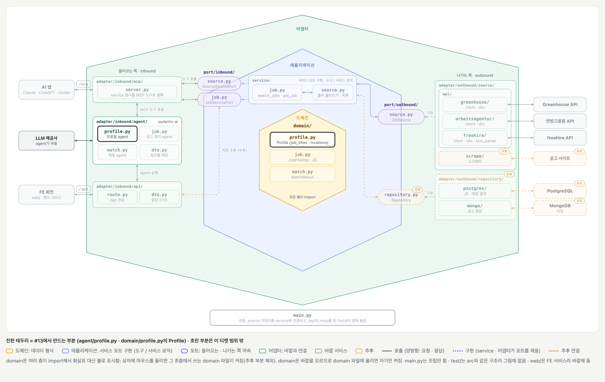
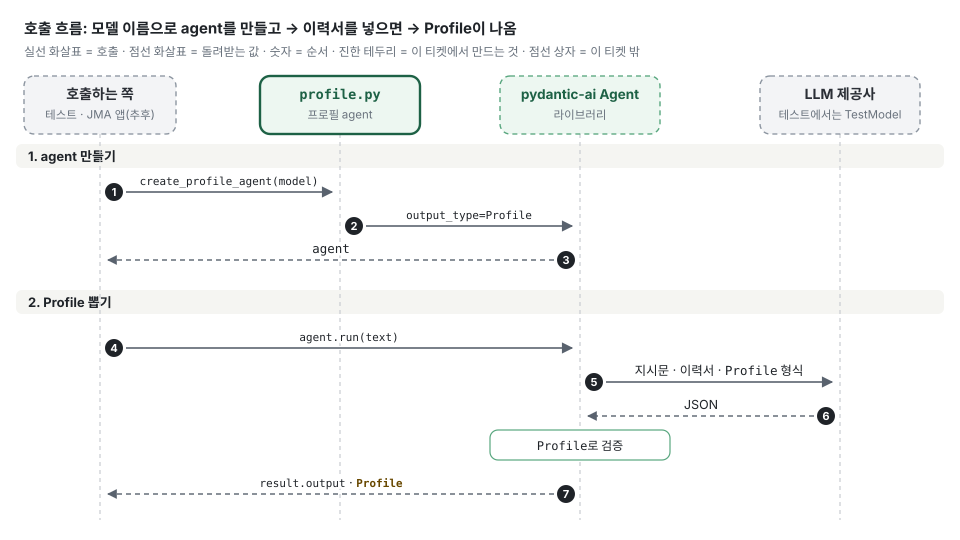

# 프로필 agent 최소판 (#13)

## 배경과 목적

[#13](https://github.com/ai-agent-study-group/job-matching-agent/issues/13)은 JMA 앱에서 받은 이력서 텍스트로 `Profile`의 검색에 쓰는 필드(직무명 · 희망 근무지)를 채우는 작업입니다. `Profile`의 나머지 필드와, 이 `Profile`로 공고를 검색하는 단계(#14)는 범위 밖입니다.

## 주요 내용

### 전체 그림

[BE 설계의 폴더 구조 그림](../structure/be.md)에서 이 티켓에서 만드는 부분만 켠 상태입니다. 진한 테두리가 만드는 부분이고, 흐린 부분은 이 티켓 범위 밖입니다.

1. **agent 만들기 (1~3):** 모델 이름(`anthropic:claude-haiku-5-5` 등)을 인자로 받아 `Agent`를 만듭니다. 코드는 `.env`를 읽지 않습니다.
2. **Profile 뽑기 (4~7):** 부르는 쪽이 `agent.run(이력서 텍스트)`를 부르면, pydantic-ai가 지시문 · 이력서 · `Profile` 형식을 LLM에 보내고 돌아온 값을 검증해 `.output`으로 줍니다. 테스트에서는 `TestModel`이 LLM 자리에 들어갑니다. agent를 부르는 코드와 빈 이력서 검사는 #14에서 `api/route.py` · `api/dto.py`에 둡니다.

### 만들 파일

| 파일 | 하는 일 |
| --- | --- |
| `src/domain/profile.py` | `Profile` (`job_titles` · `locations`만 먼저) |
| `src/adapter/inbound/agent/profile.py` | `INSTRUCTIONS` · `create_profile_agent(model)` |
| `test/adapter/inbound/agent/test_profile.py` | `TestModel`로 확인 (실제 LLM 호출 없음) |

### 검색 조건 형식을 따로 두지 않는 이유

- #9부터 `search_jobs`는 출처마다 다른 `params`를 받고, 그 형식은 `get_usage`가 알려 줍니다.
- 그래서 `params`는 #14의 검색 agent(LLM)가 `Profile`과 `get_usage` 결과를 보고 직접 씁니다.
- 그 사이에 고정된 검색 조건 형식(`SearchQuery`)이 있어도 읽는 코드가 없어서 두지 않습니다.

### LLM이 읽는 것

| 쓰는 곳 | LLM에게 보이는 것 |
| --- | --- |
| `INSTRUCTIONS` | 지시문 |
| `agent.run(...)`에 넣는 이력서 텍스트 | 사용자 메시지 |
| `Profile` docstring | 돌려줄 형식의 설명 |
| `Field(description=...)` | 각 필드의 설명 |

그래서 이력서를 뺀 나머지는 영어로 씁니다. `Profile`은 도메인이지만 LLM이 읽으니 docstring과 필드 설명도 영어입니다. `create_profile_agent` 같은 함수의 docstring은 LLM에게 가지 않습니다.

## 결정 사항과 미정 사항

- 확정:
    - 프로필 agent는 `Profile`을 돌려줌. 이번에는 `job_titles` · `locations`만
    - 모델 이름은 인자로 받음. 의존성은 `pydantic-ai-slim[anthropic,openai]`
    - agent를 부르는 코드와 빈 이력서 검사는 두지 않음 (#14의 `api/route.py` · `api/dto.py`)
- 미정:
    - #14 검색 agent가 `Profile`로 `params`를 쓰게 하는 지시문
    - `Profile`의 나머지 필드(경력 · 기술 스택 · 언어 · 연차)를 넣는 시점

## 다음 할 일

- [ ] #14: `api/route.py`에서 프로필 agent를 부르고, `api/dto.py`에서 빈 이력서를 검사
