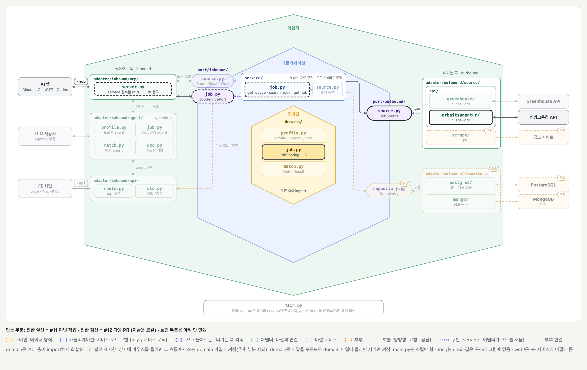

# Arbeitsagentur 공고 출처 어댑터 (#11)

## 배경과 목적

[#11](https://github.com/ai-agent-study-group/job-matching-agent/issues/11)은 출처에서 가져온 공고를 우리 형식(`JobPosting`)으로 바꿔, 서비스와 MCP 도구가 쓸 수 있게 하는 작업입니다.

처음에는 Greenhouse를 첫 출처로 잡았다가 Arbeitsagentur 구인 검색 API로 바꿨습니다.

- **Greenhouse:** 회사(board) 단위 API라 회사를 모르면 검색할 수 없음. "뮌헨 AI 엔지니어"처럼 회사를 가로질러 찾는 기능이 없음
- **Arbeitsagentur:** 독일 전체 공고를 키워드 · 지역 · 반경으로 API가 직접 검색해 줌. 무료이고 가입 없이 공개 키로 씀

## 주요 내용

### 전체 그림



[BE 설계의 폴더 구조 그림](../structure/be.md)에서 이 티켓에서 만든 부분만 켠 상태입니다. 진한 테두리가 만든 부분이고, 흐린 부분은 이 티켓 범위 밖입니다.


위 그림의 길을 실제로 부르는 순서입니다. 맨 왼쪽은 실제 LLM(Claude Code 등)이 붙어도 되고, 테스트에서는 가짜(mock)를 붙여도 됩니다.

1. **사용법 읽기 (1~4):** `get_usage()`가 서비스로 가고, 서비스가 어댑터의 `get_search_request_dto()`로 `ArbeitsagenturSearchRequestDTO`를 받아 JSON 스키마로 바꿔 돌려줍니다. LLM은 그 형식을 보고 `params`를 채웁니다.
2. **검색 (5~9):** `search_jobs(params)`를 부르면 어댑터가 같은 요청 DTO로 검사하고, 키워드 × 위치 조합마다 API를 부른 뒤 중복을 빼고 `JobPosting` 목록(본문 없음)을 돌려줍니다.
3. **본문 가져오기 (10~14):** LLM이 고른 공고를 `get_job(posting_id)`로 부르면, 본문까지 채운 `JobPosting` 하나가 옵니다.

### `JobPosting` 필드

공고를 가져오는 데 필요한 도메인은 `domain/job.py`의 `JobPosting` 하나입니다. 연방고용청 응답의 어느 필드에서 오는지와 왜 필요한지는 다음과 같습니다.

| 필드 | 연방고용청 응답 | 왜 필요한가 |
| --- | --- | --- |
| `source` | 없음 (어댑터가 `"arbeitsagentur"`를 넣음) | 어느 출처의 공고인지. 나중에 출처가 늘면 `get_job`이 어느 어댑터로 갈지 이걸로 정함 |
| `id` | `referenznummer` (예: `12336-a26f1192j0456062-S`) | 출처 안에서의 공고 번호. 본문을 다시 가져올 때 씀 |
| `company` | `firma` | 회사 이름 |
| `title` | `stellenangebotsTitel` | 목록에 보여 줌 |
| `location` | `stellenlokationen`의 도시(`adresse.ort`)들 | 목록에 보여 줌. 지역 검색은 API가 `wo` · `umkreis`로 해 줌 |
| `url` | `externeURL`, 없으면 연방고용청 공고 페이지 | 사용자가 눌러서 원문을 보거나 지원하는 링크. 제휴 업체 공고는 원래 공고로 감 |
| `description` | 상세 조회의 `stellenangebotsBeschreibung` | 공고 본문. 검색 결과에는 없고 하나씩 가져올 때만 와서 기본값 `None` |

### 호출할 때 동작

예: 사용자가 "뮌헨에서 정규직 풀타임 AI 엔지니어 찾아줘"라고 할 때

1. **`get_usage()`**
    - 서비스가 어댑터의 `get_search_request_dto()`로 검색 파라미터 DTO 클래스를 받아 JSON 스키마로 바꿔 돌려줌
    - API의 모든 parameter 값들과 설명이 들어 있어서 LLM이 이걸 보고 다음 호출의 값을 채움
2. **`search_jobs(params)`**

    ```json
    {"keywords": ["AI Engineer"], "locations": ["München"], "angebotsart": 1, "arbeitszeit": ["vz"], "befristung": [2]}
    ```

    - 서비스는 `params`를 그대로 어댑터에 넘김
    - 어댑터가 DTO로 검사함. 모르는 키나 잘못된 값이면 오류가 LLM에게 돌아감
    - 키워드 × 위치 조합마다 GET을 동시에 보냄

      ```http
      GET /pc/v6/jobs?was=AI Engineer&wo=München&angebotsart=1&arbeitszeit=vz&befristung=2&size=50&page=1
      ```

    - 결과를 참조번호로 중복 제거하고 `JobPosting` 목록으로 돌려줌 (본문 없음)
3. **`get_job(posting_id)`**
    - 참조번호를 base64로 바꿔 `GET /pc/v4/jobdetails/{...}`를 부름
    - 본문까지 채운 `JobPosting` 하나를 돌려줌

Claude Code에 MCP 서버를 붙여 확인한 결과입니다.

- `search_jobs` 전에 `get_usage`를 먼저 부름
- "Munich"이라고 물어도 `locations: ["München"]`으로 넣음
- "정규직"은 `befristung: [2]`, "풀타임"은 `arbeitszeit: ["vz"]`로 바꿈
- "비슷한 직무도"라고 하면 `Machine Learning Engineer`, `KI-Entwickler` 같은 키워드를 여러 개 넣음

### 연방고용청 API에서 알아낸 것

직접 불러서 확인한 내용이고, 코드는 이에 맞춰 짰습니다.

| 알아낸 것 | 그래서 코드는 |
| --- | --- |
| 검색어(`was`)와 지역(`wo`)은 하나씩만 받음. 공백으로 이으면 키워드는 결과가 줄고(102건 · 111건 → 68건), 지역은 첫 도시만 씀 | 키워드 × 위치 조합마다 따로 부르고 합침 |
| 목록 값은 `;`로 이어야 함(`arbeitszeit=vz;tz`). 같은 키를 반복하면 오류 없이 0건 | 목록을 `;`로 이어 보냄 |
| 빈 값(`angebotsart=`)을 보내면 400 | 넣지 않은 필드는 보내지 않음 |
| 독일어 지명만 알아들음. `Munich`은 오류 없이 0건이고 응답에 `suchmodus: UNGUELTIG`가 옴 | 오류로 바꿔 돌려줘서 LLM이 `München`으로 고쳐 다시 부르게 함 |
| 한 검색으로 받을 수 있는 건 최대 1만 건(`page × size`) | `size` · `page`를 각각 100까지만 받음 |
| 제휴 업체 공고는 연방고용청 페이지에 280자 정도 요약만 있음 | `url`은 원래 공고 링크(`externeURL`)를 우선함 |
| 검색 결과에는 본문이 없음 | 본문은 `get_job`으로 하나씩 받음 |
| 문서에 없는 파라미터(`beruf`, `arbeitsort`, `pav`, `externestellenboersen`, `quereinstieg`)도 동작함 | 검색 파라미터 DTO에 넣고, 예고 없이 바뀔 수 있다고 주석을 남김 |

### 테스트

`test/adapter/outbound/source/api/arbeitsagentur/`의 단위 테스트는 위에서 알아낸 것 중 **깨져도 오류 없이 결과만 틀려지는 것**을 우리 코드가 계속 지키는지 확인합니다. 누가 코드를 고치다 깨뜨려도 PR 단계에서 바로 알 수 있게 테스트로 묶었습니다.

| 테스트 | 지키는 것 | 깨지면 (실제로 확인한 결과) |
| --- | --- | --- |
| `test_search_sends_one_request_per_keyword_and_place` | 키워드 × 위치 조합마다 따로 요청 | 공백으로 이으면 결과가 줄거나 도시가 버려짐. 예: `was=AI Engineer Machine Learning` → 68건 (따로 하면 102건 + 111건), `wo=München Berlin` → 뮌헨만 검색되고 베를린은 오류 없이 무시 |
| 〃 | 목록은 `;`로 이음 | `arbeitszeit=vz&arbeitszeit=tz`로 보내면 오류 없이 **0건** (`vz;tz`는 25,891건) |
| 〃 | 넣지 않은 필터는 보내지 않음 | `angebotsart=`처럼 빈 값을 보내면 400 오류 |
| 〃 | 같은 공고는 참조번호로 한 번만 | 조합 여러 개에서 같은 공고가 겹쳐 나옴 |
| `test_search_fails_on_unknown_place` | 모르는 지명이면 오류 | `wo=Munich`은 오류 없이 0건 → LLM이 "공고 없음"으로 답함. 오류를 내야 LLM이 `München`으로 고쳐 다시 부름 |
| `test_to_posting_links_partner_postings_to_the_original` | 제휴 업체 공고는 원래 링크(`externeURL`) | 연방고용청 페이지에는 280자 정도 요약만 있음 |
| `test_to_posting_joins_each_city_once` | 근무지 도시를 중복 없이 이음 | 같은 도시가 여러 번 나오거나 빈 값이 섞임 |
| `test_search_request_rejects_unknown_keys` | 검색 요청 DTO(`ArbeitsagenturSearchRequestDTO`)가 모르는 키를 막음 (`extra="forbid"`) | Pydantic 기본값은 모르는 키를 조용히 버림 → LLM이 `get_usage`를 안 읽고 지어낸 키(`location`)로 불러도 통과 |

**테스트하지 않는 것**

- **Pydantic이 원래 해 주는 검사:** 타입, `size` · `page` 범위 같은 것
- **연방고용청 API 자체가 바뀌는 것:** 단위 테스트는 저장한 응답(`search_response.json`)과 가짜 HTTP로 돌아서, API가 바뀌어도 계속 통과함. API 변경 감지는 실제 API를 부르는 계약 테스트를 정기 실행으로 따로 둬야 함 (다음 할 일)

**테스트가 실제로 잡는지 확인한 방법:** `;` 잇기 제거, 제휴 링크 무시, 모르는 키 허용을 하나씩 일부러 넣어 돌렸고, 매번 해당 테스트가 실패했습니다.

### 추후 보완할 점: 키워드 검색의 한계

연방고용청 API는 검색어(`was`)를 받아 자기 서버에서만 찾습니다. 우리가 "의미가 비슷한 공고"를 찾게 할 방법이 없어서, 검색어를 무엇으로 넣느냐에 따라 결과가 크게 갈립니다.

**예: 뮌헨에서 검색어만 바꿔 본 결과 (2026-10-21)**

| 검색어 | 결과 |
| --- | --- |
| `AI Engineer` | 102건 |
| `Machine Learning` | 111건. 이 중 91건은 `AI Engineer` 검색에 없음 |
| `Data Scientist` | 35건. 이 중 26건은 위 두 검색 어디에도 없음 |

예를 들어 `Senior Data Engineer* / Machine Learning Engineer*` 공고는 AI 엔지니어 자리를 찾는 사람에게 맞을 수 있지만, `AI Engineer`로 검색하면 나오지 않습니다. 임베딩으로 찾으면 "AI Engineer"와 "Machine Learning Engineer"가 뜻이 가깝다는 걸 알아서 같이 찾을 수 있습니다.

**보완 방법**

- **받은 결과 안에서 다시 정렬:** `AI Engineer`로 받은 102건을 이력서와의 유사도로 정렬하면 경력에 가까운 공고가 위로 옴. 다만 검색어에 안 걸린 공고는 처음부터 없어서 살릴 수 없으므로, LLM이 키워드 변형(`AI Engineer`, `Machine Learning`, `Data Scientist` 등)을 여러 개 만들어 넓게 받는 것과 같이 써야 함
- **위치 + 분야로 넓게 받아 직무명으로 찾기:** 검색어 없이 `wo=München`에 IT 세 분야(`berufsfeld`: Informatik · IT-Netzwerktechnik · Softwareentwicklung)를 걸면 약 2천 건이라, 요청 20번 정도로 직무명을 다 받아 유사도로 찾을 수 있음. DB가 필요 없음. 대신 IT 분야로 분류되지 않은 공고는 빠짐 (`AI Engineer` 검색 결과 102건 중 76%만 IT 세 분야에 듦)
- **공고를 우리 DB에 모아 두기:** 검색어 없이 이력서와 가까운 공고를 바로 찾을 수 있음. 직무명 임베딩 자체는 싸지만(100만 건 ≈ 1,500만 토큰), 모으는 게 어려움. 검색 하나로 1만 건까지만 받을 수 있어 독일 전체(약 102만 건)를 받으려면 검색을 수백 개로 쪼개 1만 번 이상 불러야 하고, 하루에 새 공고가 약 3만 건씩 올라와 정기 수집이 필요함. DB · 정기 수집 결정과 같이 봐야 함

## 결정 사항과 미정 사항

- 확정:
    - 첫 출처는 연방고용청. Greenhouse는 회사 단위라 보류
    - 출처만의 사용법은 어댑터의 검색 파라미터 DTO에 둠. `get_usage`가 그 DTO를 스키마로 돌려주고, `search_jobs`는 `params`를 받아 어댑터가 같은 DTO로 검사함
    - 포트와 서비스는 dict만 주고받아서 어느 출처인지 모름
    - 코드 주석은 한국어, LLM이 읽는 docstring과 설명은 영어
- 제안 또는 미정:
    - `keywords` · `locations`를 `params` 밖 인자로 꺼낼지 (지금은 `params` 안에 있음)
    - 키워드 검색이 느슨해서 엉뚱한 공고가 섞임. 유사도로 보완하는 방법 (위의 "추후 보완할 점")
    - 출처가 여러 개가 되면 `search_jobs`가 어떻게 나눠 부를지 (#9 `list_sources`와 같이)
    - **API 변경 감지 (계약 테스트 · API 모니터링):** 단위 테스트는 저장한 응답과 가짜 HTTP로 돌아서, 연방고용청 API가 바뀌어도 계속 통과함. 실제 API를 부르는 계약 테스트를 GitHub Actions 일정(예: 매일)으로 돌려 바뀐 걸 알아채자는 제안. 확인할 것: 응답이 DTO로 읽히는지, 필터 파라미터가 아직 결과를 줄이는지(문서에 없는 파라미터는 없어져도 오류 없이 무시됨), `Munich`이 여전히 `UNGUELTIG`로 오는지, 목록 `;` 잇기가 동작하는지

## 다음 할 일

- [ ] #11 PR: domain · 출구 포트 · 연방고용청 어댑터 · 단위 테스트 · `httpx2` 의존성
- [x] #11 티켓 본문을 지금 포트 모양(`get_search_request_dto()` · `search(params)`)에 맞추기
- [ ] 실제 API를 부르는 계약 테스트와 정기 실행 티켓 만들기
