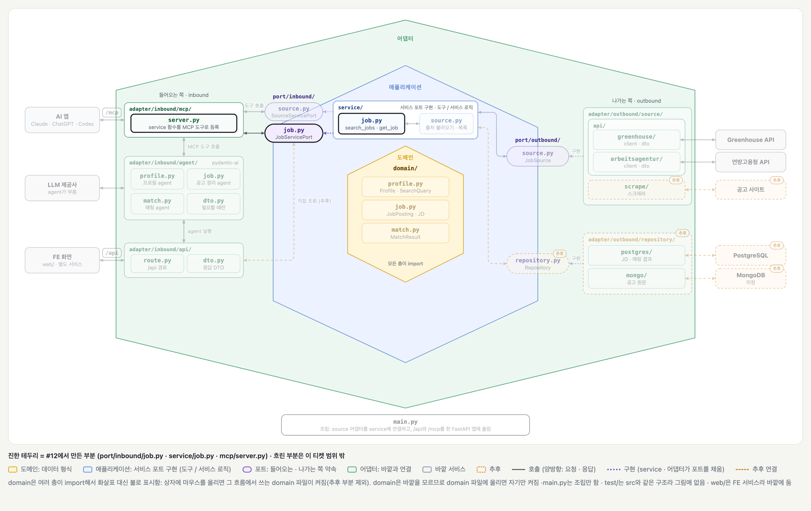
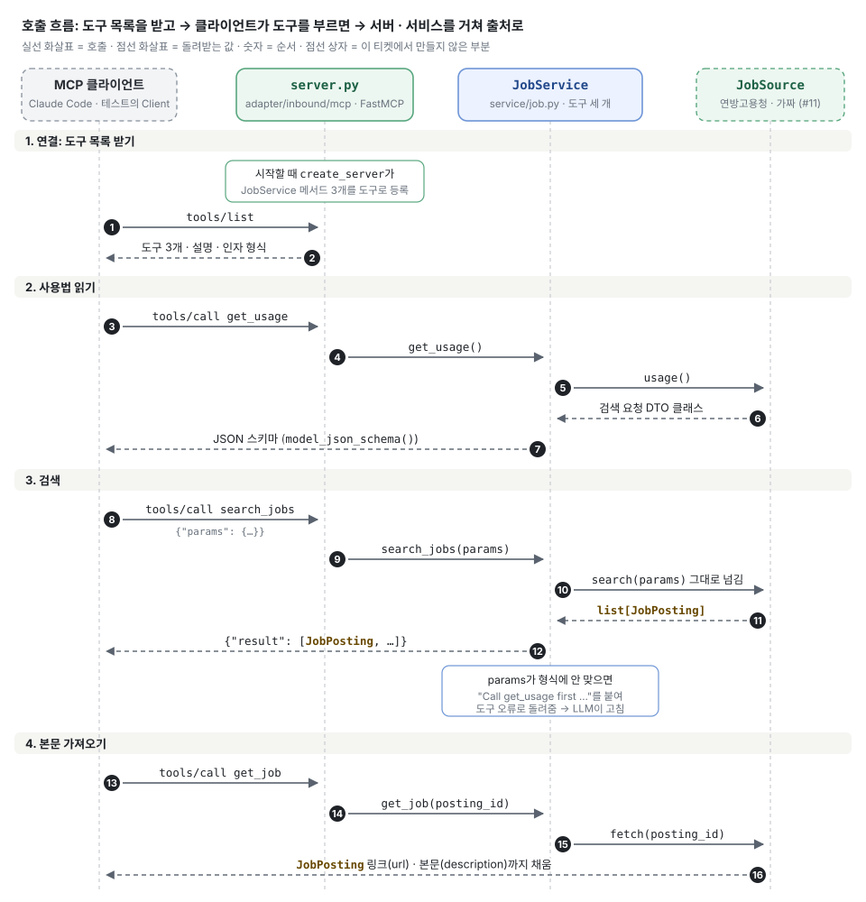

# MCP 서버와 공고 검색 도구 (#12)

## 배경과 목적

[#12](https://github.com/ai-agent-study-group/job-matching-agent/issues/12)는 Claude Code 같은 MCP 클라이언트가 우리 서버의 도구로 공고를 검색할 수 있게 하는 작업입니다.

[#11](./ticket-11.md)에서 만든 출처 어댑터(`JobSource`)를 서비스가 받아 도구 세 개로 내보내고, MCP 서버가 그 도구를 클라이언트에 알려 줍니다. 지금은 내 컴퓨터에서 stdio로만 돌아갑니다.

## 주요 내용

### 전체 그림



[BE 설계의 폴더 구조 그림](../structure/be.md)에서 이 티켓에서 만든 부분만 켠 상태입니다. 진한 테두리가 만든 부분이고, 흐린 부분은 이 티켓 범위 밖입니다. AI 앱과 잇는 `/mcp`(HTTP)는 아직 만들지 않았고, 지금은 stdio로 붙습니다.



1. **연결 (1~2):** 서버는 시작할 때 `JobService`의 메서드 세 개를 도구로 등록합니다. 클라이언트가 붙으면 도구 이름 · 설명 · 인자 형식을 받습니다.
2. **사용법 읽기 (3~7):** `get_usage`는 출처의 검색 요청 DTO를 JSON 스키마로 바꿔 돌려줍니다.
3. **검색 (8~12):** `search_jobs`는 `params`를 그대로 출처에 넘깁니다. 형식이 틀리면 `get_usage`를 먼저 부르라는 오류가 갑니다.
4. **본문 가져오기 (13~16):** `get_job`은 공고 하나를 본문까지 채워 돌려줍니다.

### 도구 세 개

| 도구 | 받는 것 | 돌려주는 것 |
| --- | --- | --- |
| `get_usage` | 없음 | `search_jobs`의 `params` 형식 (JSON 스키마) |
| `search_jobs` | `params`: `get_usage`가 알려 준 형식의 검색 조건 | 공고 목록 (본문 없음) |
| `get_job` | `posting_id`: `search_jobs` 결과의 `id` | 본문까지 채운 공고 하나 |

`search_jobs`가 `params` 하나만 받는 이유는 출처마다 검색 조건이 달라서입니다. 도구 인자를 한 출처 모양으로 고정할 수 없어서, 안쪽 모양은 `get_usage`로 알려 줍니다.

```python
client.call_tool("search_jobs", {"params": {"keywords": ["AI Engineer"], "locations": ["München"]}})
#                 도구 이름       도구 인자      출처의 검색 조건
```

### LLM이 읽는 것

FastMCP는 `JobService` 메서드를 도구로 만들 때 아래 두 가지를 읽습니다. 그래서 LLM에게 보일 글은 영어로 서비스에 씁니다.

| 쓰는 곳 | LLM에게 보이는 것 | 서비스에 없으면 |
| --- | --- | --- |
| 메서드 docstring | 도구 설명 (무엇을 하고 언제 부르는지) | 포트(`JobServicePort`)의 docstring을 대신 씀 |
| `Annotated[..., Field(description=...)]` | 인자 설명 | 안 보임 (포트에 써도 안 씀) |

### 직접 확인해 보기

```bash
# 도구 목록과 설명 (LLM 없이)
uv run fastmcp list --command "uv run python -m adapter.inbound.mcp.server"

# 도구 하나 부르기 (실제 연방고용청 API)
uv run fastmcp call --command "uv run python -m adapter.inbound.mcp.server" \
  --target search_jobs --input-json '{"params": {"keywords": ["AI Engineer"], "locations": ["München"], "size": 2}}' 2>/dev/null

# Claude Code에 등록 (이 프로젝트에서만)
claude mcp add jobs -- uv run --directory <저장소 경로> python -m adapter.inbound.mcp.server
```

Claude Code에 붙여 "뮌헨 AI Engineer 정규직"을 물으면 `get_usage` → `search_jobs`(`München`, `angebotsart: 1`, `befristung: [2]`) 순서로 부르고 공고가 나옵니다.

### `search_jobs` 설명에 `get_usage` 안내를 넣을지

`search_jobs` docstring만 바꿔 Claude Code(Opus 5.5)에 같은 대화로 검색을 두 번 시켰습니다. 변형마다 두 번씩 돌린 결과입니다.

| `search_jobs` docstring | 첫 검색 | 두 번째 검색 |
| --- | --- | --- |
| 안내 없음 (지금 코드) | `get_usage` → `search_jobs` | `search_jobs`만 |
| "아직 못 봤으면 먼저" | `get_usage` → `search_jobs` | `search_jobs`만 |
| "항상 먼저" | `get_usage` → `search_jobs` | `get_usage`를 다시 부름 |

`get_usage` 설명의 "Call this before search_jobs."와 `params` 설명만으로 순서를 지켜서 넣지 않았습니다. "항상"이라고 쓰면 이미 아는데도 다시 부릅니다. 작은 모델로 우리 agent를 붙일 때 다시 확인합니다.

### 테스트

`test/adapter/inbound/mcp/test_server.py`는 서버를 띄우지 않고 메모리 안 클라이언트(`fastmcp.Client`)로 붙습니다. 출처는 정해 둔 공고만 돌려주는 가짜(`FakeSource`)라서 네트워크를 쓰지 않습니다.

| 테스트 | 지키는 것 | 깨지면 |
| --- | --- | --- |
| `test_three_tools_registered_read_only` | 도구 세 개가 읽기 전용으로 등록됨 | 빠진 도구는 LLM이 모름. 읽기 전용 표시가 없으면 클라이언트가 데이터를 바꾸는 도구로 볼 수 있음 |
| `test_search_jobs_returns_postings` | `search_jobs` 결과가 출처의 공고 그대로 옴 | 서버 · 서비스를 거치며 공고가 바뀌거나 빠짐 |

LLM이 `get_usage`를 먼저 부르는지는 LLM이 정하는 일이라 단위 테스트로 확인할 수 없습니다. 위의 비교처럼 LLM을 붙여 여러 번 돌려 보는 평가로 따로 봅니다.

## 결정 사항과 미정 사항

- 확정:
    - 도구는 `get_usage` · `search_jobs(params)` · `get_job(posting_id)` 세 개, 모두 읽기 전용
    - LLM이 읽는 설명(docstring · `Annotated`)은 서비스에 둠
    - `create_server`는 `JobService`가 아니라 `JobServicePort`를 받음. 그래서 테스트에서 가짜 출처를 넣을 수 있음
    - 서비스는 출처를 `self.source`로 들고 있어서, `get_job`은 출처 안의 `id`만 받음
    - 조립은 따로 `main.py`를 두지 않고 `server.py`의 `__main__`에서 함 (로컬 stdio)
- 제안 또는 미정:
    - 출처가 여러 개가 되면 `search_jobs` · `get_job`이 어떻게 나눠 부를지 (#9 `list_sources`, #15 freehire와 같이)
    - 원격 공개(HTTP · FastAPI `/mcp`)와 인증 (DevOps)

## 다음 할 일

- [ ] #12 PR(#19): #16 병합 후 `main`으로 rebase하고 리뷰 · 병합
- [ ] #9 `list_sources`와 출처 여러 개 나눠 부르기
