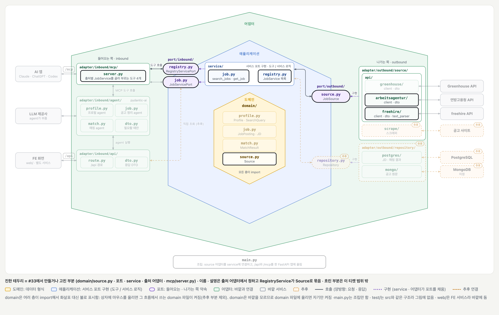

# 출처 설명 (#33)

## 배경과 목적

[#33](https://github.com/ai-agent-study-group/job-matching-agent/issues/33)은 LLM이 요청에 맞는 출처를 고를 수 있게 하는 작업입니다.

[#9](./ticket-9.md)의 `list_sources`는 `["arbeitsagentur", "freehire"]`처럼 이름만 돌려줬습니다. 이름만으로는 freehire가 어떤 공고를 다루는지 알 수 없습니다. 이제 출처마다 이름과 설명을 돌려줍니다.

## 주요 내용

### 전체 그림



[#9의 그림](./ticket-9.md)에 `domain/source.py`를 더하고, 이 티켓에서 만들거나 고친 부분만 켠 상태입니다. 진한 테두리가 만들거나 고친 부분이고, 흐린 부분은 이 티켓 범위 밖입니다. 이름 · 설명은 오른쪽 출처 어댑터에서 정해져 `JobSource` → `JobService` → `RegistryService`를 거쳐 왼쪽 `server.py`로 갑니다.

### LLM이 받는 값

```json
[
  {"name": "arbeitsagentur", "description": "Germany's Federal Employment Agency (Bundesagentur für Arbeit): job postings across Germany in all industries, mostly written in German."},
  {"name": "freehire", "description": "freehire.me: job postings collected from company career pages, worldwide."}
]
```

`list_sources`의 도구 설명도 "요청에 맞는 출처를 골라 그 이름을 넘기라"로 바꿨습니다.

### 이름 · 설명이 전달되는 과정

```text
출처 어댑터          name() · description()        이름 · 설명
  ▼
JobService          get_name() · get_description()  그대로 넘김
  ▼
RegistryService     list_sources() -> list[Source]  출처마다 이름 · 설명을 Source로 묶음
  ▼
server.py           list_sources 도구               그대로 돌려줌
```

- 이름 · 설명은 출처 어댑터의 `name()` · `description()`에만 있습니다.
- 조립 코드는 `RegistryService([JobService(arbeitsagentur), JobService(freehire)])`처럼 이름을 따로 쓰지 않습니다.
- `RegistryService`는 `JobService`만 보고 어댑터를 직접 부르지 않습니다. 그래서 `JobService`가 어댑터의 값을 그대로 넘기는 `get_name()` · `get_description()`을 둡니다.
- `Source`는 `domain/`에 둡니다. 우리가 정한 모양이라 [BE 설계](../structure/be.md)의 규칙대로 도메인입니다. `/api`도 같이 씁니다.

### 파일 구성

| 파일 | 바뀐 것 |
| --- | --- |
| `domain/source.py` | `Source(name, description)` (새 파일) |
| `port/outbound/source.py` | `JobSource`에 `name()` · `description()` 추상 메서드 |
| `adapter/outbound/source/api/*/client.py` | 두 어댑터의 이름과 설명. 공고로 바꿀 때 `name()`을 넘김 |
| `adapter/outbound/source/api/*/dto.py` | `to_summary` · `to_posting`이 출처 이름을 인자로 받음 (전에는 `"arbeitsagentur"`를 직접 적음) |
| `port/inbound/job.py` · `service/job.py` | `get_name()` · `get_description()` |
| `port/inbound/registry.py` · `service/registry.py` | `JobService` 목록을 받아 이름으로 들고, `list_sources() -> list[Source]` |
| `adapter/inbound/mcp/server.py` | `list_sources`의 리턴 타입과 설명, 인자용 이름표 `Source` → `SourceName`, 조립 |

### 직접 확인해 보기

```bash
uv run fastmcp call --command "uv run python -m adapter.inbound.mcp.server" --target list_sources 2>/dev/null
```

실제 stdio 서버에서 `list_sources`가 위의 값을 돌려주고, 어댑터가 정한 이름으로 `search_jobs` → `get_job`이 그대로 되는 것을 확인했습니다.

### 테스트

| 테스트 | 지키는 것 | 깨지면 |
| --- | --- | --- |
| `test_list_sources_returns_names_and_descriptions` | 어댑터에 적힌 이름과 설명을 출처마다 돌려줌 | LLM이 출처를 고를 근거가 없음 |
| `test_sources_with_the_same_name_fail_at_assembly` | 이름이 같은 출처를 둘 넣으면 조립할 때 오류 | 한 출처가 목록에서 조용히 사라짐 |

나머지 테스트는 가짜 출처 두 개에 `name()` · `description()`을 넣고 `RegistryService`에 목록으로 넘기도록만 바꿨습니다. DTO 테스트는 `to_summary` · `to_posting`에 출처 이름을 넘기도록 바꿨고, 클라이언트 테스트는 그대로 공고의 `source`가 `name()`과 같은지 확인합니다.

