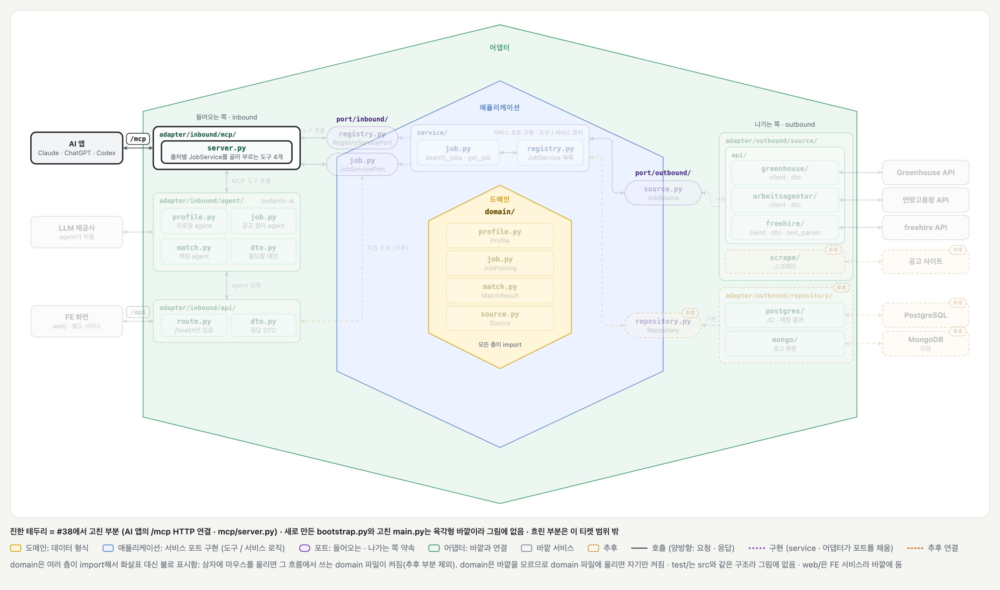

# /mcp HTTP 연결 (#38)

## 배경과 목적

[#38](https://github.com/ai-agent-study-group/job-matching-agent/issues/38)은 AI 앱이 HTTP 주소로 MCP 도구를 쓰게 하는 작업입니다.

지금까지 MCP 서버는 `server.py`의 `__main__`에서 stdio로만 돌았습니다. claude.ai · ChatGPT 커넥터는 HTTP 주소로만 MCP 서버에 연결할 수 있어서, 배포 전에 HTTP 주소부터 열었습니다. [LLM 설계](../structure/llm.md)대로 FastAPI 앱 하나가 `/api`와 `/mcp` 두 주소를 함께 받습니다.

## 주요 내용

### 전체 그림



[#33의 그림](./ticket-33.md)에서 이 티켓에서 고친 부분만 켠 상태입니다. 진한 테두리가 고친 부분이고, 흐린 부분은 이 티켓 범위 밖입니다. AI 앱은 왼쪽 `/mcp` 주소로 요청을 보내고, 그 뒤의 도구와 출처는 #33 그대로입니다. 새로 만든 `bootstrap.py`와 고친 `main.py`는 육각형 바깥에서 조립과 시작만 맡아서 그림에 넣지 않았습니다.

### 앱이 켜지고 꺼질 때

```text
main.py를 불러올 때
  bootstrap()                          출처 클라이언트를 만들어 registry에 넣음 (연결은 아직 안 엶)
  create_server(registry).http_app()   도구 네 개를 /mcp 주소로 내보냄
앱이 켜질 때 (lifespan)
  container.open()                     출처마다 HTTP 연결을 엶
  mcp_app.lifespan(app)                MCP 세션 관리자를 켬
앱이 떠 있는 동안
  /mcp 요청                             열어 둔 연결을 다시 씀
앱이 꺼질 때
  연 순서의 반대로 닫음                   MCP 세션 관리자, freehire, 연방고용청 순서
```

- 출처 클라이언트는 HTTP 연결을 하나 열어 두고 계속 다시 씁니다([#25](./ticket-25.md)). 이 연결은 한 번 닫으면 다시 열 수 없어서, 앱이 떠 있는 동안 한 번만 열고 꺼질 때 닫습니다.
- FastMCP의 HTTP 앱은 세션 관리자를 자기 lifespan에서 켭니다. `app.mount`로 다른 앱 안에 넣으면 그 lifespan이 저절로 돌지 않아서, `main.py`의 lifespan에서 같이 돌립니다.
- `Container.open()`은 출처를 목록 순서대로 엽니다. 하나가 열리지 않으면 이미 연 출처를 닫고 오류를 그대로 냅니다.

### bootstrap.py를 따로 둔 이유

- 실제 출처 클래스(`ArbeitsagenturClient` · `FreehireClient`)를 import하는 곳은 `bootstrap.py` 하나뿐입니다. 새 출처는 `bootstrap()`의 목록에 한 줄만 더하면 됩니다.
- `main.py`는 시작점이라 어떤 출처를 쓰는지 몰라도 됩니다. `server.py`도 전처럼 `RegistryServicePort`만 봅니다.
- `bootstrap()`에 가짜 출처를 넘기면 실제 API 없이 조립과 열고 닫기를 시험할 수 있습니다.
- [Cosmic Python 13장](https://www.cosmicpython.com/book/chapter_13_dependency_injection.html)의 bootstrap과 같은 역할입니다. 기본값으로 실제 어댑터를 쓰고, 테스트는 가짜를 넘기고, 객체 하나(`Container`)를 돌려줍니다.

`Container`에는 두 가지가 들어 있습니다. `registry`는 앱을 만들 때 MCP 서버에 넘기고, `open()`은 앱이 켜질 때 lifespan에서 씁니다.

### 이슈와 달라진 점

| 이슈 계획 | 실제 |
| --- | --- |
| 조립은 `main.py`에서 함 | `bootstrap.py`로 분리. `main.py`는 시작점 역할만 함 |
| 배포용 조립에는 freehire를 넣지 않음 | 연방고용청과 freehire를 모두 넣음 |
| `server.py`의 stdio `__main__`은 로컬용으로 둠 | 지움. 조립을 `bootstrap.py` 한 곳에만 두려고. 내 컴퓨터에서 쓸 때도 아래처럼 앱을 띄우고 HTTP 주소로 연결함 |

그래서 [#9](./ticket-9.md) · [#12](./ticket-12.md) · [#33](./ticket-33.md) 작업 메모의 `python -m adapter.inbound.mcp.server` 명령은 이제 동작하지 않습니다.

### 파일 구성

| 파일 | 바뀐 것 |
| --- | --- |
| `bootstrap.py` | `bootstrap()`과 `Container` (새 파일) |
| `main.py` | `bootstrap()`으로 조립하고, MCP 서버를 `/mcp` 주소로 앱에 넣고, lifespan에서 출처 연결과 MCP 세션 관리자를 엶 |
| `adapter/inbound/mcp/server.py` | stdio `__main__` 삭제 |
| `service/registry.py` | 클래스 설명만 고침 |

### 직접 확인해 보기

```bash
uv run --env-file .env uvicorn main:app   # .env에 LLM_MODEL이 있어야 앱이 켜짐 (README 로컬 실행 참고)
uv run fastmcp list http://localhost:8000/mcp
uv run fastmcp call http://localhost:8000/mcp --target list_sources 2>/dev/null
```

Claude Code에서 쓰려면 이 주소를 MCP 서버로 등록합니다.

```bash
claude mcp add --transport http jobs-http http://localhost:8000/mcp
```

8000번 포트를 다른 프로그램이 쓰고 있으면 `--port`로 바꿉니다. 실제로 띄워서 `/health`가 200을 돌려주는 것, 도구 네 개가 보이는 것, `list_sources`가 두 출처의 이름과 설명을 돌려주는 것, 연방고용청 검색(`Data Analyst`, Berlin) 결과가 34건인 것을 확인했습니다.

### 테스트

| 테스트 | 지키는 것 | 깨지면 |
| --- | --- | --- |
| `test_mcp_over_http_lists_four_tools` | 앱의 `/mcp`로 도구 네 개가 보임 | AI 앱이 HTTP로 도구를 쓰지 못함 |
| `test_mcp_over_http_list_sources` | `/mcp`의 `list_sources`가 연방고용청과 freehire를 돌려줌 | 앱이 실제 출처를 조립하지 않음 |
| `test_registry_has_the_given_sources` | `bootstrap()`에 넘긴 출처가 이름 그대로 registry에 들어감 | 도구가 이름으로 출처를 찾지 못함 |
| `test_open_opens_in_order_and_closes_in_reverse` | 출처를 순서대로 열고 반대 순서로 닫음 | 앱이 꺼질 때 연결이 남음 |
| `test_open_failure_closes_already_opened_sources` | 하나가 열리지 않으면 이미 연 출처를 닫고 오류를 냄 | 앱 시작이 실패해도 앞서 연 연결이 남음 |

`test_main.py`는 서버를 띄우지 않고 `httpx2.ASGITransport`로 앱에 바로 요청을 보냅니다. 출처 API를 부르는 도구는 부르지 않아서 네트워크를 쓰지 않습니다. `test_bootstrap.py`는 열고 닫을 때 기록만 남기는 가짜 출처(`RecordingSource`)를 넘깁니다.
