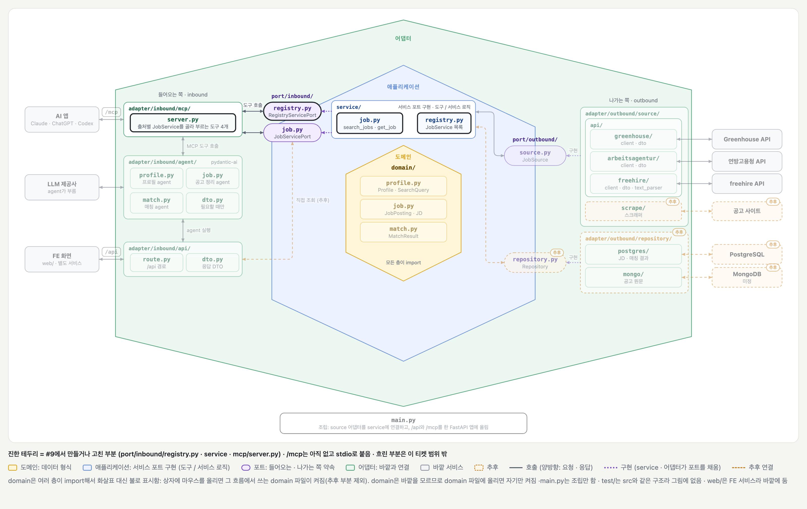
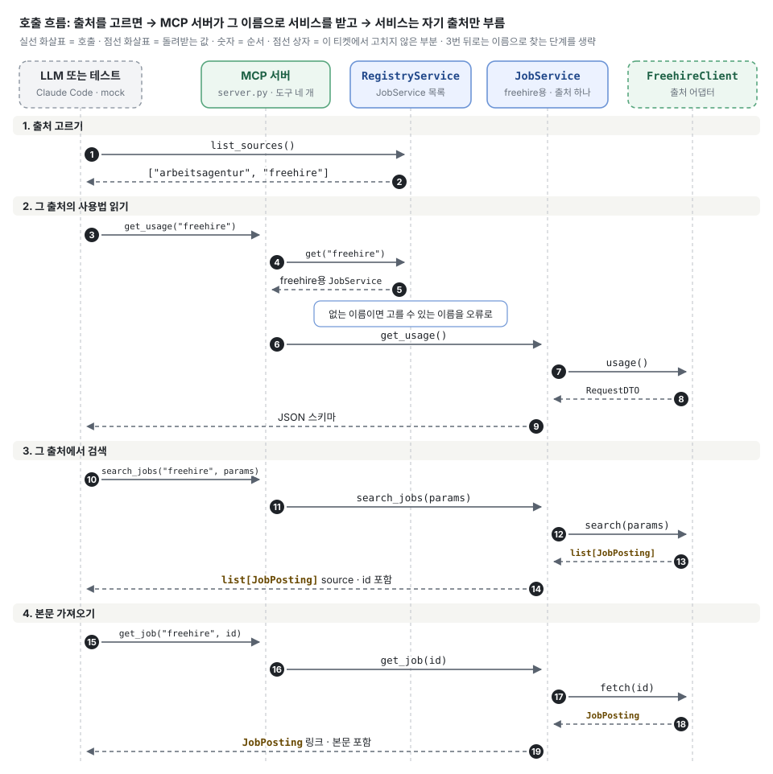

# 출처 목록과 출처 고르기 (#9)

## 배경과 목적

[#9](https://github.com/ai-agent-study-group/job-matching-agent/issues/9)는 LLM이 어느 출처에서 공고를 찾을 수 있는지 알게 하는 작업입니다.

[#15](./ticket-15.md)까지 `JobService`는 출처를 하나만 받았습니다. 그래서 연방고용청과 freehire를 같이 쓰려고 출처마다 도구 세 개를 만들어 합쳤고, 도구가 6개가 됐습니다. 이 방식이면 출처가 늘 때마다 도구도 3개씩 늘어납니다.

이제 출처마다 `JobService`를 하나씩 만들고, `RegistryService`가 그 목록을 이름으로 들고 있습니다. LLM은 `source` 인자로 출처를 고르고, 출처가 몇 개든 도구는 4개입니다.

## 주요 내용

### 전체 그림



[BE 설계의 폴더 구조 그림](../structure/be.md)에 #15의 `freehire/`를 더하고, 이 티켓에서 만들거나 고친 부분만 켠 상태입니다. 진한 테두리가 만들거나 고친 부분이고, 흐린 부분은 이 티켓 범위 밖입니다. `/mcp`는 아직 만들지 않았고, 지금은 stdio로 붙습니다.



어댑터와 `JobSource` 포트는 고치지 않았습니다.

### 구조

| 부분 | 하는 일 |
| --- | --- |
| `JobService` | 출처 하나의 공고 일만 함. 다른 출처와 출처 이름을 모름 |
| `RegistryService` | 출처별 `JobService`를 이름으로 들고 있음. `list_sources` · `get`만 함 |
| `server.py` | 도구 네 개. LLM이 보낸 이름으로 `RegistryService`에서 `JobService`를 받아 부름 |

LLM은 서버 밖에 있어서 인스턴스를 주고받을 수 없고, 출처 이름을 글자로만 보냅니다. 글자를 서비스로 바꾸는 일은 `RegistryService.get` 한 곳에서만 하고, `server.py`가 이를 부릅니다. 그래서 `JobService`와 `JobServicePort`에는 `source` 인자가 없습니다.

```text
server.py (LLM이 보는 도구)  search_jobs("freehire", params)
                                │  registry.get("freehire")로 JobService를 받음
                                ▼
JobService                    search_jobs(params)
```

도구 네 개는 `server.py`에 있습니다. 각 도구는 `RegistryService`에서 `JobService`를 받아 같은 이름의 함수를 부르기만 합니다. `source` 인자는 도구에만 있으므로, LLM이 읽는 설명(docstring과 `Field(description=...)`)도 이 도구 함수에 둡니다.

### 다른 방식을 쓰지 않은 이유

| 방식 | 쓰지 않은 이유 |
| --- | --- |
| 출처마다 도구를 따로 둠 (`mount`, `freehire_search_jobs`) | 출처가 하나 늘 때마다 도구가 3개씩 늘어남 |
| `JobService`가 출처 표를 직접 듦 | 출처 하나의 일을 하는 서비스가 출처 고르기까지 맡게 됨 |
| `RegistryService`에 `search_jobs` 같은 도구 함수까지 둠 | 같은 함수가 `RegistryService`와 `JobService`에 똑같이 생김 |
| `RegistryService` 없이 `server.py`가 목록을 직접 듦 | FE의 "연결된 사이트 목록"도 `list_sources`를 써서, `/api`에 같은 코드를 다시 만들어야 함 |

### 도구 네 개

| 도구 | 받는 것 | 돌려주는 것 |
| --- | --- | --- |
| `list_sources` | 없음 | 출처 이름 목록 |
| `get_usage` | `source` | 그 출처의 `params` 형식 (JSON 스키마) |
| `search_jobs` | `source`, `params` | 그 출처의 공고 목록 (링크 · 본문 없음) |
| `get_job` | `source`, `posting_id` | 링크 · 본문까지 채운 공고 하나 |

출처 이름은 `JobPosting.source`와 같습니다. LLM은 검색 결과의 `source`와 `id`를 그대로 `get_job`에 넘기면 됩니다.

### `source` 인자로 고르는 이유

- **검색 조건이 출처마다 다름:** 연방고용청은 `keywords` · `locations`, freehire는 `q` · `cities`를 받습니다. 어느 출처인지 알아야 어느 DTO로 검사할지 정해집니다.
- **공고 ID는 출처가 발급한 값:** 연방고용청은 `referenznummer`, freehire는 `public_slug`입니다. 해석은 그 어댑터만 할 수 있어서, `get_job`도 어느 어댑터로 보낼지 알아야 합니다. 어댑터를 먼저 고르니 두 출처의 ID가 같아도 섞이지 않습니다.

### 파일 구성

| 파일 | 하는 일 |
| --- | --- |
| `port/inbound/registry.py` | `RegistryServicePort`: `list_sources` · `get` 약속 (새 파일) |
| `service/registry.py` | `RegistryService`: 출처별 `JobService`를 이름으로 보관하고 찾음 (새 파일) |
| `service/job.py` | 동작은 그대로. LLM이 읽는 도구 설명은 `server.py`로 옮김 |
| `adapter/inbound/mcp/server.py` | `RegistryServicePort`만 보고 `source`를 받는 도구 네 개 정의, 출처별 서버를 합치던 코드 제거 |

### 잘못 불렀을 때

| 잘못된 호출 | LLM이 받는 오류 |
| --- | --- |
| 없는 출처 | `Unknown source 'greenhouse'. Use one of: arbeitsagentur, freehire.` |
| 다른 출처 형식의 `params` | 틀린 키 + `Call get_usage first to see the params search_jobs accepts.` |
| 다른 출처의 공고 ID | `No posting with id '...'. Use an id from the search results.` |

### 직접 확인해 보기

```bash
# 도구 목록
uv run fastmcp list --command "uv run python -m adapter.inbound.mcp.server"

# 출처 목록
uv run fastmcp call --command "uv run python -m adapter.inbound.mcp.server" --target list_sources 2>/dev/null

# 검색
uv run fastmcp call --command "uv run python -m adapter.inbound.mcp.server" \
  --target search_jobs --input-json '{"source": "freehire", "params": {"q": "Kubernetes Platform Engineer", "cities": ["Munich"], "posted_within_days": 7}}' 2>/dev/null
```

실제 stdio 서버로 두 출처 모두 `get_usage` → `search_jobs` → `get_job`까지 확인했습니다.

### 테스트

`test/adapter/inbound/mcp/test_server.py`는 가짜 출처 두 개(`FakeSource` · `OtherSource`)로 돕니다.

| 테스트 | 지키는 것 | 깨지면 |
| --- | --- | --- |
| `test_four_tools_registered_read_only` | 도구 네 개가 읽기 전용으로 등록됨 | LLM이 도구를 못 찾음 |
| `test_list_sources_returns_the_names` | 등록된 출처 이름을 돌려줌 | LLM이 고를 이름을 모름 |
| `test_get_usage_returns_the_format_of_the_chosen_source` | 고른 출처의 검색 조건을 돌려줌 | 다른 출처 형식으로 `params`를 채움 |
| `test_get_job_with_the_same_id_goes_to_the_chosen_source` | ID가 같아도 고른 출처의 공고를 돌려줌 | 다른 출처의 공고가 옴 |
| `test_unknown_source_tells_the_names` | 없는 출처면 고를 수 있는 이름을 오류로 (도구 세 개) | LLM이 무엇이 틀렸는지 모름 |

`test_search_jobs_returns_postings`와 `test_search_jobs_bad_params_tells_wrong_key_and_get_usage`는 `source`를 넘기도록 바꿨고, 확인하는 내용은 그대로입니다.

## 결정 사항과 미정 사항

- 확정:
    - 도구는 네 개로 고정하고, 출처는 `source` 인자로 고름
    - 출처 이름은 `JobPosting.source`와 같음
    - `JobService`는 출처 하나만 맡음
    - `RegistryService`는 출처별 `JobService`를 이름으로 들고 `list_sources` · `get`만 함. `/api`도 같이 씀
    - 출처별 `JobService`는 조립 코드가 만들어 `RegistryService`에 넘김
    - 출처 이름을 서비스로 바꾸는 일은 `RegistryService.get`에서만 함
    - LLM이 읽는 도구 설명은 `server.py`의 도구 함수에 둠
    - 이름은 흐름에 맞춤: 출처를 고르는 쪽은 `registry`, `source`는 바깥 출처와 이어지는 쪽(`JobSource` · 출처 어댑터)에만 씀
    - 출처별로 서버를 만들어 합치던 `mount`와 `freehire_` 같은 도구 이름 앞부분은 없앰
- 제안 또는 미정:
    - 여러 출처를 한 번에 검색할지: 지금은 출처마다 검색 조건이 달라 한 번에 한 출처만 부름
    - `/api`(#14)가 출처를 어떻게 고를지
    - `/mcp`를 올릴 때 배포용 조립(`src/main.py`)에 넣을 출처: freehire는 약관 때문에 빼는 쪽으로 논의 중

## 다음 할 일

- [ ] Claude Code의 `jobs` 서버를 다시 연결해 "뮌헨 AI 엔지니어"로 `list_sources` → `get_usage` → `search_jobs` → `get_job` 확인
