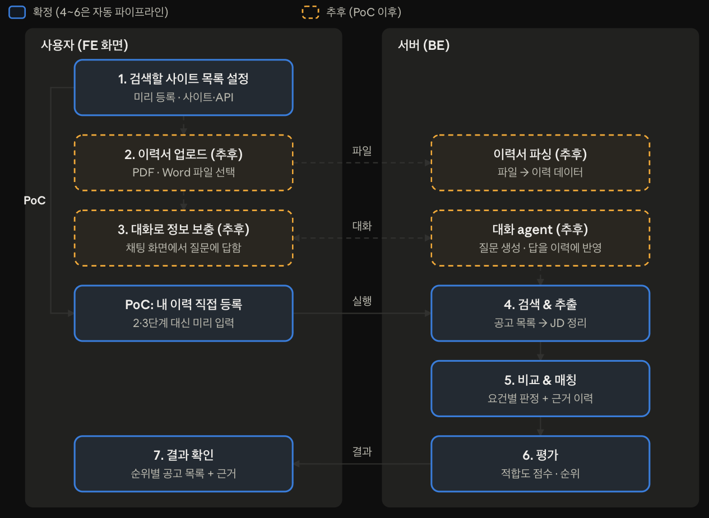
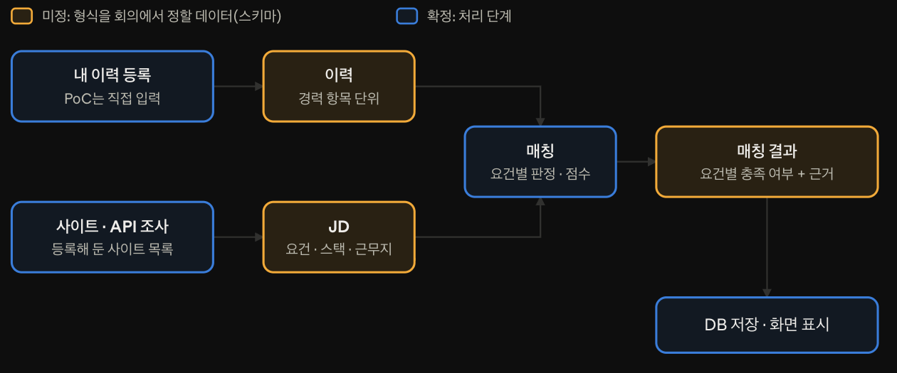
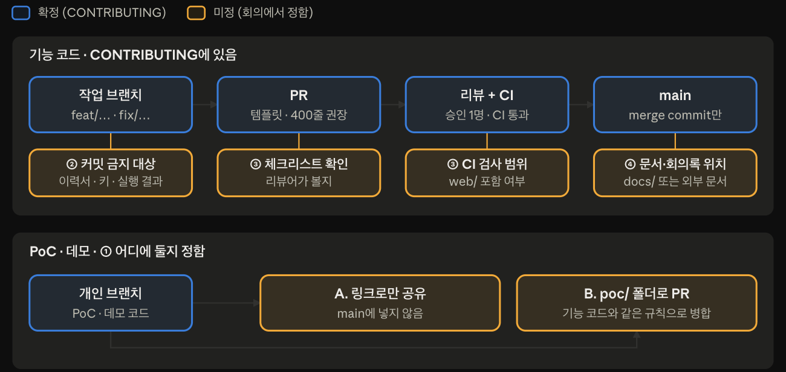
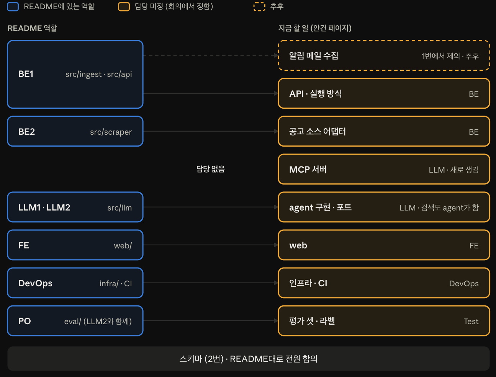

# 2026-10-20 회의 안건

상태: 회의 전

| 항목 | 내용 |
| --- | --- |
| 날짜 | 2026-10-20 (화) |
| 시간 | 18:00 |
| 회의 방식 | Discord |
| 원문 작성일 | 2026-10-15 |
| 원문 | [10/20 회의 안건](https://claude.ai/artifact/BGLX3JrXCWCJfNXfXaTtBJ#4ea426de-8777) |

## 전체 구조

회의에서 이 페이지의 공통 안건(1~4)을 먼저 정하고, 이어서 BE · LLM · FE · DevOps · QA 페이지 순서로 정합니다.

원문의 모든 그림은 같은 규칙을 따릅니다. 파랑은 확정, 주황은 회의에서 정할 것(라벨은 안건이 있는 페이지), 주황 점선은 추후(PoC 이후)입니다. 회의에서 정해지면 주황을 파랑으로 바꿉니다.

> 전체 구조 그림은 [원문](https://claude.ai/artifact/BGLX3JrXCWCJfNXfXaTtBJ#4ea426de-8777)에서 확인합니다. 아래의 현재 상황과 비교 내용은 원문 작성일인 2026-10-15 기준입니다.

## 1. 첫 구현 범위

- **흐름:** 검색할 사이트 목록을 먼저 정해 두면, 이력서 업로드 → 대화 보충 → 검색·추출 → 매칭 → 평가가 중간에 멈추지 않고 한 번에 이어집니다. 결과는 다시 화면으로 돌아갑니다.
- **PoC 범위:** 1단계(사이트 목록 설정) 후, 미리 등록해 둔 내 이력으로 4~7단계를 돌립니다.
- **추후:** 2단계 이력서 업로드·파싱, 3단계 대화 보충. 파싱은 Markdown 변환(markitdown 등) + LLM 구조화가 후보입니다.
- **용어:** 사용자 단계까지 포함한 전체는 워크플로, 그 안에서 사람 개입 없이 이어지는 4~6단계는 파이프라인입니다.
- **제외:** 구인 사이트 알림 메일(Gmail) 수집.
- **남은 질문:** 내 이력을 어떤 형식으로 등록할지(JSON 파일, 입력 폼), 사이트 목록을 누가 어떻게 등록할지.

## 2. 스키마

모듈 사이를 오가는 데이터는 JD, 이력, 매칭 결과 세 가지입니다. 만드는 쪽과 쓰는 쪽을 다른 사람이 맡을 가능성이 높아서, 형식을 먼저 맞춰야 나중에 붙일 수 있습니다.

| 스키마 | 만드는 곳 | 쓰는 곳 | 들어갈 내용 (초안) |
| --- | --- | --- | --- |
| JD | 사이트·API 조사 | 매칭, 화면 | 회사, 직무명, 원문 링크, 근무지, 필수 요건, 우대 요건, 기술 스택, 언어, 최소 연차 |
| 이력 | 이력서 업로드(파싱) | 매칭, 화면(수정) | 경력 항목(회사, 기간, 역할, 한 일), 기술 스택, 언어 |
| 매칭 결과 | 매칭 | DB 저장, 화면 | 요건별 판정(충족·부분 충족·미충족)과 근거 이력 항목, 점수, 언어·근무지·연차 필터 결과 |

항목은 초안이고 회의에서 확정합니다. 같이 정할 것: 협업 성향 같은 소프트 요건을 따로 나눌지, 점수를 퍼센트로 보여줄지.

**공고 구조화 단계 (추후):** PoC는 매칭 agent가 공고 원문을 바로 읽습니다. 나중에 공고를 JD 스키마로 구조화하는 단계를 따로 두고, 매칭은 구조화된 JD를 읽게 할지 정합니다. 구조화하면 저장·필터링에 쓸 수 있지만 공고마다 LLM 호출이 한 번 더 늘어납니다.

## 3. 협업 규칙

CONTRIBUTING의 규칙(브랜치 이름, PR 병합 조건, semi-linear 히스토리, 설명할 수 있는 코드)은 이미 main에 있습니다. 새로 정할 것은 아래 4가지입니다.

| 정할 것 | 지금 (원문 작성일 기준) | 선택지 | 결정 |
| --- | --- | --- | --- |
| ① PoC·데모 코드 위치 | PoC는 feat/poc-mcp-agent 브랜치에만 있고 PR 없음 | A. 개인 브랜치에 두고 링크로 공유 / B. poc/ 폴더로 PR해서 main에 넣음 | 미정 |
| ② 커밋하면 안 되는 것 | .env와 poc/private/를 gitignore로 막음. 저장소가 공개라 올리면 누구나 봄 | 이력서·키·실행 결과를 둘 공통 경로 / 실수로 올렸을 때 처리(키 폐기, 히스토리 정리) | 미정 |
| ③ PR 규칙 적용 방식 | 400줄 권장과 체크리스트는 작성자가 스스로 체크함. CI는 Python lint·test만 돌려서 web/은 검사 안 함 | 리뷰어가 체크리스트를 확인할지 / 병합되는 코드는 모두 CI가 검사할지 | 미정 |
| ④ 문서·회의록 위치 | main에 문서 폴더 없음. PR #2(닫힘)에 docs/meetings/ 회의록 초안이 있었음. 이 안건 문서는 외부 문서임 | 저장소 docs/ / 외부 문서 | 미정 |

## 4. 역할 분담

README의 역할(BE1·BE2·LLM1·LLM2·FE·DevOps·PO)은 Gmail 알림을 수집하는 흐름을 기준으로 나눈 것입니다. 다른 안건에서 할 일이 바뀌어서, 사람을 배정하기 전에 역할 구분부터 다시 정합니다.

- **빠진 일:** BE1의 알림 메일 수집은 1번에서 제외됩니다. BE1에는 API만 남습니다.
- **새로 생긴 일:** MCP 서버(LLM-4)와 agent 구현(LLM-2·3)는 README에 없습니다. PoC에서는 공고 검색도 agent가 도구로 합니다.
- **바뀐 일:** ATS 어댑터는 MCP 도구 뒤의 공고 출처 어댑터(`src/adapter/outbound/source/`)가 됩니다(LLM-4, BE-3).
- **인원:** README 역할은 7개, 팀은 6명입니다.

| 정할 것 | 선택지 | 참고 | 결정 |
| --- | --- | --- | --- |
| 역할 구분 | A. README 역할 유지 / B. 지금 할 일(원문 그림 오른쪽) 기준으로 다시 나눔 / C. 구현 3개를 한 명씩 맡고 공통 부분을 나눔 | C는 LLM-3 가정(구현 3개 비교) 기준 | 미정 |
| 담당자 | 역할 구분이 정해진 뒤 배정 | 스키마(2번)는 README대로 전원 합의 | 미정 |

## 참고 자료

- [PoC 브랜치 feat/poc-mcp-agent](https://github.com/ai-agent-study-group/job-matching-agent/tree/feat/poc-mcp-agent): pydantic-ai agent + MCP 서버(Greenhouse · 연방고용청 공고 검색). 헥사고날 구조입니다.
- [PR #2 sample docs & web folder update](https://github.com/ai-agent-study-group/job-matching-agent/pull/2): Next.js web 데모, 회의록, STRUCTURE.md.
- [첫 회의록 (2026-10-13)](https://github.com/ai-agent-study-group/job-matching-agent/blob/feat/create_sample/docs/meetings/2026-10-13.md): Phase 1·2 범위와 미정 항목.
- [STRUCTURE.md](https://github.com/ai-agent-study-group/job-matching-agent/blob/feat/create_sample/docs/STRUCTURE.md): 지금 구조와 정해야 할 연결 지점.
- [CONTRIBUTING.md](https://github.com/ai-agent-study-group/job-matching-agent/blob/main/CONTRIBUTING.md): 브랜치·PR 규칙.
