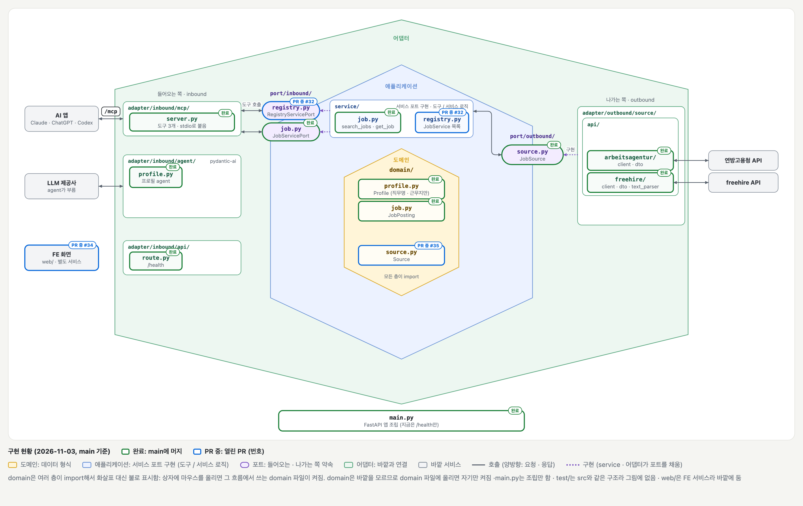

# 2026-11-03 회의 안건

상태: 회의 전

| 항목 | 내용 |
| --- | --- |
| 날짜 | 2026-11-03 (화) |
| 시간·시간대 | 18:00 (Europe/Berlin) |
| 회의 방식 | Discord |
| 이전 회의록 | [2026-10-27 회의](./2026-10-27.md) |

## 이전 할 일 확인

10/27 이후 바뀐 티켓입니다.

| 할 일 | 담당 역할 | 진행 결과 | 남은 문제 |
| --- | --- | --- | --- |
| #13 프로필 agent 최소판 | LLM | 완료 (PR #31) | |
| #15 freehire 어댑터 | BE | 완료 (PR #28) | |
| #36 freehire 근무지에 도시 목록 쓰기 | BE | 완료 (PR #37) | |
| #26 GitHub Actions CI | DevOps | 완료 (PR #27) | |
| #25 연방고용청 HTTP 연결 재사용 | BE | PR 중 (PR #29) | |
| #9 `list_sources` · `source` 인자 | BE | PR 중 (PR #32, #29 위 스택) | |
| #33 `list_sources` 출처 설명 | BE | PR 중 (PR #35, #32 위 스택) | |
| #7 Next.js 기본 세팅 | FE | PR 중 (PR #34) | |
| #38 `/mcp` HTTP로 붙이기 | BE | 새 티켓 | |
| #39 `/mcp` OAuth | BE | 새 티켓 | |

## 구현 현황

- 완료(초록): main에 머지된 것
- PR 중(파랑): 열린 PR. 번호는 PR

| 영역 | 완료 | PR 중 |
| --- | --- | --- |
| BE | MCP 도구 3개(stdio) · 연방고용청 · freehire 어댑터 · `/health` | 출처 고르기 `list_sources` (PR #32 · #35), HTTP 연결 재사용 (PR #29) |
| LLM | 프로필 agent (이력서 → 직무명 · 근무지) | |
| 인프라 | Dockerfile (PR #23), CI: BE · FE 검사, main 필수 검사 `all-checks` (PR #27) | |
| 프론트엔드 | | 목 데이터로 매칭 화면 · web CI (PR #34) |

## 안건

| 안건 | 정해야 할 질문 | 논의 메모 |
| --- | --- | --- |
| ? | ? | |

## 논의 메모

<!-- 의견·후보를 기록합니다. 결정 사항과 구분합니다. -->

## 결정 사항

<!-- 합의된 내용만 작성합니다. 미정 항목은 미결 사항에 남깁니다. -->

| 항목 | 합의 내용 | 이유·조건 |
| --- | --- | --- |
| ? | ? | ? |

## 다음 할 일

| 할 일 | 담당 역할 | 협업 역할 | 완료 기준 | 기한 | 상태 |
| --- | --- | --- | --- | --- | --- |
| ? | ? | ? | ? | ? | 미정 |

## 미결 사항

| 질문 | 추가로 확인할 것 | 확인 역할 | 다시 논의할 시점 |
| --- | --- | --- | --- |
| ? | ? | ? | ? |

## 다음 모임

- 날짜·시간·시간대: ?
- 준비할 내용: ?
- 다음 회의록: ?
