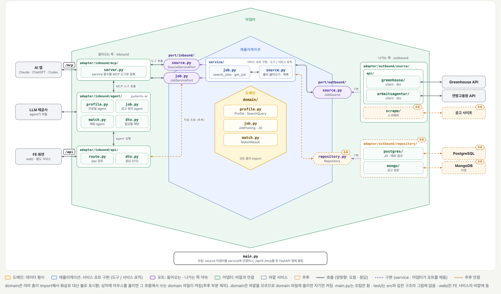
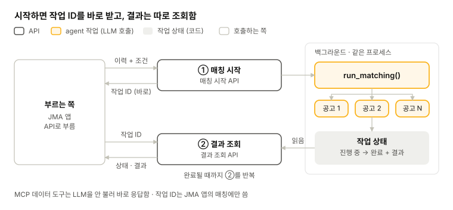
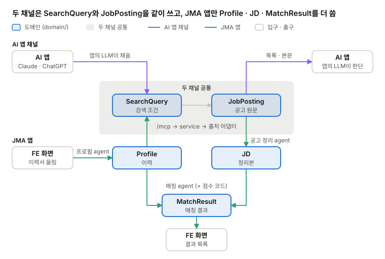
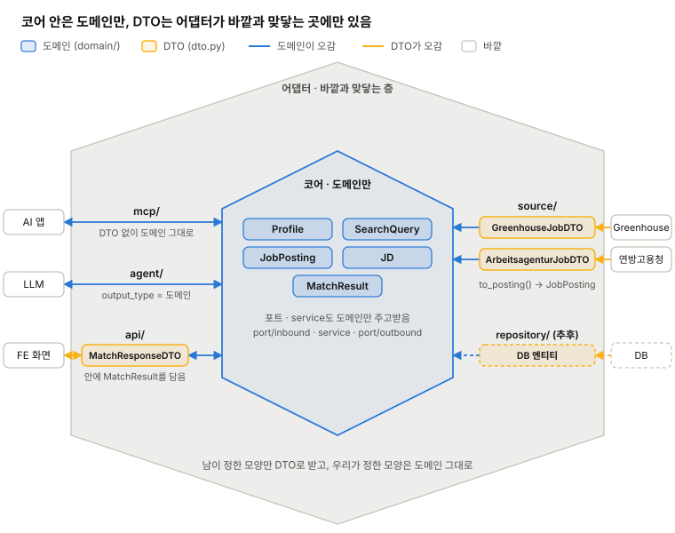

# BE 설계

[현재 구조와 기술](../STRUCTURE.md) · 영역별 설계: **BE** · [LLM](llm.md) · [FE](fe.md) · [DevOps](devops.md) · [QA](qa.md)

## 헥사고날 아키텍처

BE는 헥사고날 아키텍처(포트와 어댑터)로 짰고, 아래 1. 폴더 구조는 이 구조를 폴더로 옮긴 것

### 무엇인가

- **구조:** 가운데에 도메인(데이터 형식)과 service(서비스 포트 구현 · 도구 / 서비스 로직)를 두고, 바깥과는 포트로만 이어짐. 포트는 무엇을 할 수 있는지만 적은 약속(interface)이고, 바깥과 실제로 붙는 코드는 어댑터
- **들어오는 쪽 · 나가는 쪽:** 들어오는 어댑터(/mcp · /api · agent)는 들어오는 포트를 부르고, 나가는 어댑터(공고 출처 · 저장소)는 나가는 포트를 구현함
- **핵심:** 의존 방향이 늘 안쪽을 향함. 안쪽 코드는 MCP · FastAPI · Greenhouse · PostgreSQL 같은 바깥 기술을 import하지 않음. 그래서 바깥이 바뀌어도 어댑터만 갈아 끼우면 됨

### 왜 헥사고날인가

- **Entry point 두 개가 같은 로직을 씀:** AI 앱은 /mcp로, JMA 앱은 /api → agent로 들어오지만 결국 같은 도구를 부름. 들어오는 포트로 묶어 두면 입구가 늘어도 로직은 한 벌
- **바깥 연결이 계속 늘어남:** 공개 API(Greenhouse · 연방고용청), 스크래핑, PostgreSQL · MongoDB까지 붙일 곳이 다양함. 나가는 포트는 그대로 두고 어댑터만 추가하면 됨
- **테스트가 쉬움:** 포트에 가짜 어댑터를 끼우면 실제 사이트 · DB · LLM 없이 service와 도메인을 테스트할 수 있음
- **프로젝트 크기에 맞음:** 도메인(이력 · 공고 · 매칭)과 service 함수가 단순하고 경계가 분명해서, 층을 나눠도 구조가 무거워지지 않음

참고: [Cosmic Python 2장 · 포트와 어댑터란](https://www.cosmicpython.com/book/chapter_02_repository.html#what_is_a_port_and_what_is_an_adapter). Python으로 포트와 어댑터를 설명하는 책(Architecture Patterns with Python)

참고: [헥사고날 아키텍처를 통한 의미 수준과 구현 수준에 대한 이해](https://mangkyu.tistory.com/396). 도메인과 DB 엔티티를 합칠지 나눌지 설명하는 글(망나니개발자)

## 1. 폴더 구조

아키텍처(헥사고날 · MCP 도구 · agent · 두 채널) 기준으로 1차 목표에 필요한 기본 틀만 짠 구조. 폴더 이름은 모두 단수. 모노레포 하나에 BE(`src/`)와 FE(`web/`)를 두고, 폴더마다 담당 영역을 정함.

```text
job-matching-agent/
├─ src/
│  ├─ domain/                    # 안쪽 공용어 (BE-3)
│  │  ├─ profile.py              #   Profile · SearchQuery (이력 · 검색 조건)
│  │  ├─ job.py                  #   JobPosting (공고 원문) · JD (정리본)
│  │  └─ match.py                #   MatchResult (매칭 결과)
│  ├─ port/
│  │  ├─ inbound/                # 서비스 포트: 입구(mcp · api)가 부르는 약속
│  │  │  ├─ job.py               #   JobServicePort (search_jobs · get_job)
│  │  │  └─ source.py            #   SourceServicePort (list_sources)
│  │  └─ outbound/               # service가 부르는 바깥 약속
│  │     ├─ source.py            #   JobSource (domain 형식으로 주고받음)
│  │     └─ repository.py        #   Repository (추후)
│  ├─ service/                   # 서비스 포트 구현 · 도구 / 서비스 로직
│  │  ├─ job.py                  #   JobService: search_jobs · get_job (출처는 SourceService에서 받음)
│  │  └─ source.py               #   SourceService: 출처 불러오기 · list_sources
│  ├─ adapter/
│  │  ├─ inbound/                # 들어오는 쪽
│  │  │  ├─ api/                 #   FE용 /api: route.py · dto.py
│  │  │  ├─ mcp/                 #   /mcp: server.py (port/inbound 함수를 도구로 등록)
│  │  │  └─ agent/               #   우리 agent: profile.py · job.py(공고 정리) · match.py · dto.py(필요할 때만)
│  │  └─ outbound/               # 나가는 쪽
│  │     ├─ source/              #   JobSource 구현
│  │     │  ├─ api/              #     greenhouse/ · arbeitsagentur/ (client.py · dto.py)
│  │     │  └─ scrape/           #     스크래퍼 (추후)
│  │     └─ repository/          #   Repository 구현 (추후)
│  │        ├─ postgres/         #     JD · 매칭 결과 (PostgreSQL)
│  │        └─ mongo/            #     공고 원문 JobPosting (MongoDB, 미정)
│  └─ main.py                    # 조립: source 어댑터를 service에 연결, api + mcp를 한 앱에 올림
├─ web/                          # FE (FE 서버는 FE-1, 프레임워크는 FE-2)
└─ test/                         # src와 같은 구조
```



크게 보기: [폴더 구조 헥사고날](https://claude.ai/artifact/1YdhbTPjiNxDReppijiYey)

| 폴더 | 육각형 내부 | 담당 |
| --- | --- | --- |
| `domain/` | 도메인 | BE· LLM |
| `service/` · `port/` | 애플리케이션 | BE |
| `adapter/inbound/api/` · `mcp/` | 들어오는 어댑터 | BE |
| `adapter/inbound/agent/` | 들어오는 어댑터 (Claude 역할) | LLM |
| `adapter/outbound/source/` | 나가는 어댑터 | BE |
| `adapter/outbound/repository/` | 나가는 어댑터 (추후) | BE |
| `web/` | FE | FE |
| `test/` | 테스트 | 각 영역 |

### 이름 규칙

같은 주제를 다루는 파일이면 폴더가 달라도 파일 이름을 똑같이 붙임.

- **공고 출처** (source)

  | 파일 | 하는 일 |
  | --- | --- |
  | `port/inbound/source.py` | "출처 목록을 달라"는 약속 (`SourceServicePort`) |
  | `service/source.py` | 그 약속을 실제로 처리 (`list_sources`). 설정에서 출처를 불러와 들고 있음 |
  | `port/outbound/source.py` | "출처에서 공고를 가져온다"는 약속 (`JobSource`) |
  | `adapter/outbound/source/` | 출처별 실제 구현 (greenhouse, arbeitsagentur) |

- **공고** (job)

  | 파일 | 하는 일 |
  | --- | --- |
  | `domain/job.py` | 공고 데이터 형식 (`JobPosting` · `JD`) |
  | `port/inbound/job.py` | "공고를 찾아 달라"는 약속 (`JobServicePort`) |
  | `service/job.py` | 그 약속을 실제로 처리 (`search_jobs` · `get_job`). 출처는 `SourceService`에서 받아 씀 |
  | `adapter/inbound/agent/job.py` | 공고 정리 agent |

- **좋은 점:** "공고 관련 코드가 어디 있지?" 싶으면 각 폴더에서 `job.py`만 찾으면 되고, 새 파일 이름을 따로 고민하지 않아도 됨

- **예외:** 모든 주제가 모든 층에 있지는 않음. 프로필 · 매칭은 LLM이 판단하는 일이라 `service/profile.py`가 없음

<a id="rules"></a>

### 그 밖의 규칙

- <mark><strong>도메인 · DTO 위치:</strong> 안쪽 공용어는 <code>domain/</code>. 포트도 domain 형식(<code>JobPosting</code> 등)으로 주고받음. 바깥과 주고받는 DTO는 그 어댑터 폴더의 <code>dto.py</code>(외부 API 응답, /api 응답 껍데기). 우리가 정한 모양은 domain을 그대로 씀 (BE-3)</mark>
- **service와 MCP:** service가 `port/inbound/`의 약속(서비스 포트)을 구현함(도구 / 서비스 로직). `mcp/server.py`는 그 약속만 보고 `mcp.tool(jobs.search_jobs)`처럼 등록하고, 읽기 전용 표시 같은 MCP 설정도 거기서만 함
- **import 방향:** `adapter/inbound/` → `port/inbound/` ← `service/` → `port/outbound/` ← `adapter/outbound/`. `domain/`은 아무것도 import하지 않음
- **추후:** 저장소(`repository`)는 자리만 잡아 둠(PostgreSQL, 공고 원문은 MongoDB일 수도 있음). 추후 agent · 입구, `eval/`, Dockerfile · CI 설정은 필요할 때 추가
- <mark>가급적 헥사고날 아키텍처를 따라가는것을 권고하지만 개발에 방해가 된다면 아키텍처를 맞추지 않고 설계 해도 됨 (추후 @seung-gu 가 아키텍처에 맞게 수정)</mark>

## 2. 실행 방식 - 비동기식

매칭은 공고 수십 개에 LLM을 부르므로 한 번의 요청 안에 끝나지 않을 수 있음. 그래서 JMA 앱은 작업 ID로 시작하고 결과를 따로 조회함. MCP 도구는 LLM을 부르지 않아 바로 응답함.


*실행 방식 · 작업 ID로 시작하고 조회*

- **MCP 쪽:** 데이터 도구만 있어 바로 응답함
- **방식:** 시작하면 작업 ID를 바로 돌려주고, 백그라운드로 `run_matching()`을 돌림. 결과 조회로 상태와 결과를 받음
- **한계:** 서버가 재시작되면 진행 중인 작업이 사라짐. 작업이 밀리면 worker + Redis 큐로 옮김(추후)

| 정할 것 | 선택지 | 참고 | 결정 |
| --- | --- | --- | --- |
| 작업 상태 보관 | 메모리 / DB | DevOps-6 저장 여부에 따름 |   |
| 결과 보관 | 조회 후 삭제 / 일정 시간 보관 / 계정별 저장 | DevOps-6 |   |

## 3. 도메인

도구 · API · agent가 안쪽에서 같이 쓰는 데이터. BE-1의 `domain/` 파일 3개에 도메인 5개를 둠. 바깥과 데이터를 주고받는 그릇인 DTO는 어댑터 안에만 있음(아래 DTO). BE와 LLM이 나눠 만들고 서로 붙이는 지점이라 도메인부터 먼저 맞춤.


*데이터 흐름 · 두 채널이 쓰는 도메인 5개*

| 도메인 | 파일 | 만드는 곳 | 쓰는 곳 | 들어갈 내용 (초안) |
| --- | --- | --- | --- | --- |
| `Profile` (이력) | `profile.py` | 프로필 agent (JMA 앱) | 매칭 agent, 화면(수정) | 경력 항목(회사, 기간, 역할, 한 일), 기술 스택, 언어 |
| `SearchQuery` (검색 조건) | `profile.py` | JMA 앱: 프로필 agent / MCP: AI 앱의 LLM | `search_jobs` 입력 | 직무 · 기술 키워드, 희망 근무지 |
| `JobPosting` (공고 원문) | `job.py` | 출처 어댑터 | `search_jobs` · `get_job` 응답, 공고 정리 agent | 출처, 공고 id, 회사, 직무명, 원문 링크, 근무지, 본문 |
| `JD` (정리본) | `job.py` | 공고 정리 agent | 매칭 agent | 필수 요건, 우대 요건, 기술 스택, 언어, 최소 연차 |
| `MatchResult` (매칭 결과) | `match.py` | 매칭 agent + 점수 코드 | FE 화면 (저장 여부는 DevOps-6) | 요건별 판정(충족 · 부분 충족 · 미충족)과 근거 이력 항목, 점수, 언어 · 근무지 · 연차 필터 결과 |

항목은 초안. 같이 정할 것: 협업 성향 같은 소프트 요건을 따로 나눌지, 점수를 퍼센트로 보여줄지 등.

공고 구조화: 공고 정리 agent가 `JobPosting`(원문)을 `JD`로 정리하고, 매칭은 `JD`를 읽음(JMA 앱). `JD`는 저장해 두고 다시 씀(추후, PostgreSQL). 저장된 `JD`가 있으면 MCP 도구도 언어 · 연차로 거르거나 요건을 나눠 돌려줄 수 있음(LLM-4).

### DTO

DTO(Data Transfer Object, 데이터 전달 객체)는 어댑터 안에서만 쓰는, 바깥과 데이터를 주고받는 그릇 (외부 데이터의 구조는 우리가 정하는게 아니기 때문에 필요함).


*도메인과 DTO · 코어는 도메인만, DTO는 어댑터 바깥쪽*

바깥 모양을 그대로 적고, 같은 파일(`dto.py`)의 메서드로 도메인과 서로 바꿈.

코어(도메인 · 포트 · service) 사이에는 DTO가 없고 도메인만 오감 (우리가 정한 엔티티이기 때문).

| DTO (이름은 예) | 위치 | 바깥 쪽 | 도메인과의 관계 |
| --- | --- | --- | --- |
| `GreenhouseJobDTO` | `adapter/outbound/source/api/greenhouse/dto.py` | Greenhouse API 응답 | `to_posting()` → `JobPosting` |
| `ArbeitsagenturJobDTO` | `adapter/outbound/source/api/arbeitsagentur/dto.py` | 연방고용청 API 응답 | `to_posting()` → `JobPosting` |
| `MatchResponseDTO` | `adapter/inbound/api/dto.py` | FE ↔ `/api` | 작업 ID + `MatchResult` 목록(도메인 그대로)을 감싸는 껍데기. 요청은 이력서 파일 업로드 |
| 없음 (도메인 그대로 사용) | `adapter/inbound/agent/` | LLM 구조화 출력 | `output_type`에 `Profile` · `JD` · `MatchResult`를 그대로 씀. 근거 같은 필드가 더 필요해지면 `agent/dto.py`에 둠 |
| 없음 (도메인 그대로 사용) | `adapter/inbound/mcp/` | MCP 클라이언트 | FastMCP가 포트 함수의 도메인 타입에서 도구 입력 스키마(JSON Schema)를 자동으로 만듦 |
| DB 엔티티 (추후) | `adapter/outbound/repository/` | MongoDB · PostgreSQL | 저장소를 붙일 때 도메인과 합칠지 나눌지 정함 |

- **필요성:** <mark>남이 정한 모양(외부 API)은 항상 DTO로 받아 도메인으로 바꿈.</mark> 우리가 정한 모양(MCP 도구 · LLM 출력 · `/api`)은 도메인을 그대로 씀
- **변환:** DTO 클래스의 메서드로 둠(`GreenhouseJobDTO.to_posting()`). 따로 `mapper.py`를 두지 않고, 변환이 복잡해지는 폴더에만 나중에 추가
- **이름:** 도메인은 접미사 없음(`JobPosting`), DTO는 `XxxDTO`(약어는 대문자), 파일은 `dto.py`
- **형식:** <mark>도메인과 DTO 모두 Pydantic</mark>

```python
# adapter/outbound/source/api/greenhouse/dto.py
class GreenhouseJobDTO(BaseModel):  # DTO: Greenhouse 응답 모양 그대로
    id: int
    title: str
    absolute_url: str
    location: GreenhouseLocationDTO
    content: str

    def to_posting(self, company: str) -> JobPosting:  # DTO → 도메인
        return JobPosting(
            source="greenhouse",
            posting_id=str(self.id),
            company=company,
            title=self.title,
            url=self.absolute_url,
            location=self.location.name,
            description=self.content,
        )
```
