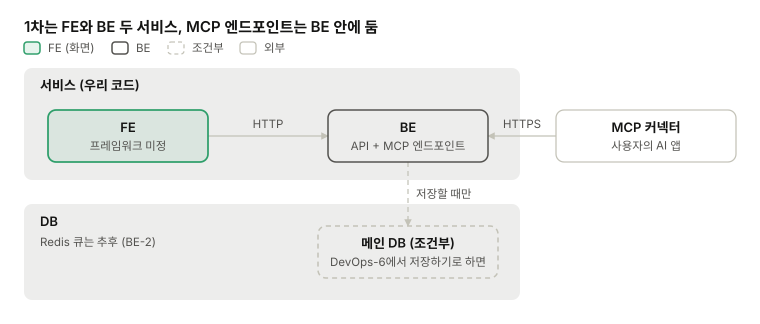
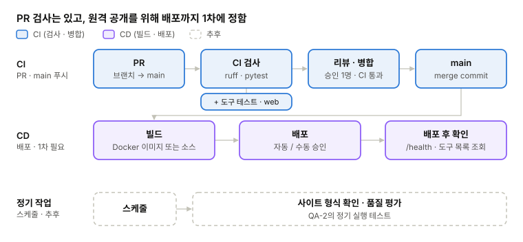
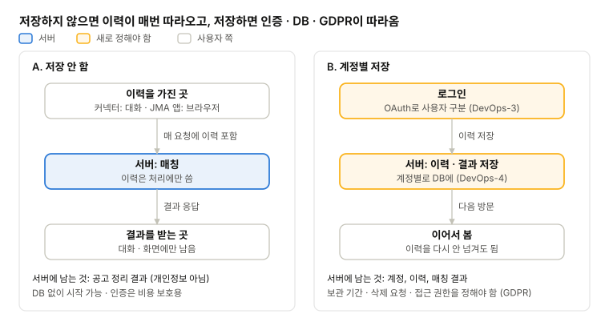

# DevOps 설계

[현재 구조와 기술](../STRUCTURE.md) · 영역별 설계: [BE](be.md) · [LLM](llm.md) · [FE](fe.md) · **DevOps** · [QA](qa.md)

## 1. 서비스 구성

1차는 FE와 BE 두 서비스. MCP 엔드포인트는 API와 같은 BE 안에 둠. worker와 Redis는 뺀 상태.

*서비스와 저장소 · DB는 조건부*

- **구성:** FE / BE(API + MCP 엔드포인트) 두 개. BE 하나가 두 입구를 다 받음
- **DB:** DevOps-6에서 B(저장)를 고르면 추가함(4번)
- **추후:** 사용자가 늘어 작업이 밀리면 worker + Redis 큐(BE-2)

## 2. CI/CD 파이프라인

원격 커넥터는 공개 주소가 있어야 붙으므로, 배포까지 1차에 정함. 지금 CI(GitHub Actions)는 PR과 main 푸시 때 Python lint · 포맷 검사 · pytest만 돌림. 정기 작업은 추후.

*CI/CD 파이프라인 · 배포는 1차, 정기 작업은 추후*

| 단계 | 지금 | 정할 것 |
| --- | --- | --- |
| PR 검사 | `ruff check`, `ruff format --check`, `pytest` | MCP 도구 테스트 추가(QA-2), web 검사 추가(메인-2 ③) |
| 빌드 방식 | 없음 (Dockerfile 없음) | Docker 이미지로 빌드 · 배포 / 소스에서 바로 배포(PaaS) |
| main 병합 후 | 없음 | 배포할 결과물을 자동으로 빌드할지 |
| 배포 | 없음 | 병합하면 자동 배포 / 태그 · 수동 승인 후 배포 |
| 환경 | 로컬만 | 개발 · 운영 분리 여부 |
| 배포 후 확인 | 없음 | `/health`와 MCP 도구 목록 조회로 확인할지 |
| 비밀 값 | 로컬 `.env` | 서버 LLM 키 · 인증 설정을 GitHub Secrets와 배포 환경 비밀값에 둠 |
| 정기 작업 | 없음 | 추후 (사이트 형식 확인 · 품질 평가) |

## 3. 배포 대상과 인증

claude.ai와 ChatGPT 커넥터는 HTTPS 공개 주소에만 붙어서 배포가 1차에 필요함. 우리 agent는 서버 LLM 키를 쓰므로 인증도 같이 정함.

### 배포 위치

| 방식 | 예 | 장점 | 단점 |
| --- | --- | --- | --- |
| PaaS | Render, Railway, Fly.io | 저장소나 컨테이너만 연결하면 배포되고 HTTPS 주소가 기본으로 나옴 | 쓰는 만큼 비용이 늘고 설정 자유도가 낮음 |
| 관리형 컨테이너 | Cloud Run, AWS ECS(Fargate), Azure Container Apps | 자동 확장, 같은 클라우드의 관리형 DB와 연결이 쉬움 | 권한(IAM) · 네트워크 설정을 익혀야 함 |

원래 안건의 로컬 · VM · Kubernetes는 원격 공개 기준에서 뺀.

### 인증 방식

| 방식 | Claude Code · Codex | claude.ai · ChatGPT | 구현 부담 | 비고 |
| --- | --- | --- | --- | --- |
| 인증 없음 | 붙음 | 붙음 | 없음 | 1차는 데이터 도구만이라 LLM 비용은 안 듦. 출처 API 호출 횟수는 지켜야 함(DevOps-6) |
| 토큰 (헤더) | 붙음 | 안 붙음 | 작음 | 팀 안에서 CLI로만 쓸 때 |
| <mark>OAuth</mark> | 붙음 | 붙음 | 큼 | 인증 서버를 직접 두거나 외부 인증 서비스를 씀 |
| 섞기 | 확인 필요 | ChatGPT는 지원, claude.ai는 확인 필요 | 중간 | 데이터 도구는 인증 없음, 나중에 여는 agent 도구만 OAuth |

claude.ai의 인증 지원 범위는 공식 문서로 다시 확인함. 출처: [ChatGPT 개발자 모드](https://developers.openai.com/api/docs/guides/developer-mode), [Codex MCP](https://learn.chatgpt.com/docs/extend/mcp?surface=cli)

| 정할 것 | 선택지 | 참고 | 결정 |
| --- | --- | --- | --- |
| 배포 위치 | PaaS / 관리형 컨테이너 | 위 표 |   |
| 인증 방식 | 인증 없음 / 토큰 / OAuth / 섞기 | 위 표, DevOps-6 저장 여부 | OAuth (MCP 커넥터용) |
| 운영 비용 | 누가 어떻게 낼지 | 서버 LLM 키 비용 포함(LLM-5) |   |

## 4. DB

DB가 1차에 필요한지는 DevOps-6의 저장 여부에 달림. A(저장 안 함)면 1차는 DB 없이 시작하고, B(저장)면 메인 DB를 정함.

| DevOps-6 선택 | 1차 DB | 저장할 것 |
| --- | --- | --- |
| A. 저장 안 함 | 없어도 됨. 작업 상태 · 공고 정리 결과는 메모리나 파일 | 공고 정리 결과 (개인정보 아님) |
| B. 계정별 저장 | 메인 DB 필요 | 계정, 이력, 매칭 결과, 작업 상태, 공고 정리 결과 |

- **메인 DB 후보 (B일 때):** MongoDB / PostgreSQL. 이력 · 공고처럼 형태가 자주 바뀌는 데이터는 MongoDB가 편하고, 공고 · 이력 · 매칭 결과를 엮어 조회할 일이 많으면 PostgreSQL이 유리함
- **운영 방식:** 관리형(MongoDB Atlas, Supabase · Neon, AWS RDS 등) / 컨테이너로 직접 운영
- **OAuth를 직접 구현하면** 토큰을 저장할 곳이 필요해서 A여도 DB가 생길 수 있음(3번)

| 정할 것 | 선택지 | 참고 | 결정 |
| --- | --- | --- | --- |
| DB 필요 여부 | DevOps-6에 따름 | 3번 인증 방식 |   |
| DB 종류 · 운영 방식 | MongoDB / PostgreSQL, 관리형 / 직접 운영 | B일 때만 |   |

## 5. 모니터링과 로그

1차는 LLM 호출 기록과 앱 로그만 둠. 대시보드와 알림은 사용자가 생긴 뒤 정함.

| 대상 | 남길 것 | 후보 |
| --- | --- | --- |
| <mark>LLM 호출</mark> | 프롬프트 · 응답, 토큰 · 비용, 지연, 도구 호출 순서 | <mark>Logfire</mark>(pydantic-ai 연동), Langfuse(오픈소스, 직접 운영 가능) |
| 앱 로그 | 요청 · 작업 ID로 묶은 구조화 로그(JSON) | 배포 환경 기본 로그 |
| 추후 | 오류 추적, 지표 대시보드, 알림 | Sentry, Prometheus · Grafana, Slack · 메일 |

- **개인정보:** LLM 호출 기록에 이력서 본문이 남음. 저장 여부(DevOps-6)와 같이 보관 기간을 정함
- **PoC:** 터미널 출력과 `poc/private/output/`의 JSON 파일로만 남김

| 정할 것 | 선택지 | 참고 | 결정 |
| --- | --- | --- | --- |
| LLM 호출 기록 도구 | Logfire / Langfuse / 안 둠 | LLM-3 (Logfire는 pydantic-ai 연동) | Logfire |

## 6. 데이터 (추후 논의)

1차 출처는 PoC의 공개 API 2곳. 이 섹션에서 정할 것은 이력서와 결과를 서버에 저장할지이고, 저장하면 인증 · DB · GDPR이 같이 따라옴.

### 수집 사이트

- **1차:** Greenhouse(회사별), 연방고용청(여러 회사) 2곳. 회사 목록은 설정 파일로 관리
- **추후:** Lever · Ashby · SmartRecruiters 등 다른 공개 API와 대형 사이트. 후보와 확인 결과는 원래 안건 BE-3 표에 있음
- **이용 조건:** 여러 회사 API는 출처 표기, 호출 횟수 같은 조건이 있음. 붙이기 전에 사이트별로 확인함

### 이력서 · 결과 저장

*이력서 · 결과 저장 · A와 B에서 이력이 있는 곳*

| 항목 | A. 저장 안 함 | B. 계정별 저장 |
| --- | --- | --- |
| 이력 | 매 요청에 함께 받음. 커넥터는 대화가, JMA 앱은 브라우저가 들고 있음 | 서버 DB에 계정별로 |
| 매칭 결과 | 작업이 끝나면 응답하고 지움 (보관 시간은 BE-2) | 계정별로 쌓여서 다시 볼 수 있음 |
| 공고 정리 결과 | 저장해 다시 씀 (개인정보 아님) | 같음 |
| 인증 | 비용 보호용만 (DevOps-3) | 사용자 구분까지 필요 |
| DB | 1차에 없어도 됨 | 필요 (DevOps-4) |
| GDPR | 저장하지 않아서 범위가 작음 | 보관 기간 · 삭제 요청 · 접근 권한을 정해야 함 |
| 사용자 경험 | 매번 이력을 다시 넘김 | 이어서 쓸 수 있음 |

- **LLM 전송:** 저장 여부와 관계없이 매칭할 때 이력과 공고 본문이 LLM 제공사로 전송됨

| 정할 것 | 선택지 | 참고 | 결정 |
| --- | --- | --- | --- |
| 이력서 · 결과 저장 | A. 저장 안 함 / B. 계정별 저장 | 위 표, DevOps-3 · 4 | A |
