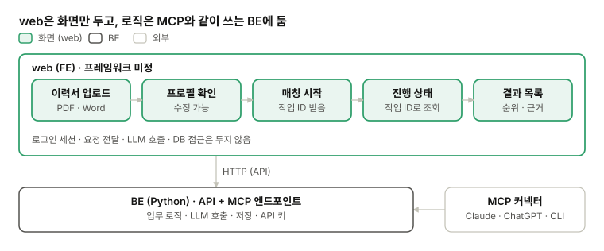

# FE 설계

[현재 구조와 기술](../STRUCTURE.md) · 영역별 설계: [BE](be.md) · [LLM](llm.md) · **FE** · [DevOps](devops.md) · [QA](qa.md)

## 1. FE 서버

별도 FE 서버를 둘지 먼저 정함. 서버가 없으면 FE를 정적 파일로 빌드해 올리고 서비스는 BE 하나, 있으면 FE · BE 두 서비스가 됨(DevOps-1).

| FE 서버 | 좋은 점 | 아쉬운 점 | 결정 |
| --- | --- | --- | --- |
| 없음 (정적 파일) | 정적 파일만 올리면 됨. 로직이 BE에만 남음 | 서버 렌더링 · 검색 노출(SEO)이 안 됨. 로그인해서 쓰는 앱이라 쓸 곳은 적음 | <mark>O (Vercel, Next.js)</mark> |
| 있음 (Node) | 서버 렌더링 · 검색 노출(SEO) | FE 서비스가 하나 더 생김. 로직이 FE로 새기 쉬움 (PR #2) |   |

## 2. 프레임워크

FE는 화면만 두고, 로직과 LLM 호출은 BE에 둠. 같은 서비스 함수를 MCP 쪽에서도 써야 하기 때문임. 프레임워크는 FE-1(FE 서버)에 따라 고름.

*web 범위 · 화면만, 로직은 BE*

- **화면만 (결정됨):** 로그인 세션 처리 · 요청 전달 · LLM 호출은 web에 두지 않음. 원래 안건의 B(프록시 · BFF) · C(제한 없음)는 뺀
- **1차 화면:** 이력서 업로드 → 프로필 확인 · 수정 → 매칭 시작 → 진행 상태(작업 ID) → 결과 목록(순위 · 요건별 근거)
- **추후:** 대화로 정보 보충(채팅 화면)
- **참고:** PR #2의 web 데모에는 TypeScript로 된 API(`app/api/chat`)와 agent(`lib/agents`)가 들어 있어 이 방향과 다름. 화면 부분만 참고할 수 있음

## 3. 구현할 항목 (<mark>추후 확정</mark>)

| 항목 | 화면에서 하는 일 | BE에서 받는 것 |
| --- | --- | --- |
| 이력서 업로드 | PDF · Word를 올리고, 뽑힌 프로필(경력 · 기술 · 언어 · 희망 지역)을 확인 · 수정 | 프로필 agent 결과 (`Profile`) |
| 필터 | 지역 · 언어 · 연차 · 원격 여부를 고르고 매칭 시작 | 검색 조건 (`SearchQuery`) |
| 연결된 사이트 목록 | 어느 출처(Greenhouse 회사 보드, 연방고용청)에서 찾는지 보고 고름 | `list_sources` |
| 모델 선택 | 매칭에 쓸 모델을 고름 (빠르고 싼 모델 / 정확한 모델) | 서버가 허용한 모델 목록 (LLM-5) |
| 진행 상태 · 결과 | 작업 ID로 진행 상태를 보여 주고, 끝나면 순위 · 요건별 근거 목록 | 작업 상태 · `MatchResult` (BE-2) |

**대시보드**

| 항목 | 화면에서 하는 일 | BE에서 받는 것 |
| --- | --- | --- |
| 사용한 토큰량 | 작업별 · 기간별 입력 · 출력 토큰과 예상 비용 | agent 실행마다 기록한 사용량 |
| 간단한 로그 | 단계(프로필 → 검색 → 정리 → 매칭)와 도구 호출, 오류 | 작업 로그 (DevOps-5) |
| 매칭된 공고 목록 | 지금까지 매칭된 공고를 점수순으로, 원문 링크 · 근거와 함께 | 저장된 `MatchResult` |
| 매칭 작업 목록 | 언제 · 어떤 조건 · 어떤 모델로 돌렸는지, 상태(진행 중 · 완료 · 실패) | 작업 목록 |
