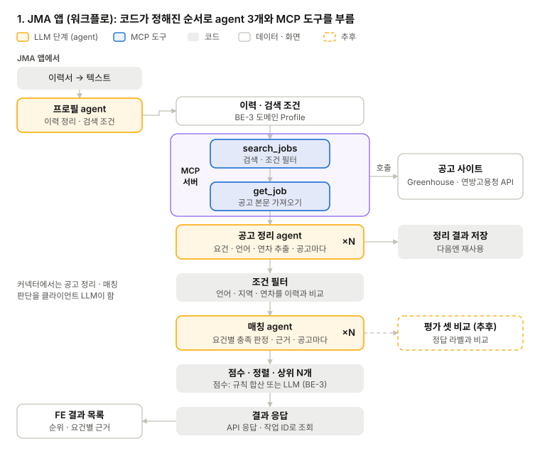
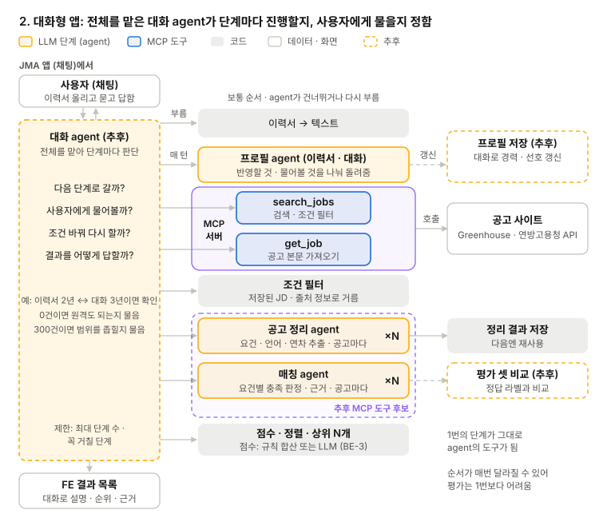
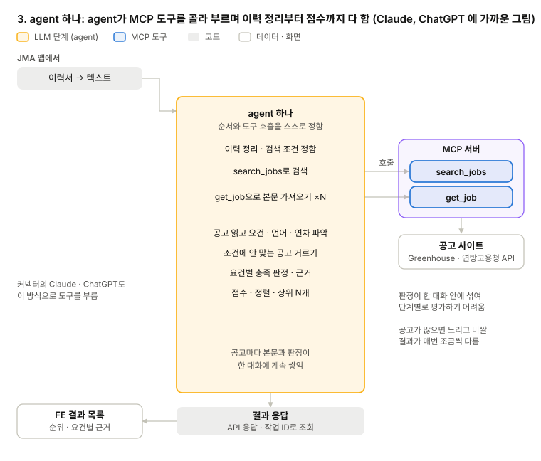
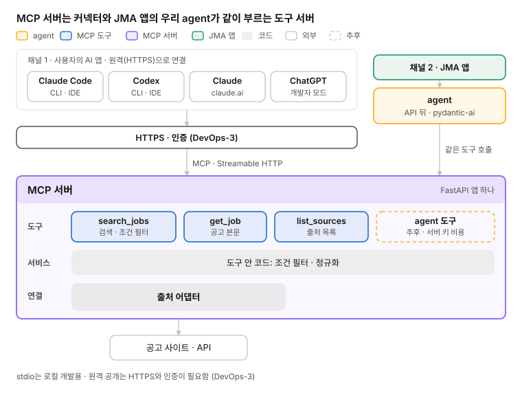

# LLM 설계

[현재 구조와 기술](../STRUCTURE.md) · 영역별 설계: [BE](be.md) · **LLM** · [FE](fe.md) · [DevOps](devops.md) · [QA](qa.md)

## 1. agent 구성

서버 안의 agent는 프로필 · 공고 정리 · 매칭 3개이고 JMA(Job Matching Agent) 앱에서만 씀. 이 agent가 Claude · Codex 역할을 하며 MCP 도구를 부르고, 커넥터에서는 이 역할을 클라이언트(Claude · ChatGPT)가 함. MCP 서버는 검색 · 본문 같은 데이터 도구만 내줌.

### 기능별 LLM 필요 여부

| 기능 (서비스/UseCase) | LLM | 커넥터에서 접근시 | JMA 앱에서 |
| --- | --- | --- | --- |
| 이력서 파일 → 텍스트 | 불필요 | 클라이언트(Claude)가 해결 | 코드 (변환 라이브러리) |
| 이력 정리 (직무, 기술, 연차, 언어, 희망 지역) | 필요 | 클라이언트가 Profile(이력)을 채움 | 프로필 agent |
| 검색어 만들기 (Text에서 직무명 검색어로 변환) | 필요 | 클라이언트가 해결 | 프로필 agent |
| 출처 선택 · 검색 · 중복 제거 · 1차 거르기 | 불필요 | 코드 (도구) | MCP 도구 (agent가 부름) |
| 공고 정리 (필수·우대 요건, 언어, 연차, 근무 형태) | 필요 | 클라이언트 (본문을 직접 읽음) | 공고 정리 agent |
| 조건 필터 (언어 필수, 지역, 연차) | 불필요 | 코드 (출처 정보로 되는 조건만) | 코드 (단순 툴) |
| 요건별 충족 판정 + 근거 | 필요 | 클라이언트 (도구 설명으로 안내) | 매칭 agent |
| 점수 · 정렬 | 선택 | 클라이언트 | 코드 (단순 툴) |
| 결과 설명 · 되묻기 · 조건 바꿔 다시 찾기 | 필요 | 클라이언트 | 추후 (대화 agent) |

LLM이 필요한 부분만 agent로 만들고 나머진 단순 도구 혹은 툴로 만들어서 MCP 서버 내에 두면 충분함

<a id="flow"></a>

## 2. 흐름

JMA 앱에서 agent를 붙이는 방식은 세 가지임. 단계와 도구는 같고, 순서를 누가 정하느냐가 다름.


*1. JMA 앱 (워크플로) · 코드가 순서를 정함*


*2. 대화형 앱 · 대화 agent가 전체를 맡음 (추후)*


*3. agent 하나 · agent가 순서까지 정함*

| 흐름 | 순서를 정하는 쪽 | 장점 | 단점 |
| --- | --- | --- | --- |
| 1. JMA 앱 (워크플로) | 코드 | LLM 호출 자리가 정해져 <u>비용 · 시간을 예측하기 쉬움</u>. 결과가 일정해 평가 셋으로 잴 수 있음 | 사용자에게 묻거나 조건을 바꿔 다시 찾는 판단이 없음 |
| 2. 대화형 앱 | 대화 agent | 단계마다 진행 · 질문 · 재검색을 판단함. 대화로 프로필을 계속 갱신함. 1번의 단계를 도구로 그대로 씀 | 채팅 화면이 필요함. 순서가 매번 달라 평가가 어려움. 대화 agent 호출 <u>비용이 더 듦</u> |
| 3. agent 하나 | agent | 코드가 가장 적음. 커넥터의 클라이언트와 같은 방식 | 공고 본문과 판정이 한 대화에 쌓여 공고가 많으면 <u>느리고 비쌈</u>. 결과가 매번 달라 평가가 어려움 |

- 제안: 1번 구조로 시작 후 점진적으로 2번 구조로 변경
- [참고자료](https://langchain-opentutorial.gitbook.io/langchain-opentutorial/17-langgraph/02-structures/08-langgraph-multi-agent-structures-01)

| 정할 것 | 선택지 | 참고 | 결정 |
| --- | --- | --- | --- |
| JMA 앱 흐름 | 1. 워크플로 / 2. 대화형 앱 / 3. agent 하나 | 1차는 1로 시작하고, 채팅 화면이 생기면 1의 단계를 도구로 써서 2로 넓힐 수 있음 | <mark>1-&gt;2</mark> |

<a id="framework"></a>

## 3. agent 구현 (프레임워크)

### 후보 비교

| 후보 | 성격 | 1. 워크플로 | 2. 대화형 (supervisor) | 3. agent 하나 |
| --- | --- | --- | --- | --- |
| 직접 구현 (SDK + 코드) | 흐름을 코드로 직접 작성 | 잘 맞음 | 보통 이하. 대화 agent 루프 · 질문 대기 · 상태 저장을 다 직접 짜야 함 | 보통. 루프를 직접 짜야 함 |
| pydantic-ai/pydantic-graph | 타입 기반 agent, 구조화 출력이 강함. 흐름은 pydantic-graph, 병렬은 asyncio로 | 잘 맞음 | 맞는 편. 도구 안에서 다른 agent를 부르고, 승인 대기 도구가 있음. 대화 상태 저장은 직접 | 잘 맞음 |
| LangChain/LangGraph | 흐름을 그래프로 명시. 병렬 처리, 반복, 체크포인트 | 잘 맞음 | 잘 맞음. supervisor 구조, 사용자 입력 대기(interrupt), 체크포인트가 기본 | 잘 맞음 |
| Google ADK | 순차·병렬·반복 워크플로 agent | 맞는 편 | 맞는 편. 하위 agent를 도구로 감싸 부름(AgentTool), 도구 승인 흐름 | 맞는 편 |
| LlamaIndex Workflows | 이벤트 기반 워크플로, 검색(RAG)이 강함 | 보통 | 맞는 편. 사람 입력 이벤트로 멈춘다 이어 감 | 보통 |
| OpenAI Agents SDK | agent 루프 + 위임(handoff) + 가드레일 | 보통 | 잘 맞는 편. agent를 도구로 부르거나 넘김(handoff), 도구 승인 대기 | 맞는 편 |
| CrewAI | 역할을 나눈 agent들의 협업 | 보통 | 맞는 편. manager agent가 나눠 맡기는 방식(hierarchical) | 보통 이하 |
| Microsoft Agent Framework | 여러 agent의 대화형 협업 (AutoGen 후속) | 보통 | 잘 맞는 편. handoff · magentic 등 여러 agent 조율 방식, 사람 입력 대기 · 체크포인트 | 보통 이하 |
| Claude Agent SDK | Claude Code 기반 자율 agent, Claude 전용 | 덜 맞음 | 맞는 편이지만 무거움. 하위 agent를 둠 | 맞는 편이지만 무거움 |

### pydantic-ai와 LangGraph 심층 비교

| 기준 | pydantic-ai | LangGraph |
| --- | --- | --- |
| 타입 검증 | 단계마다 입력 · 출력을 Pydantic으로 검증. 강점 | 상태 타입 검증은 약한 편 |
| 도메인 모델 공유 | FastAPI · FastMCP와 같은 Pydantic 모델을 그대로 씀. 강점 | 메시지가 LangChain 타입이라 한 번 더 바꿈 |
| 멈추는 곳 | 승인 대기 도구를 부를 때만 | 어느 노드에서든 (`interrupt`). 강점 |
| 상태 저장 · 재개 | 직접 저장. 장애 재개는 Temporal · DBOS 연동 | 체크포인터가 단계마다 자동 저장. 강점 |
| 흐름 표현 | 코드(if · while) | 노드 · 엣지 · 조건부 엣지로 선언. 강점 |
| 러닝커브 | Agent · 도구 · 대화 기록만. 강점 | 노드 · 엣지 · 상태 · 체크포인터까지 익혀야해서 러닝커브 있는편 |
| 자료 · 예제 | 상대적으로 적음 | 가장 많음. 그래프 디버깅 도구(Studio). 강점 |

- **pydantic-ai:** 타입 검증이 강하고 배우기 쉬워서 워크플로형(1번)에 강점
- **LangGraph:** 러닝커브가 있고 타입 검증은 약한 편. 대신 작업 도중 멈췄다 이어 갈 수 있고, 자료 · 예제가 가장 많음

| 프레임워크 선택지 | 좋은 점 | 아쉬운 점 | 결정 |
| --- | --- | --- | --- |
| 1차 pydantic-ai → 대화형(2번)으로 넓힐 때 LangGraph | 1번 흐름에 맞고 배우기 쉬움 | 2번으로 넓힐 때 대화 agent 부분을 다시 짜야 함 | <mark>pydantic-ai</mark> |
| 처음부터 LangGraph | 2번으로 넓힐 때 다시 짜지 않아도 됨 | 1차에는 안 쓰는 노드 · 상태 · 체크포인터까지 익혀야 함 |   |

- **비교할 때 볼 것:** 사용자에게 묻고 기다렸다 이어 가기, 조건을 바꿔 다시 돌기, 코드 양, 평가 셋 점수 · 비용
- **참고:** [pydantic-ai 승인 대기 도구](https://pydantic.dev/docs/ai/tools-toolsets/deferred-tools/index.md), [LangGraph interrupt](https://docs.langchain.com/oss/python/langgraph/interrupts), [LangGraph 체크포인터](https://docs.langchain.com/oss/python/langgraph/persistence), [LangGraph supervisor 예제](https://langchain-opentutorial.gitbook.io/langchain-opentutorial/17-langgraph/02-structures/08-langgraph-multi-agent-structures-01)

## 4. MCP 서버

MCP 서버는 외부 클라이언트와 JMA 앱의 우리 agent가 같이 쓰는 도구 서버임. 원격(HTTPS)으로 공개하고, 1차에는 LLM을 부르지 않는 데이터 도구만 둠.


*MCP 서버 · 커넥터와 우리 agent가 같이 씀*

- **전송 방식:** 원격 Streamable HTTP. claude.ai 커넥터와 ChatGPT(개발자 모드)는 원격 서버만 붙음. Claude Code · Codex도 같은 원격 주소로 붙고, stdio는 로컬 개발용
- **같은 앱:** MCP 엔드포인트를 API와 같은 FastAPI 앱에 붙여 한 서비스로 배포함
- **쓰기 표시:** ChatGPT는 `readOnlyHint` 표시가 없는 도구를 쓰기 도구로 보고 실행 전에 사용자 확인을 받음. 조회 도구에는 이 표시를 붙임
- **시간 제한:** 데이터 도구는 LLM을 부르지 않아 바로 응답함. 오래 걸리는 매칭은 JMA 앱에서 작업 ID로 나눔(BE-2)
- **PoC 확인:** `feat/poc-mcp-agent` 브랜치에서 FastMCP stdio 서버(search\_jobs · get\_job, Greenhouse · 연방고용청)를 pydantic-ai가 호출하는 것까지 확인함. 원격(HTTP)은 아직 확인 안 함
- **출처:** [ChatGPT 개발자 모드](https://developers.openai.com/api/docs/guides/developer-mode), [Codex MCP](https://learn.chatgpt.com/docs/extend/mcp?surface=cli)

### 도구 목록 (초안)

| 도구 | 입력 | 출력 | 쓰기 표시 |
| --- | --- | --- | --- |
| `search_jobs` | 검색 조건(직무 키워드 · 지역 · 출처 등). 도구가 코드로 거름 | 공고 목록 (JobPosting) | 읽기 전용 |
| `get_job` | 공고 id | 공고 원문 (JobPosting). 정리된 JD가 저장돼 있으면 함께(추후) | 읽기 전용 |
| `list_sources` | 없음 | 등록된 출처 이름 목록 | 읽기 전용 |

이력을 저장하는 도구(`save_profile` 등)는 추후 DB가 존재할 때 추가함.

### <mark>도구 설명으로 판단 안내 (두 채널 공통)</mark>

<u>도구 설명이 곧 프롬프트. 커넥터의 클라이언트와 우리 agent가 같은 설명을 읽으므로, 잘 만들면 두 채널이 같이 좋아짐.</u>

```python
# domain/profile.py
class SearchQuery(BaseModel):
    keywords: list[str] = Field(description="이력서에서 뽑은 직무 · 기술 키워드")
    locations: list[str] = Field(description="희망 근무지. 모르면 사용자에게 먼저 묻는다")


# port/inbound/job.py — 서비스 포트 (입구가 부르는 약속)
class JobServicePort(Protocol):
    def search_jobs(self, query: SearchQuery, limit: int = 20) -> list[JobPosting]: ...


# service/job.py — 서비스 포트 구현 (도구 / 서비스 로직). docstring이 곧 도구 설명
class JobService:  # JobServicePort 구현
    def search_jobs(self, query: SearchQuery, limit: int = 20) -> list[JobPosting]:
        """조건에 맞는 공고를 찾는다. 호출 전에 이력서에서 query를 채운다."""
        return [p for s in self.sources for p in s.search(query, limit)]  # JobSource 포트


# adapter/inbound/mcp/server.py — 약속만 보고 등록
def register(mcp: FastMCP, jobs: JobServicePort) -> None:
    mcp.tool(jobs.search_jobs, annotations={"readOnlyHint": True})
```

- **조건은 코드로:** 지역 · 직무명처럼 출처가 주는 정보는 도구 입력으로 받아 코드로 필터링
- **설명에 할 일을 적음:** docstring과 `Field(description=...)`에 "호출 전에 이력서에서 조건을 뽑는다" 같은 순서를 적음
- **한계:** 권유까지만 됨. 커넥터 쪽 판단은 클라이언트 모델에 따라 달라짐

### agent 도구를 열면 얻는 것 (추후)

공고 정리와 매칭을 agent 도구로 열면 아래 두 가지를 얻음. 대신 우리 서버 키 비용이 들고, 인증과 사용 한도가 필요함. 1차에는 열지 않음.

#### 1. 양이 많은 일: 공고 정리


*공고 정리 · 클라이언트가 직접 읽을 때 vs agent 도구로 할 때*

- **측정:** GetYourGuide·N26 공개 공고 105개의 본문은 중간값 약 5,000자, 상위 10% 약 6,800자(2026-10-17 측정). 50개면 약 25만 자임
- **A. 클라이언트가 직접 읽을 때:** 본문 조회를 공고마다 한 번씩 50번 부르고, 본문이 대화에 계속 쌓임. 모델이 턴마다 쌓인 내용을 다시 읽어서 갈수록 느려지고 사용량을 빨리 씀. 한 번에 넘기려 해도 [Claude Code는 도구 결과를 기본 2.5만 토큰까지만 받음](https://code.claude.com/docs/en/mcp)
- **B. agent 도구로 할 때:** `structure_postings`를 한 번 부르면 서버가 공고마다 작은 모델로 병렬 정리하고, 조건 필터를 거친 뒤 요건·언어·연차 요약만 돌려줌
- **재사용:** 공고 정리 결과는 사용자와 상관없어서 (출처, id)로 저장해 두면 다음 사용자나 다음 실행에서는 LLM을 부르지 않음

1차에서는 클라이언트가 본문을 직접 읽으므로(A), `search_jobs`가 코드로 먼저 거르고 개수를 제한함. 그래도 양이 문제가 되면 agent 도구를 여는 근거가 됨.

#### 2. 평가가 필요한 일: 매칭


*매칭 · 클라이언트가 판정할 때 vs 우리 agent가 판정할 때*

- **A. 클라이언트가 매칭할 때:** 판정 기준이 모델·버전·앞선 대화·질문 문구에 따라 달라짐. 클라이언트의 프롬프트와 모델을 우리가 정할 수 없어서 평가 셋을 같은 조건으로 반복해 돌릴 수 없음
- **B. 우리 agent가 매칭할 때:** 지시문·출력 형식·모델·설정이 고정됨. Claude·ChatGPT·평가 스크립트가 같은 agent를 부르므로 어디서 불러도 같은 기준으로 판정함
- **평가:** 평가 셋(공고 약 30개 + 정답 라벨)을 정기적으로 돌려 바꾸기 전후를 비교함(QA-1)
- **한계:** LLM이라 같은 입력에도 출력이 조금씩 흔들릴 수 있음. 조건이 고정돼 있어서 같은 입력을 여러 번 돌려 흔들림도 잴 수 있음

#### 클라이언트에 맡기는 일

- **사용자와 주고받기:** 빠진 정보 되묻기, 결과 설명, 사용자 반응에 따라 조건을 바꿔 다시 찾기
- **이력서 하나 읽기:** 이력 정리·검색어 뽑기. 입력이 하나라 클라이언트 모델로 충분함. JMA 앱에서는 프로필 agent가 함

| 정할 것 | 선택지 | 참고 | 결정 |
| --- | --- | --- | --- |
| 도구 목록 | 위 초안 / 추가 · 삭제 | 메인 정할 것 2 |   |
| agent 도구 열기 | 1차에는 안 엶 / 엶 (서버 키 비용 · 인증 · 사용 한도 필요) | 위 '얻는 것', LLM-5 |   |
| 공고 정리 미리 돌리기 | 안 함 (JMA 앱 실행 때 쌓인 JD만) / 정기적으로 미리 정리 | 언어 · 연차 필터와 요건 구조에 필요. 비용은 사용자 수가 아니라 공고 수에 비례 |   |

<a id="model"></a>

## 5. 모델과 키

커넥터에서는 대화부터 공고 판단까지 LLM 비용이 사용자의 Claude · ChatGPT 쪽에서 나감. 서버 LLM은 JMA 앱의 agent에만 쓰므로 pydantic-ai 기본 기능과 서버 키 하나로 시작함.

| 일 | LLM을 부르는 쪽 | 비용 |
| --- | --- | --- |
| 커넥터 대화 · 공고 판단 · 결과 설명 | 클라이언트(Claude · ChatGPT · Codex) | 사용자의 구독 · 키 |
| 공고 정리 · 매칭 (JMA 앱) | 서버의 agent | 우리 서버 키 |
| 프로필 정리 (JMA 앱) | 서버의 프로필 agent | 우리 서버 키 |

- **방식:** pydantic-ai 기본 기능으로 제공사 SDK를 바로 부름. 모델은 `anthropic:claude-haiku-5-5`처럼 문자열로 고름
- **키:** 배포 환경에는 서버 키 하나를 비밀값으로 둠. 로컬 개발은 개인 키
- <mark><strong>LiteLLM (추후)</strong></mark>**:** 사람별 예산 · 사용 기록이 필요하거나 제공사를 자주 바꿀 때
- **비용 참고:** 같은 질의 1회 비용이 Haiku 5.5 약 $0.002, Opus 5.5 약 $0.078(PoC 측정)

| 정할 것 | 선택지 | 참고 | 결정 |
| --- | --- | --- | --- |
| 기본 모델 | 후보: Haiku 5.5, Sonnet 5.5 등 | 평가 셋으로 비교(QA-1) | <mark>처음엔 로컬에 각자 모델 (.env 파일 연결)</mark> |
| 서버 키 | 프로젝트 공용 키 / 개인 키를 돌려 씀 | 배포 환경 비밀값, 비용 상한 |   |
