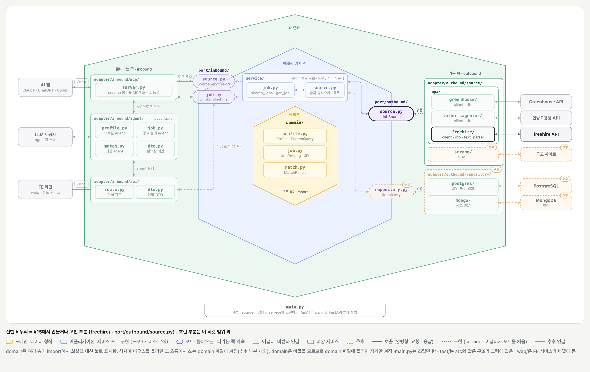
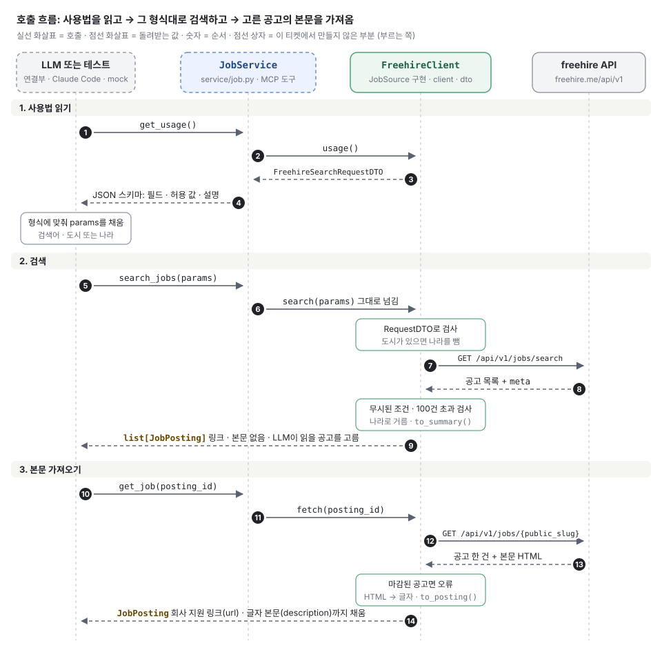

# freehire 공고 출처 어댑터 (#15)

## 배경과 목적

[#15](https://github.com/ai-agent-study-group/job-matching-agent/issues/15)는 두 번째 공고 출처로 [freehire.me](https://freehire.me)를 붙이는 작업입니다. freehire는 여러 회사의 채용 페이지(Greenhouse, Ashby 등)에서 공고를 모아 두고, 장소와 키워드로 검색하게 해 줍니다.

출처를 하나 더 붙이면서 [#11](#doc=wiki/BE-티켓-11.md)에서 만든 출처 포트(`usage` · `search` · `fetch`)가 다른 출처에도 그대로 맞는지 같이 확인했습니다. 공고를 다루는 함수는 고치지 않았고, 포트에는 열고 닫는 함수만 추가했습니다.

freehire 약관상 키 없이 쓰면 **개인적 · 비상업적 사용**만 됩니다. 그래서 내 컴퓨터에서 띄우는 서버에서만 켜고, 배포 서버에는 넣지 않습니다.

## 주요 내용

### 전체 그림



[BE 설계의 폴더 구조 그림](#doc=wiki/구조-BE.md)에 `freehire/`를 더하고, 이 티켓에서 만들거나 고친 부분만 켠 상태입니다. 진한 테두리가 만들거나 고친 부분이고, 흐린 부분은 이 티켓 범위 밖입니다. `/mcp`는 아직 만들지 않았습니다. `server.py`는 `__main__`에 로컬 stdio 연결만 추가해서 켜지 않았습니다.



위 그림의 길을 실제로 부르는 순서입니다. 맨 왼쪽은 실제 LLM(Claude Code 등)이 붙어도 되고, 테스트에서는 가짜(mock)를 붙여도 됩니다. 로컬 서버에서는 도구 이름 앞에 `freehire_`가 붙습니다.

### 파일 구성

`src/adapter/outbound/source/api/freehire/` 아래에 있습니다.

| 파일 | 하는 일 |
| --- | --- |
| `dto.py` | 검색 요청 DTO(`FreehireSearchRequestDTO`), 공고 DTO(`FreehireJobDTO`)와 `JobPosting`으로 바꾸기 |
| `client.py` | `FreehireClient(JobSource)`: `usage` · `search` · `fetch`. 검색 요청 모양 만들기(`_to_query`)와 응답 검사(`_search`) |
| `text_parser.py` | 공고 본문(HTML)을 글자로 바꾸기 |

### 호출할 때 동작

예: 사용자가 "베를린에서 AI 엔지니어 공고 찾아줘"라고 할 때

1. **`get_usage()`**
    - 서비스가 어댑터의 `usage()`로 `FreehireSearchRequestDTO`를 받아 JSON 스키마로 돌려줌
    - LLM은 필드 설명을 보고 `params`를 채움
2. **`search_jobs(params)`**

    ```json
    {"q": "\"AI Engineer\"", "cities": ["Berlin"], "q_fields": ["title"]}
    ```

    - 어댑터가 DTO로 검사함. `q`가 없거나, 도시와 나라가 둘 다 없거나, 모르는 키가 있으면 오류가 LLM에게 돌아감
    - freehire가 받는 모양으로 바꿔 한 번 부름

      ```http
      GET /api/v1/jobs/search?q="AI Engineer"&q_fields=title&cities=Berlin&limit=100
      ```

    - freehire가 조건 일부를 적용하지 못했거나(`meta.ignored_params` · `meta.ignored_values`), 검색된 공고가 100건을 넘으면 오류를 돌려줌
    - 도시와 나라를 같이 받았으면, 받은 공고 중 그 나라 공고만 남김
    - `JobPosting` 목록을 돌려줌 (링크 · 본문 없음)
3. **`get_job(posting_id)`**
    - `GET /api/v1/jobs/{public_slug}`를 부름
    - 마감된 공고면 오류를 돌려줌
    - 회사 지원 페이지 링크와, 글자로 바꾼 본문까지 채운 `JobPosting` 하나를 돌려줌

### `JobPosting` 필드

| 필드 | freehire 응답 | 비고 |
| --- | --- | --- |
| `source` | 없음 (어댑터가 `"freehire"`를 넣음) | |
| `id` | `public_slug` (예: `ai-engineer-acme-berlin`) | `get_job`에 이 값을 넘김 |
| `company` | `company` | |
| `title` | `title` | |
| `location` | `location` | 공고에 적힌 그대로 |
| `url` | 공고 하나 조회의 `url` (회사 지원 페이지) | 비어 있으면 `https://freehire.me/jobs/{public_slug}`를 넣음. `get_job`에서만 채움 |
| `description` | 공고 하나 조회의 `description` | HTML을 글자로 바꿔 넣음. `get_job`에서만 채움 |

freehire 응답에는 이 밖에도 필드가 40개쯤 있습니다. 어떤 필드를 쓰고 어떤 필드를 왜 안 쓰는지는 [#15 댓글의 필드 표](https://github.com/ai-agent-study-group/job-matching-agent/issues/15#issuecomment-6446865785)에 정리했습니다.

### 검색 조건 (`FreehireSearchRequestDTO`)

| 필드 | 뜻 |
| --- | --- |
| `q` (필수) | 직무명이나 기술. 아래 "검색어(`q`)를 찾는 방식" 참고 |
| `q_fields` | `q`를 찾을 칸: `title` · `company` · `description` · `location`. 안 넣으면 네 칸 모두 |
| `cities` · `countries` (둘 중 하나 이상 필수) | 도시 이름, 나라 코드(`de` 등) |
| `work_mode` · `seniority` · `employment_type` · `posting_language` · `visa_sponsorship` · `posted_within_days` · `reality` | 근무 형태, 경력 수준, 고용 형태, 공고 언어, 비자 지원, 최근 N일, 공고 신선도 |
| `seniority_include_unspecified` | `seniority`를 줄 때 경력 수준을 안 밝힌 공고도 남길지 |

필수가 아닌 필드는 사용자가 원할 때만 LLM이 채웁니다. 나라 · 언어 코드는 대문자로 와도 소문자로 바꿉니다.

### 검색어(`q`)를 찾는 방식

LLM이 검색어를 잘 쓰도록 `q` · `q_fields` 설명에 적은 내용입니다. 독일 공고로 직접 불러 확인했습니다 (2026-10-27).

| 방식 | 확인한 결과 |
| --- | --- |
| 따옴표 없는 단어는 앞쪽만 꼭 맞아야 하고, 맞는 공고가 적으면 뒤쪽 단어는 빼고 찾음 | 직무명에서 `Python Zebra` → 173건. `Python`만으로 찾은 173건과 같음 (Zebra는 버려짐) |
| 따옴표로 묶으면 모든 단어가 있어야 함. 순서 · 위치는 상관없음 | `"Python Zebra"` → 0건. `"Engineer AI"` → `AI Engineer`, `Backend Engineer, AI` 등 961건 |
| `-단어`는 그 단어가 있는 공고를 뺌 | 직무명에서 `Engineer` 10,867건 → `Engineer -senior` 7,086건 |
| `OR`(대문자)로 대안을 5개까지 이음 | 명세 기준. 6개 이상이면 400 |
| `q_fields`로 찾는 칸을 좁힘 | `Python`을 네 칸 모두 863건 → 직무명만 173건 |

문구가 똑같은 것만 찾는 검색은 freehire에 없습니다.

### freehire API에서 알아낸 것

직접 불러서 확인한 내용이고, 코드는 이에 맞춰 짰습니다.

| 알아낸 것 | 그래서 코드는 |
| --- | --- |
| 위치 조건은 "또는(OR)"으로 묶임. `countries=de` 8,254건, `cities=Berlin` 2,373건, 둘 다 8,277건 (독일 전체 또는 베를린) | 도시가 있으면 나라는 요청에서 빼고 도시로만 찾은 뒤, 받은 공고를 나라로 거름 |
| 목록은 같은 키를 반복해서 받음(`cities=Berlin&cities=Hamburg`). `q_fields`만 쉼표로 이은 글자 하나(`q_fields=title,company`) | 목록은 httpx가 반복 키로 보냄. `q_fields`만 쉼표로 이음 |
| 모르는 파라미터는 버리고 `meta.ignored_params`에 적음. 허용 목록 밖 값은 0건으로 답하고 `meta.ignored_values`에 적음. 둘 다 오류는 아님 | 둘 중 하나라도 있으면 오류. 그대로 두면 LLM이 "공고 없음"으로 답함 |
| 잘못된 검색(`OR` 6개 이상 등)은 400과 `{"error": 이유}` | 본문을 500자까지 그대로 오류로 돌려줌. 코드는 내용을 보지 않아서 JSON으로 읽지 않고, 앞단에서 막혀 HTML이 와도 그대로 감. HTML 페이지는 길 수 있어서 자름 |
| 한 번에 최대 100건(`limit`). `meta.total`은 검색된 전체 수 | `limit=100`으로 한 번만 부르고, `total`이 100을 넘으면 범위를 좁히라는 오류 |
| 검색 결과의 본문은 앞부분만 잘린 미리보기, 공고 하나 조회는 전체. 둘 다 HTML이고, 글자로 달라는 옵션은 없음 | 검색 결과에는 본문을 넣지 않음. `get_job`에서 HTML을 글자로 바꿔 넣음 |
| 공고 하나 조회는 마감된 공고도 돌려줌 (`closed_at`에 값이 있음) | 마감된 공고면 오류. 그대로 주면 LLM이 마감된 공고를 추천할 수 있음 |
| 없는 id는 404와 `{"error": "not found"}` | id가 든 오류로 바꿔 돌려줌 |
| 도시 이름은 영어와 독일어 둘 다 받음 (`Munich` · `München` 둘 다 2,433건, 2026-10-27) | 따로 처리하지 않음. 이슈를 조사한 10/21에는 영어 이름만 됐음 |
| 쉬는 연결을 400초 뒤에 끊음 (freehire 앞의 Cloudflare) | 연결 유지 시간을 300초로 둠 (아래 "HTTP 연결") |

### 본문 HTML을 글자로 바꾸기

`text_parser.py`의 `to_text()`가 하는 일은 네 가지입니다.

1. `<p>`, `</p>`, `<li>` 같은 태그를 지움
2. 태그가 있던 자리에 줄바꿈을 넣음. 문단 · 제목 사이는 빈 줄, 목록 항목은 한 줄씩 앞에 `- `
3. `&amp;` 같은 HTML 기호를 원래 글자(`&`)로 바꿈
4. `<script>` · `<style>` 안의 JS · CSS 코드는 버림. 화면에 안 보이는 내용이라 본문에 섞이면 안 됨

```text
<p>We build agents.</p><ul><li>Python &amp; ML</li><li>LLMs</li></ul>
→
We build agents.

- Python & ML
- LLMs
```

태그만 지우면 공고에 따라 본문 전체가 한두 줄로 붙어 버립니다. 실제 공고 5건으로 확인한 결과입니다.

| 출처 | 글자 수 (HTML → 글자) | 줄 수 (태그만 지움 / `to_text`) |
| --- | --- | --- |
| ashby | 5,066 → 4,511 | 1 / 80 |
| softgarden | 5,243 → 4,875 | 3 / 71 |
| greenhouse | 5,408 → 4,946 | 47 / 60 |
| greenhouse | 5,966 → 5,610 | 35 / 54 |
| greenhouse | 2,335 → 2,119 | 17 / 24 |

글자 수는 6~11%만 줄어서, 바꾸는 이유는 토큰보다 **`JobPosting.description`의 형식을 글자 하나로 맞추는 것**입니다. 본문을 정리하는 쪽(JD agent 등)이 출처마다 HTML인지 글자인지 따지지 않아도 됩니다. 파이썬 표준 라이브러리(`html.parser`)만 써서 새 의존성은 없습니다.

### HTTP 연결

- **클라이언트를 하나만 씀:** `async with`로 어댑터를 열 때 `httpx2.AsyncClient`를 하나 만들어 두고, 모든 요청이 같이 씁니다. 서버가 뜰 때 한 번 열리니, 여러 사용자의 요청이 맺어 둔 연결을 다시 씁니다. 실제 검색을 두 번 보내 연결 수가 1개로 유지되는 것을 확인했습니다.
- **설정:** 동시 연결은 10개까지이고, 쉬는 연결도 10개까지 남겨 두며, 쉰 지 300초가 지나면 버립니다. freehire가 400초에 끊으니 그보다 먼저 버리게 했습니다. 버린 뒤 오는 요청은 httpx가 알아서 새로 연결합니다.
- **열고 닫기:** `JobSource` 포트에 `__aenter__` · `__aexit__`를 넣었습니다. 서버를 띄우는 코드는 `async with source:`만 쓰면 되고, 어댑터가 무엇을 열고 닫는지는 몰라도 됩니다. 포트의 기본 함수는 아무것도 하지 않아서, 닫아야 할 연결이 있는 어댑터만 구현합니다. `FreehireClient`는 `async with` 안에서만 쓸 수 있습니다.

### 테스트

`test/adapter/outbound/source/api/freehire/`의 단위 테스트는 위에서 알아낸 것 중 **깨져도 오류 없이 결과만 틀려지는 것**을 지킵니다.

freehire 약관상 실제 응답은 저장해서 공개 저장소에 올릴 수 없습니다. 그래서 `search_response.json` · `detail_response.json`은 명세([openapi.yaml](https://freehire.me/openapi.yaml))를 보고 지어낸 응답입니다. 검색 응답은 이름이 같은 영국 · 미국 Cambridge 공고 2건입니다.

| 테스트 | 지키는 것 | 깨지면 |
| --- | --- | --- |
| `test_search_sends_filters_in_the_api_format` | 목록은 반복 키, `q_fields`만 쉼표로 이음, 넣지 않은 필터는 안 보냄, `limit`은 100 | freehire는 모양이 틀려도 오류 없이 다르게 검색함 |
| `test_search_with_cities_and_countries_keeps_only_those_countries` | 도시 + 나라면 도시로만 찾고 나라로 거름 (나라 코드가 대문자여도) | 나라를 같이 보내면 그 나라 전체가 나옴. 안 거르면 다른 나라의 같은 이름 도시 공고가 섞임 |
| `test_search_asks_to_narrow_when_total_exceeds_limit` | 100건을 넘으면 오류 | 100건만 주면 LLM은 결과가 잘린 줄 모름 |
| `test_search_fails_when_freehire_ignores_part_of_it` | `ignored_*`가 있으면 오류 | 0건이 와서 LLM이 "공고 없음"으로 답함 |
| `test_search_passes_on_the_reason_of_a_bad_request` | 400이면 freehire가 준 이유를 오류로 | LLM에게 주소와 HTTP 설명 링크만 가서 무엇이 틀렸는지 모름 |
| `test_search_cuts_a_bad_request_that_is_not_json` | 400 본문이 HTML이어도 500자까지 그대로 오류로 | 내용을 잃거나, 긴 HTML 페이지가 통째로 가서 토큰을 낭비함 |
| `test_requests_share_one_client` | 요청들이 처음 만든 클라이언트를 같이 씀 | 요청마다 연결을 새로 맺음 |
| `test_client_closes_when_the_block_ends_with_an_error` | `async with`가 끝나면 도중에 오류가 나도 닫음 | 맺어 둔 연결이 프로세스가 끝날 때까지 남음 |
| `test_fetch_escapes_the_id_in_the_path` | id의 `/` 같은 글자를 바꿔 넣음 | id는 LLM이 넘기는 값이라 `../companies` 같은 id로 다른 주소를 부를 수 있음 |
| `test_fetch_returns_the_posting_with_its_company_page` | `url`은 회사 지원 페이지, 본문은 글자 | 사용자가 지원할 페이지로 가지 못함 |
| `test_fetch_fails_on_unknown_id` | 없는 id면 그 id가 든 오류 | HTTP 설명 링크가 든 오류가 감 |
| `test_fetch_fails_on_closed_posting` | 마감된 공고면 오류 | LLM이 마감된 공고를 추천할 수 있음 |
| `test_search_request_needs_a_place` | 도시도 나라도 없으면 거부 | 전 세계를 검색해서 거의 항상 100건을 넘음 |
| `test_search_request_rejects_unknown_keys` | 모르는 키를 막음 (`extra="forbid"`) | Pydantic 기본값은 모르는 키를 조용히 버림 |
| `test_to_posting_turns_html_into_text_and_links_the_company_page` | 문단은 빈 줄, 목록은 `- `, `&amp;`는 `&`, `url`은 회사 지원 페이지 | 본문이 한 줄로 붙거나 태그가 LLM에게 그대로 감 |
| `test_to_posting_links_the_freehire_page_without_a_company_page` | 응답의 `url`이 비어 있으면 freehire 공고 페이지 | `url`이 빈 글자로 나가서 지원할 곳을 알 수 없음 |
| `test_to_summary_is_posting_without_url_and_description` | 검색 결과용(`to_summary`)은 `to_posting`에서 `url` · 본문만 뺀 것 | 검색 결과에 링크 · 미리보기가 섞임 |
| `test_to_text_drops_script_and_style` | `<script>` · `<style>` 안의 코드는 버림 | `HTMLParser`가 그 코드도 글자로 넘겨서 본문에 JS · CSS가 섞임 |

**테스트하지 않는 것:** freehire API 자체가 바뀌는 것. 단위 테스트는 지어낸 응답과 가짜 HTTP로 돌아서 API가 바뀌어도 계속 통과합니다. 실제 API를 부르는 계약 테스트로 따로 봐야 합니다.

## 결정 사항과 미정 사항

- 확정:
    - 포트에는 열고 닫는 함수(`__aenter__` · `__aexit__`)만 추가함. 공통 클래스는 DB처럼 다른 포트도 열고 닫아야 할 때 만듦
    - 검색 결과에는 `url` · 본문을 넣지 않고 `get_job`에서만 채움. `url`은 회사 지원 페이지이고, 없으면 freehire 공고 페이지
    - 검색 결과 상한은 100건 (freehire가 한 번에 주는 최대). 넘으면 범위를 좁히라는 오류. `offset`으로 나눠 받지 않음
    - `q`는 필수, `cities`나 `countries` 중 하나 이상 필수. 나머지는 사용자가 원할 때만 LLM이 채움
    - 도시와 나라를 같이 받으면 도시로 찾고 나라로 거름
    - 마감된 공고는 `get_job`에서 오류
    - 본문 HTML은 글자로 바꿈. 검색 결과의 AI 요약(`enrichment.summary`) 같은 AI 추출 정보는 쓰지 않음 (비어 있는 공고가 많고, 요약을 검색 결과마다 붙이면 LLM이 읽을 양이 크게 늘어남)
    - 테스트 응답은 지어낸 것 (약관)
    - HTTP 클라이언트는 어댑터에 하나 두고 `async with`가 끝날 때 닫음
    - 로컬 실행(`server.py`의 `__main__`)은 출처마다 서버를 만들어 `mount`로 묶음. 도구 이름 앞에 출처가 붙음 (`freehire_search_jobs`)
    - 배포용 조립(`src/main.py`)에는 freehire를 넣지 않음 (약관)
- 제안 또는 미정:
    - `JobPosting.published_on`(게시일): 지금은 넣지 않음. "최근 공고만"은 검색 조건(`posted_within_days` 등)으로 거를 수 있음. JMA 앱에 게시일을 보여 주거나 날짜순 정렬이 필요해지면 도메인과 두 어댑터에 같이 추가 (freehire는 `posted_at`, 없으면 `created_at`에서 날짜만)
    - 429(요청 한도 초과) 다시 시도: 지금은 넣지 않음. 키 없는 한도가 주소마다 분당 120회 · 하루 2,000회라 지금 규모에서는 걸리지 않음
    - 출처가 여러 개가 되면 `search_jobs`가 어떻게 나눠 부를지 (#9)
    - 연방고용청 어댑터의 연결 재사용 (#25)

## 다음 할 일

- [x] `server.py`의 `__main__`에 `FreehireClient`를 연결
- [ ] Claude Code에 붙여 "뮌헨 AI 엔지니어"로 `freehire_get_usage` → `freehire_search_jobs` → `freehire_get_job` 확인 (완료 조건)
- [ ] PR 크기: 코드와 테스트가 400줄을 넘어서 나눌지 정하기
