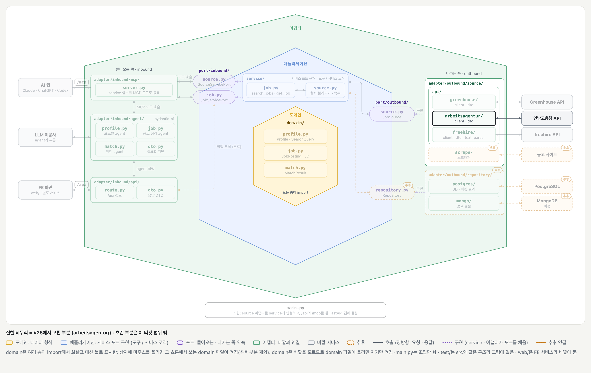
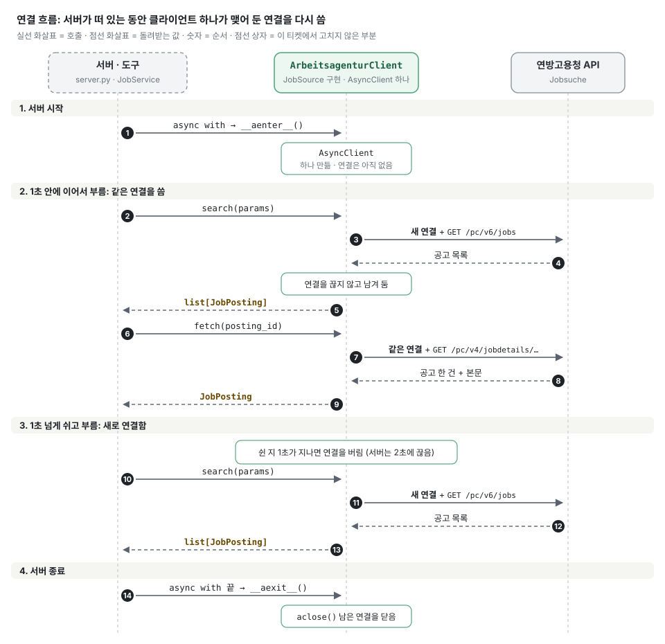

# 연방고용청 어댑터의 HTTP 연결 재사용 (#25)

## 배경과 목적

[#25](https://github.com/ai-agent-study-group/job-matching-agent/issues/25)는 [#16 리뷰](https://github.com/ai-agent-study-group/job-matching-agent/pull/16#discussion_r4361803070)에서 나온 제안을 처리하는 작업입니다. 기존 코드는 `search()` · `fetch()`를 부를 때마다 `AsyncClient`를 만들고 닫아서, 모든 요청이 매번 새로 연결했습니다.

이제 `async with`로 어댑터를 열 때 클라이언트를 하나 만들고, 서버가 떠 있는 동안 모든 요청이 같이 씁니다. 열고 닫는 방식은 [#15](#doc=wiki/BE-티켓-15.md)의 `FreehireClient`와 같습니다.

## 주요 내용

### 전체 그림

[BE 설계의 폴더 구조 그림](#doc=wiki/구조-BE.md)에 #15의 `freehire/`를 더하고, 이 티켓에서 고친 부분만 켠 상태입니다. 진한 테두리가 고친 부분이고, 흐린 부분은 이 티켓 범위 밖입니다.

`server.py`의 `__main__`은 #15에서 이미 `async with`로 어댑터를 열고 있어서 고치지 않았습니다.

### 바뀐 코드

| 항목 | 전 | 후 |
| --- | --- | --- |
| 클라이언트 | 요청마다 만들고 닫음 | `__aenter__`에서 하나 만들고 `__aexit__`에서 닫음 |
| timeout | `search` 30초, `fetch` 기본 5초 | 둘 다 30초 |
| 동시 연결 | 100개까지 (기본값) | 10개까지 |
| 쉬는 연결 | 20개까지, 5초 뒤 버림 (기본값) | 10개까지, 1초 뒤 버림 |

`ArbeitsagenturClient`도 이제 `async with` 안에서만 쓸 수 있습니다.

키워드 × 위치 조합이 10개를 넘으면, 나머지 요청은 빈 연결을 기다립니다. 30초 안에 연결이 나지 않으면 오류가 납니다.

### 연방고용청 서버에서 알아낸 것

실제 API를 불러 확인했습니다. 서버는 `Keep-Alive: timeout=2, max=100`으로 답합니다. 2초 쉰 연결을 끊는다는 뜻입니다.

| 확인한 것 | 결과 |
| --- | --- |
| 1초 안에 검색 2번 + 공고 조회 1번 | 연결 1개로 모두 응답 |
| 3초 쉬고 검색 | 새 연결을 맺고 오류 없이 응답 |
| 응답 시간 (4번씩 잼) | 새 연결 112~225ms, 같은 연결 54~65ms |
| 유지 시간 5초에서 2.5초 · 3.5초 쉬고 호출 | 새 연결을 맺고 오류 없이 응답 |
| 유지 시간 5초에서 1.92~2.03초 쉬고 호출 (36번) | **16번 `RemoteProtocolError`** |
| 유지 시간 1초에서 1.92~2.03초 쉬고 호출 (36번) | 오류 없음 |

오류는 오래 쉴 때가 아니라, 서버가 연결을 끊는 2초 무렵에 요청을 보낼 때 납니다. 그래서 서버보다 먼저 연결을 버리도록 유지 시간을 1초로 정했습니다.

### 테스트

`test/adapter/outbound/source/api/arbeitsagentur/test_client.py`에 두 개를 추가했습니다. 기존 테스트는 `search` · `fetch` 함수로 `async with`를 거쳐 부르도록 바꿨고, 확인하는 내용은 그대로입니다.

| 테스트 | 지키는 것 | 깨지면 |
| --- | --- | --- |
| `test_requests_share_one_client` | 검색과 공고 조회가 처음 만든 클라이언트를 같이 씀 | 요청마다 연결을 새로 맺음 |
| `test_client_closes_when_the_block_ends_with_an_error` | `async with`가 끝나면 도중에 오류가 나도 닫음 | 맺어 둔 연결이 프로세스가 끝날 때까지 남음 |

**테스트하지 않는 것:** 실제 연결 재사용과 유지 시간. 단위 테스트의 가짜 HTTP는 연결을 맺지 않아서, 위 표처럼 실제 API로 따로 확인했습니다.

## 결정 사항과 미정 사항

- 확정:
    - 클라이언트는 `__aenter__`에서 만들고 `__aexit__`에서 닫음 (`FreehireClient`와 같음)
    - 유지 시간은 1초 (서버가 2초에 끊음)
    - timeout은 30초 하나로 통일
    - 동시 연결은 10개. 쉬는 연결 수는 따로 적지 않아 동시 연결 수와 같은 10개가 됨 (`FreehireClient`와 같음)
- 제안 또는 미정:
    - 포트의 `__aenter__` · `__aexit__`를 `@abstractmethod`로 바꿀지: 이제 실제 어댑터는 둘 다 구현하고, 빈 기본 함수를 쓰는 곳은 테스트의 `FakeSource`뿐임
    - 두 어댑터의 `__aenter__`가 헤더와 유지 시간 빼고 같음: 공통 코드로 묶을지는 어댑터가 더 늘어날 때 판단

## 다음 할 일

- [ ] #25 PR(#29): #28과 GitHub 스택(#30)으로 묶음. #28 병합 후 GitHub이 main 위로 옮기면 승인 · 병합
