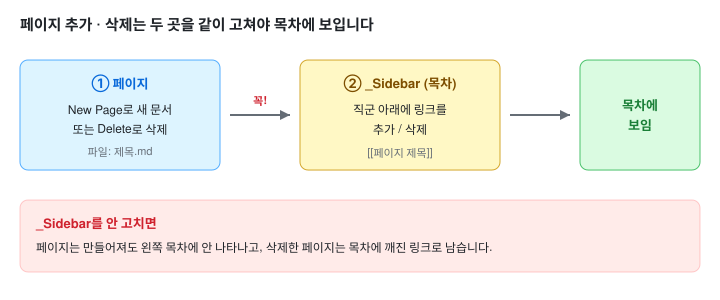

# Wiki 작성법

이 위키는 GitHub Wiki로 운영합니다. 웹에서 바로 고치거나, 로컬에 clone해 여러 문서를 한 번에 작업할 수 있습니다. PR은 없고 저장하면 바로 반영됩니다.

> ⚠️ **페이지를 추가하거나 삭제하면 반드시 `_Sidebar`(목차)도 같이 고쳐야 합니다.**
> GitHub Wiki는 새 페이지를 자동으로 목차에 넣어 주지 않습니다. `_Sidebar`를 안 고치면 페이지는 만들어져도 왼쪽 목차에 안 보이고, 삭제한 페이지는 목차에 깨진 링크로 남습니다.



## 웹에서 수정

1. 페이지 오른쪽 위 **Edit**를 누릅니다.
2. Markdown으로 작성하고 **Save Page**를 누릅니다.
3. 새 문서는 오른쪽 위 **New Page**로 만듭니다.
4. **페이지를 새로 만들거나 지웠으면 바로 아래 "사이드바(목차) 수정"대로 `_Sidebar`도 고칩니다.**

## 사이드바(목차) 수정

**페이지 추가·삭제 시 필수 단계입니다.** 왼쪽 목차는 위키 저장소의 `_Sidebar` 페이지 하나로 관리됩니다.

1. 위키에서 `_Sidebar`를 열고 **Edit**를 누릅니다. (주소 끝에 `/_edit`을 붙여도 됩니다: `.../wiki/_Sidebar/_edit`)
2. 새 페이지는 해당 **직군 아래에** 링크를 추가합니다. 지운 페이지는 그 줄을 삭제합니다.
3. 링크는 `[페이지 제목](#doc=wiki/페이지-제목.md)` 형식입니다. 제목의 띄어쓰기는 파일 이름에서 `-`로 바뀝니다. 예: `[구조 BE](#doc=wiki/구조-BE.md)` → 파일 `구조-BE.md`.
4. **Save Page**를 누르면 목차에 바로 반영됩니다.

## 로컬에서 작업 (여러 문서 한 번에)

여러 문서를 한꺼번에 고칠 때는 위키 저장소를 clone해서 작업합니다.

```
git clone https://github.com/ai-agent-study-group/job-matching-agent.wiki.git
```

- 파일 이름은 `페이지 제목.md`이며 띄어쓰기는 `-`로 씁니다.
- 수정 후 아래로 올립니다. master에 바로 반영됩니다.

```
git add .
git commit -m "docs: update wiki"
git push origin master
```

## 이미지

- `assets/` 폴더에 넣고 ``로 참조합니다.
- SVG는 raw GitHub에서 렌더되지 않으므로 반드시 위키 저장소의 `assets/`에 함께 올립니다.

## 회의록

- 제목은 `YYYY-MM-DD 회의` 형식입니다. 파일은 `YYYY-MM-DD-회의.md`.
- [회의록 양식](#doc=wiki/회의록-양식.md)을 복사해 작성하고 [회의기록](#doc=wiki/회의기록.md) 목록과 사이드바에 추가합니다.
