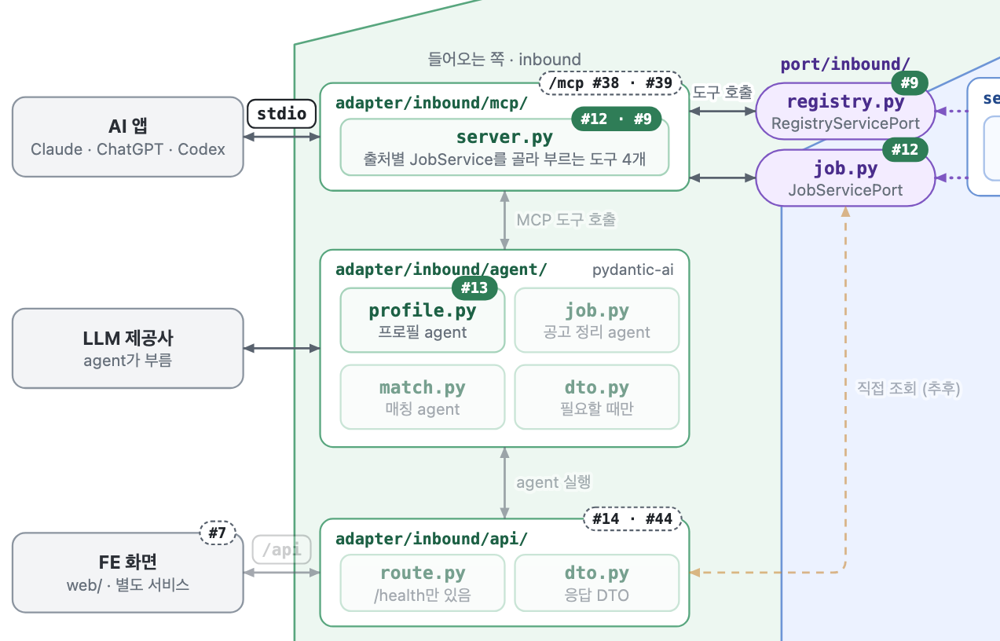
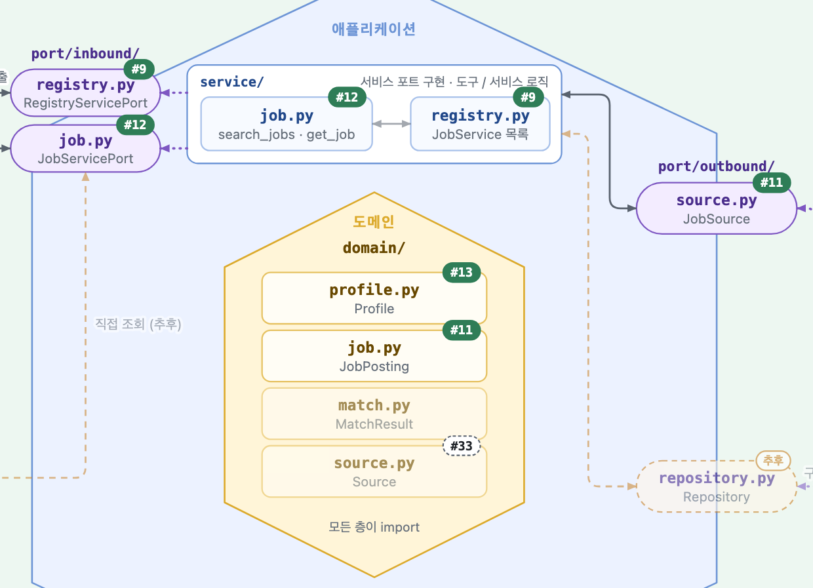
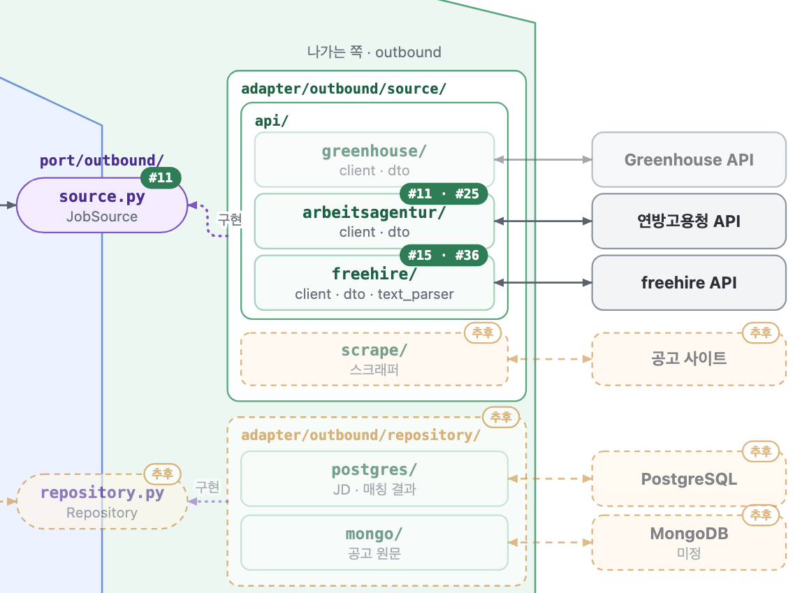

11/08 main 기준입니다.

- 진하게 그린 곳은 구현된 곳, 흐리게 그린 곳은 아직 구현 안 된 곳입니다.
- 상자 위 번호는 그 부분을 맡은 티켓입니다. 초록 번호는 닫힌 티켓, 점선 흰 번호는 열린 티켓입니다.

전체 그림입니다. 누르면 원본 크기로 열립니다.

### 들어오는 쪽: AI 앱 · agent · /api

### 가운데: port · service · domain

### 나가는 쪽: 출처 어댑터 · 저장소

## 그림에 있는 티켓

| 티켓 | 내용 | 상태 | 그림 위치 | 담당 | 작업 메모 |
|---|---|---|---|---|---|
| [#11](https://github.com/ai-agent-study-group/job-matching-agent/issues/11) | JobPosting 도메인과 연방고용청 어댑터 | 완료 | `domain/job.py` · `port/outbound/source.py` · `arbeitsagentur/` | seung-gu | [BE 티켓 11](#doc=wiki/BE-티켓-11.md) |
| [#12](https://github.com/ai-agent-study-group/job-matching-agent/issues/12) | search_jobs MCP 도구와 서버 뼈대 | 완료 | `port/inbound/job.py` · `service/job.py` · `mcp/server.py` | seung-gu | [BE 티켓 12](#doc=wiki/BE-티켓-12.md) |
| [#9](https://github.com/ai-agent-study-group/job-matching-agent/issues/9) | list_sources와 출처 고르기 | 완료 | `registry.py` (port · service) · `mcp/server.py` | seung-gu | [BE 티켓 9](#doc=wiki/BE-티켓-9.md) |
| [#13](https://github.com/ai-agent-study-group/job-matching-agent/issues/13) | 프로필 agent 최소판 | 완료 | `agent/profile.py` · `domain/profile.py` | cju12345623-cell | [LLM 티켓 13](#doc=wiki/LLM-티켓-13.md) |
| [#15](https://github.com/ai-agent-study-group/job-matching-agent/issues/15) | freehire API 어댑터 | 완료 | `freehire/` | seung-gu | [BE 티켓 15](#doc=wiki/BE-티켓-15.md) |
| [#25](https://github.com/ai-agent-study-group/job-matching-agent/issues/25) | 연방고용청 어댑터의 HTTP 연결 재사용 | 완료 | `arbeitsagentur/` | seung-gu | [BE 티켓 25](#doc=wiki/BE-티켓-25.md) |
| [#36](https://github.com/ai-agent-study-group/job-matching-agent/issues/36) | freehire 근무지에 도시 목록 쓰기 | 완료 | `freehire/` | seung-gu | |
| [#33](https://github.com/ai-agent-study-group/job-matching-agent/issues/33) | list_sources에 출처 설명 | PR #35 리뷰 중 | `domain/source.py` | seung-gu | |
| [#38](https://github.com/ai-agent-study-group/job-matching-agent/issues/38) | /mcp: MCP 서버를 앱에 HTTP로 붙이기 | 예정 | `adapter/inbound/mcp/` · `main.py` | | |
| [#39](https://github.com/ai-agent-study-group/job-matching-agent/issues/39) | /mcp에 OAuth 인증 | 예정 | `adapter/inbound/mcp/` | | |
| [#14](https://github.com/ai-agent-study-group/job-matching-agent/issues/14) | /api 검색 엔드포인트 | 예정 | `adapter/inbound/api/` | cju12345623-cell | |
| [#44](https://github.com/ai-agent-study-group/job-matching-agent/issues/44) | /api 이력서 파일을 텍스트로 | 예정 | `adapter/inbound/api/` | jungeum | |
| [#7](https://github.com/ai-agent-study-group/job-matching-agent/issues/7) | FE Next.js 기본 세팅 | 이슈 열림 (`web/` 기본 세팅은 PR #34로 머지) | FE 화면 | de24world | |

그림에 없는 티켓: DevOps [#22](https://github.com/ai-agent-study-group/job-matching-agent/issues/22) · [#26](https://github.com/ai-agent-study-group/job-matching-agent/issues/26) (완료), [#46](https://github.com/ai-agent-study-group/job-matching-agent/issues/46) (PR #47) · [#48](https://github.com/ai-agent-study-group/job-matching-agent/issues/48) · [#49](https://github.com/ai-agent-study-group/job-matching-agent/issues/49), FE [#24](https://github.com/ai-agent-study-group/job-matching-agent/issues/24) · [#41](https://github.com/ai-agent-study-group/job-matching-agent/issues/41) (PR #45), 문서 [#43](https://github.com/ai-agent-study-group/job-matching-agent/issues/43)

## 그림 고치기

원본은 [assets/progress/hexagon.html](#doc=wiki/assets/progress/hexagon.html.md)입니다. 맨 아래 script의 `built`(진하게 둘 상자), `builtEdges`(진하게 둘 선), `tickets`(상자별 티켓 번호)만 고치고, 브라우저로 열어 캡처해 `hexagon.png`를 바꾸면 됩니다. 확대 세 장은 전체 그림에서 잘라 낸 것입니다.
