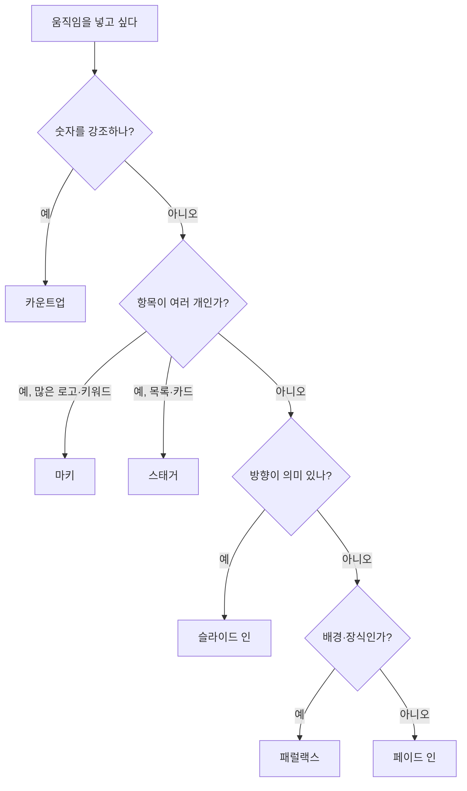

# 애니메이션 용어와 구현

이 문서는 기본 움직임 7개와 글자 애니메이션 8개, 총 15개 용어를 정의하고, 각 용어를 **언제 쓰는지**와 **어떻게 구현하는지**를 정리한다. 용어를 맞춰 두면 "제목에 페이드 인 넣어줘"처럼 한 줄로 요청해도 사람과 코딩 에이전트가 같은 결과를 만든다.

## 기본 원칙

- 기본적으로 `opacity`와 `transform`만 움직인다. 글자 효과의 `filter`·배경 변화는 짧은 문구에만 제한적으로 허용한다. `height`·`width`·`top`을 움직이면 레이아웃이 밀려 CLS가 나빠진다.
- CSS `@keyframes`와 유틸 클래스를 먼저 쓴다. JS 애니메이션 라이브러리는 spring·drag·enter/exit처럼 CSS로 안 되는 경우에만 검토한다.
- CSS로 표현하는 페이지 로드 애니메이션은 Server Component에서 그대로 쓴다. 단어 교체·문자 치환처럼 시간에 따라 내용이 바뀌는 효과만 작은 Client Component로 분리한다.
- 스크롤 진입 애니메이션은 `FadeInView`(IntersectionObserver 기반 Client Component)로 감싼다.
- SEO 핵심 텍스트(제목·설명·가격)는 서버에서 렌더하고, 애니메이션은 표시 방식만 바꾼다.
- 모든 유틸은 `prefers-reduced-motion: reduce`에서 애니메이션 없이 최종 상태로 보인다.

## 어떤 걸 써야 하나

먼저 "무엇을 보여주고 싶은가"로 고른다.

| 상황                                                   | 쓸 것                         |
| ------------------------------------------------------ | ----------------------------- |
| 요소 하나가 처음 나타날 때 (제목, 섹션, 메시지)        | 페이드 인                     |
| 같은 종류의 항목 여러 개가 함께 나타날 때 (목록, 카드) | 스태거                        |
| 어디서 왔는지 방향이 의미 있을 때 (박스, 패널, 목록)   | 슬라이드 인                   |
| 숫자의 크기·성과를 강조하고 싶을 때                    | 카운트업                      |
| 많은 로고·키워드를 좁은 공간에 보여줄 때               | 마키                          |
| 평평한 배경·이미지에 깊이감을 주고 싶을 때             | 패럴랙스                      |
| 글자가 입력되듯 한 글자씩 나타나게 할 때               | 타이핑 효과                   |
| 문장의 일부 단어를 번갈아 보여줄 때                    | 단어 순환 교체                |
| 문구가 가려진 영역 아래에서 올라오게 할 때             | 마스크 리빌                   |
| 글자·단어마다 시간차를 두고 등장시킬 때                | 스플릿 텍스트                 |
| 무작위 문자가 원래 문구로 해독되게 할 때               | 텍스트 스크램블               |
| 흐린 글자가 선명해지게 할 때                           | 블러 리빌                     |
| 스크롤 진행에 따라 단어가 차례로 진해지게 할 때        | 스크롤 텍스트 하이라이트      |
| 특정 문구 뒤에 밑줄처럼 색이 채워지게 할 때            | 형광펜 효과                   |
| 위 효과의 속도 느낌을 정할 때 (항상 함께 정한다)       | 이징                          |
| 사용자가 반드시 읽고 눌러야 하는 핵심 정보·CTA         | 움직임 없음, 또는 페이드 인만 |

글자 자체를 움직일 때는 위 표의 글자 효과를 먼저 고른다. 아래 흐름도는 기본 움직임을 고르는 기준이다.



### 언제 쓰지 않는가

- 사용자가 반복해서 쓰는 화면(폼 입력, 관리자 목록, 검색 결과 재조회)에는 진입 애니메이션을 넣지 않는다. 매번 기다리게 된다.
- 한 섹션에 효과를 2개 이상 겹치지 않는다. 주인공 하나만 움직인다.
- 에러 메시지·결제 금액처럼 즉시 읽어야 하는 정보에는 0.2s 이하의 짧은 페이드 인만 쓴다.

## 요청하는 법

**용어 + 대상 + (선택) 수치**로 요청한다.

```text
항목에 0.15초 간격 스태거 넣어줘
설명 박스가 아래에서 슬라이드 인 되게 해줘
배경에 약한 패럴랙스 넣어줘
소개 문구에 글자당 0.06초 타이핑 효과 넣어줘
제목의 동사를 3초마다 순환 교체해줘
핵심 문구 뒤에 형광펜 효과 넣어줘
```

## 전체 항목

| #   | 용어                   | 한 줄 정의                         | 요청 예시                                    | 구현                                        |
| --- | ---------------------- | ---------------------------------- | -------------------------------------------- | ------------------------------------------- |
| 1   | 페이드 인 (Fade in)    | 투명에서 서서히 나타남             | "제목에 페이드 인 넣어줘"                    | `animate-fade-in`, `animate-fade-in-up`     |
| 2   | 마키 (Marquee)         | 로고·글자가 옆으로 끝없이 흐름     | "로고 띠에 마키 효과 넣어줘"                 | `<Marquee>`                                 |
| 3   | 카운트업 (Count-up)    | 숫자가 0부터 목표값까지 올라감     | "성과 숫자에 카운트업 넣어줘"                | `<CountUp>`                                 |
| 4   | 스태거 (Stagger)       | 항목이 시간차를 두고 하나씩 등장   | "항목에 0.15초 간격 스태거 넣어줘"           | 부모에 `stagger` 클래스                     |
| 5   | 패럴랙스 (Parallax)    | 스크롤하면 배경이 더 느리게 움직임 | "배경에 약한 패럴랙스 넣어줘"                | `parallax` + `parallax-layer`               |
| 6   | 슬라이드 인 (Slide in) | 한쪽 방향에서 미끄러지듯 들어옴    | "설명 박스가 아래에서 슬라이드 인 되게 해줘" | `animate-slide-in-left`, `-right`, `-up`    |
| 7   | 이징 (Easing)          | 움직이는 동안 속도 변화 곡선       | "ease-in-out 이징 적용해줘"                  | `ease-smooth`, `ease-spring`, `ease-in-out` |
| 8   | 타이핑 효과 (Typewriter) | 한 글자씩 입력되듯 나타남 | "소개 문구에 타이핑 효과 넣어줘" | `typewriter` + `text-char` |
| 9   | 단어 순환 교체 (Rotating text) | 문장 일부를 다른 단어로 교체 | "동사를 3초마다 순환 교체해줘" | Client Component + 고정 크기 슬롯 |
| 10  | 마스크 리빌 (Masked text reveal) | 가림 영역 안에서 문구가 올라옴 | "제목을 줄별 마스크 리빌로 보여줘" | `text-mask` + `text-mask-content` |
| 11  | 스플릿 텍스트 (Split text) | 글자·단어별 시간차 등장 | "제목을 글자별 스플릿 텍스트로 보여줘" | `split-text` + `text-char` |
| 12  | 텍스트 스크램블 (Text scramble) | 무작위 문자가 원래 글자로 바뀜 | "로고 문구에 스크램블 넣어줘" | Client Component + 문자 치환 |
| 13  | 블러 리빌 (Blur reveal) | 흐린 문구가 선명해짐 | "소개 문구에 블러 리빌 넣어줘" | `animate-blur-reveal` |
| 14  | 스크롤 텍스트 하이라이트 (Scroll-linked text highlight) | 스크롤에 맞춰 단어가 진해짐 | "스크롤할수록 단어를 차례로 진하게 해줘" | `scroll-text` + `scroll-word` |
| 15  | 형광펜 효과 (Highlight animation) | 글자 뒤의 색이 가로로 채워짐 | "무료 체험에 형광펜 효과 넣어줘" | `text-highlight` |

## 구성 요소

기본 효과를 도입하는 프로젝트는 다음 구성을 갖춘다. 글자 효과는 필요한 항목만 추가한다.

| 구성 요소           | 위치                                       | 내용                                        |
| ------------------- | ------------------------------------------ | ------------------------------------------- |
| 모션 유틸 CSS       | 앱의 `globals.css`                         | [이식용 CSS](#이식용-css) 전체와 이징 토큰  |
| `FadeInView`        | 컴포넌트 폴더의 `motion/` (또는 `shared/`) | 스크롤 진입 시 재생 래퍼 (Client Component) |
| `CountUp`·`Marquee` | 같은 폴더                                  | 카운트업 (Client), 마키 (Server Component)  |

글자 효과의 CSS 클래스는 아래 [이식용 CSS](#이식용-css)에 포함한다. 단어 순환 교체와 텍스트 스크램블은 **구현 규약**이며, 이 문서가 있는 공용 문서 저장소에는 실행 컴포넌트가 없다. 사용하는 앱에서 해당 규약대로 구현한다.

아래 예시의 import 경로 `@/components/motion/...`는 프로젝트의 실제 경로로 바꾼다.

## 용어

### 1. 페이드 인 (Fade in)

투명(`opacity: 0`)에서 불투명(`opacity: 1`)으로 바뀐다. 가장 기본적인 진입 효과다.

**언제 쓰나**

- 페이지에 처음 들어왔을 때 제목·소개 문구를 부드럽게 보여줄 때.
- 스크롤해서 새 섹션이 나타날 때.
- 에러·완료 메시지처럼 상태가 바뀌어 새 요소가 생길 때 (0.2s 이하로 짧게).
- 어떤 효과를 쓸지 애매할 때의 기본값.

**쓰지 않는 곳**: 이미 보이던 요소가 다시 렌더될 때. 깜빡이는 것처럼 보인다.

**클래스**: `animate-fade-in`(제자리), `animate-fade-in-up`(아래에서 살짝 올라오며 나타남, 기본 추천).

```tsx
// 페이지 로드 시 — Server Component에서 그대로 쓴다
<h1 className="animate-fade-in-up">봄맞이 할인</h1>

// 값 조절은 Tailwind 임의 속성으로
<div className="animate-fade-in-up [--fade-delay:0.24s] [--fade-y:16px]">...</div>

// 스크롤 진입 시
<FadeInView animation="fade-in" duration={0.5}>
  <p>...</p>
</FadeInView>
```

| CSS 변수          | 기본값 | 설명                            |
| ----------------- | ------ | ------------------------------- |
| `--fade-y`        | `40px` | `fade-in-up` 시작 위치 (아래쪽) |
| `--fade-delay`    | `0s`   | 지연                            |
| `--fade-duration` | `0.6s` | 재생 시간                       |

**함정**: 히어로 제목처럼 LCP 요소는 duration을 0.5s 이하로 짧게 둔다. 텍스트 자체를 JS 렌더 뒤로 미루지 않는다.

### 2. 마키 (Marquee)

로고나 글자 띠가 옆으로 끝없이 흐른다. `<Marquee>`가 같은 내용을 2벌 렌더하고 트랙을 `-50%` 이동시켜 이음매 없이 반복한다. JS가 없는 Server Component다.

**언제 쓰나**

- 파트너·고객사·등록 기업 로고를 한 줄에 많이 보여줄 때.
- 키워드 칩, 한 줄 후기처럼 "이런 것들이 있다"는 분위기만 전하면 될 때.
- 항목이 화면 폭보다 많아서 정적으로 두면 잘리거나 줄이 많아질 때.

**쓰지 않는 곳**

- 핵심 정보와 CTA. 사용자가 읽기 전에 지나간다.
- 항목이 3개 이하일 때. 반복이 눈에 띈다. 이때는 정적 목록으로 둔다.
- 사용자가 항목을 비교·선택해야 하는 내비게이션.

```tsx
import { Marquee } from "@/components/motion/Marquee";

<Marquee duration={40} gap="2.5rem" ariaLabel="파트너사">
  {partners.map((partner) => (
    <Link key={partner.slug} href={`/partner/${partner.slug}`}>
      {partner.name}
    </Link>
  ))}
</Marquee>;
```

| Prop           | 타입      | 기본값   | 설명                                        |
| -------------- | --------- | -------- | ------------------------------------------- |
| `children`     | ReactNode | —        | 흐를 항목. 한 벌만 넘긴다                   |
| `duration`     | number    | `30`     | 한 바퀴 시간(초). 항목이 많을수록 길게      |
| `gap`          | string    | `"2rem"` | 항목 간격 (CSS 길이)                        |
| `reverse`      | boolean   | `false`  | 왼쪽 → 오른쪽으로 흐름                      |
| `pauseOnHover` | boolean   | `true`   | 마우스를 올리면 일시정지                    |
| `ariaLabel`    | string    | —        | 띠 전체 라벨. 있으면 `role="region"`이 된다 |
| `className`    | string    | —        | 추가 클래스                                 |

**접근성**: 복제본은 `aria-hidden`과 `inert`로 스크린리더와 키보드 포커스에서 빠진다. reduced-motion에서는 흐르지 않고 줄바꿈 목록으로 보인다.

**함정**: 마키의 이징은 `linear`만 쓴다. 속도가 변하면 이음매에서 덜컥거린다. 데이터가 적을 수 있으면 최소 개수(예: 4개) 미만일 때 띠를 숨기는 조건을 둔다.

### 3. 카운트업 (Count-up)

숫자가 `from`(기본 0)부터 목표값까지 올라간다. 화면에 40% 이상 보이면 한 번 재생한다.

**언제 쓰나**

- 누적 가입자·거래 건수·데이터 표본 수처럼 "이만큼 많다"는 규모를 강조할 때.
- 통계 카드·성과 지표 섹션에서 첫 시선을 숫자로 모으고 싶을 때.

**쓰지 않는 곳**

- 가격·잔액·결제 금액. 사용자가 중간 값을 잘못 읽을 수 있다.
- 날짜·전화번호·ID처럼 크기가 의미 없는 숫자.
- 실시간으로 자주 바뀌는 숫자. 바뀔 때마다 다시 세면 산만하다.

```tsx
import { CountUp } from "@/components/motion/CountUp";

<strong className="text-2xl font-bold">
  <CountUp value={1220} suffix="건" />
</strong>;
```

| Prop            | 타입                     | 기본값    | 설명                            |
| --------------- | ------------------------ | --------- | ------------------------------- |
| `value`         | number                   | —         | 목표값                          |
| `from`          | number                   | `0`       | 시작값                          |
| `duration`      | number                   | `1.2`     | 재생 시간(초)                   |
| `delay`         | number                   | `0`       | 지연(초)                        |
| `locale`        | string                   | `"ko-KR"` | 숫자 포맷 로케일 (천 단위 콤마) |
| `formatOptions` | Intl.NumberFormatOptions | —         | 소수점·통화 등 포맷 옵션        |
| `prefix`        | string                   | `""`      | 앞 단위 (예: `"₩"`)             |
| `suffix`        | string                   | `""`      | 뒤 단위 (예: `"건"`)            |
| `className`     | string                   | —         | 추가 클래스                     |

**동작 방식**: `CountUp`은 최종값을 `sr-only`로 함께 렌더한다. 크롤러와 스크린리더는 항상 정확한 값을 읽는다. 최종값 크기의 투명 자리표시자로 폭을 고정하므로 숫자가 늘어나도 레이아웃이 흔들리지 않는다. reduced-motion에서는 바로 최종값을 보여준다.

**함정**: 값을 문자열로만 받는 카드 컴포넌트에 넣으려면 prop 타입을 `ReactNode`로 넓힌다.

### 4. 스태거 (Stagger)

여러 항목이 시간차를 두고 하나씩 등장한다. 부모에 `stagger` 클래스를 붙이면 직계 자식이 순서대로 `fade-in-up`된다.

**언제 쓰나**

- 카드 그리드, 기능 소개 3~6개, 게시글·공고 목록처럼 같은 모양의 항목이 여러 개일 때.
- 항목의 순서나 개수를 자연스럽게 인지시키고 싶을 때.
- 내비게이션 칸처럼 짧은 항목들이 처음 한 번 나타날 때 (간격 0.05s).

**쓰지 않는 곳**

- 무한 스크롤·페이지네이션으로 계속 추가되는 목록. 새로 추가될 때마다 다시 기다리게 된다.
- 항목이 20개를 넘는 긴 목록. 앞쪽 몇 개만 스태거하고 나머지는 한 번에 보여준다 (12번째 이후는 자동으로 같은 지연).

**간격**: 0.05~0.15s. 항목이 많을수록 간격을 줄인다.

```tsx
// 페이지 로드 시
<ul className="stagger [--stagger-step:0.08s]">
  {items.map((item) => (
    <li key={item.id}>...</li>
  ))}
</ul>

// 스크롤 진입 시 — FadeInView를 스태거 컨테이너로 쓴다
<FadeInView animation="none" className="stagger grid gap-5 md:grid-cols-3">
  {cards.map((card) => (
    <Card key={card.id}>...</Card>
  ))}
</FadeInView>
```

| CSS 변수             | 기본값  | 설명                 |
| -------------------- | ------- | -------------------- |
| `--stagger-step`     | `0.15s` | 항목 간 간격         |
| `--stagger-delay`    | `0s`    | 첫 항목 지연         |
| `--stagger-duration` | `0.5s`  | 항목별 재생 시간     |
| `--stagger-y`        | `16px`  | 항목별 올라오는 거리 |

**함정**: `stagger`는 **직계 자식**에만 적용된다. 자식을 Fragment 대신 실제 요소로 렌더해야 한다. 자식에 이미 `animation`이 있으면 스태거가 덮어쓴다.

### 5. 패럴랙스 (Parallax)

스크롤할 때 배경 레이어가 콘텐츠보다 느리게 움직여 깊이감을 준다. CSS scroll-driven animation(`animation-timeline`)으로 구현하므로 JS 스크롤 리스너가 없다.

**언제 쓰나**

- 히어로·섹션 배경 장식, 일러스트처럼 정보가 없는 시각 요소에 깊이감을 줄 때.
- 썸네일·커버 이미지가 스크롤에 따라 살짝 움직여 생동감을 주고 싶을 때.
- 랜딩·소개 페이지처럼 스크롤하며 "구경하는" 화면.

**쓰지 않는 곳**

- 텍스트·버튼이 있는 레이어. 읽기 어렵고 클릭 위치가 어긋난다.
- 작업 화면(폼, 대시보드, 표). 정보 탐색을 방해한다.
- 한 화면에 패럴랙스 레이어를 여러 개 겹칠 때. 멀미를 유발한다.

**강도**: "약한 패럴랙스"는 `--parallax-shift` 10~40px.

```tsx
<div className="parallax aspect-[16/10] [--parallax-shift:14px]">
  <div className="parallax-layer absolute inset-x-0 -inset-y-4">
    <Image src={src} alt="" fill className="object-cover" />
  </div>
</div>
```

| 클래스 / 변수      | 기본값 | 설명                                                              |
| ------------------ | ------ | ----------------------------------------------------------------- |
| `parallax`         | —      | 컨테이너. `position: relative`, `overflow: hidden`, 타임라인 기준 |
| `parallax-layer`   | —      | 느리게 움직이는 레이어. `parallax`의 자손이어야 한다              |
| `--parallax-shift` | `40px` | 레이어가 위아래로 움직이는 최대 거리                              |

**함정**: 레이어는 이동 거리 이상으로 위아래를 키운다 (`-inset-y-*`). 그러지 않으면 가장자리에 빈 띠가 보인다. 미지원 브라우저(Firefox 등)와 reduced-motion에서는 레이어가 정지 상태로 보인다.

### 6. 슬라이드 인 (Slide in)

한쪽 방향에서 미끄러지듯 들어온다. 페이드 인보다 방향성이 강하다.

**언제 쓰나**

- 설명 박스·사이드 박스처럼 본문 옆에 "추가로 붙는" 정보를 보여줄 때 (아래 → 위).
- 이미지와 텍스트가 좌우로 번갈아 나오는 교차 레이아웃 (각자 바깥쪽에서 안쪽으로).
- 공지·알림 목록처럼 흐름이 있는 짧은 목록 (왼쪽 → 오른쪽).
- 토스트·배너처럼 화면 가장자리에서 등장하는 요소.

**쓰지 않는 곳**

- 방향에 의미가 없는 일반 섹션. 페이드 인이 더 차분하다.
- 같은 화면에서 여러 방향을 섞을 때. 시선이 흩어진다.

```tsx
<FadeInView animation="slide-in-up" y={32}>
  <aside>...</aside>
</FadeInView>

<div className="animate-slide-in-left [--slide-distance:24px]">...</div>
```

| CSS 변수           | 기본값 | 설명                                |
| ------------------ | ------ | ----------------------------------- |
| `--slide-distance` | `48px` | 이동 거리 (`FadeInView`의 `y` prop) |
| `--slide-delay`    | `0s`   | 지연                                |
| `--slide-duration` | `0.5s` | 재생 시간                           |

**함정**: `slide-in-right`는 화면 오른쪽 밖에서 시작하므로 부모에 `overflow-x: clip`이 없으면 가로 스크롤바가 생길 수 있다. 확신이 없으면 `slide-in-up`이나 `slide-in-left`를 쓴다.

### 7. 이징 (Easing)

같은 거리·같은 시간이라도 움직이는 동안 속도가 어떻게 변하는지 정하는 곡선이다. 모든 애니메이션과 transition에 항상 함께 정한다.

**언제 무엇을 쓰나**

| 토큰 / 유틸                   | 곡선                                | 느낌                        | 언제 쓰나                                                       |
| ----------------------------- | ----------------------------------- | --------------------------- | --------------------------------------------------------------- |
| `ease-smooth` (ease-out 계열) | `cubic-bezier(0.2, 0.8, 0.2, 1)`    | 빠르게 출발 → 부드럽게 멈춤 | 요소가 **들어올 때** (페이드·슬라이드·스태거), hover 반응       |
| `ease-in`                     | Tailwind 기본                       | 천천히 출발 → 빠르게 퇴장   | 요소가 **사라질 때** (닫기, 삭제)                               |
| `ease-in-out`                 | Tailwind 기본                       | 천천히 → 빠르게 → 천천히    | 화면 안에서 **A → B로 이동할 때** (토글, 탭 인디케이터)         |
| `ease-spring`                 | `cubic-bezier(0.34, 1.56, 0.64, 1)` | 살짝 튀었다 돌아옴          | **눌렀다는 손맛**이 필요할 때 (CTA, 아이콘 hover, 칩 선택)      |
| `ease-linear`                 | `linear`                            | 일정한 속도, 기계적         | **끝없이 반복**하거나 스크롤에 묶일 때 (마키, 스피너, 패럴랙스) |

```tsx
<ArrowUpRight className="transition-transform duration-200 ease-spring group-hover:translate-x-0.5" />
```

`globals.css`의 `@theme`에 토큰을 등록하면 `ease-smooth`·`ease-spring` 유틸과 `var(--ease-smooth)` 변수가 함께 생긴다.

```css
/* globals.css */
@theme {
  --ease-smooth: cubic-bezier(0.2, 0.8, 0.2, 1);
  --ease-spring: cubic-bezier(0.34, 1.56, 0.64, 1);
}
```

**함정**: 진입에 `linear`를 쓰면 딱딱해 보인다. `ease-spring`은 정보 전달 요소(목록, 본문)에 쓰면 가볍게 보이므로 인터랙션 요소에만 쓴다.

### 8. 타이핑 효과 (Typewriter)

완성된 문구를 한 글자씩 즉시 드러내 입력하는 느낌을 준다. 스플릿 텍스트와 달리 각 글자에 이동·페이드 없이 `steps(1, end)`를 적용한다. 기본은 한 번 재생이며 삭제·무한 반복은 넣지 않는다.

**언제 쓰나**: 짧은 소개 문구, 대화형 제품의 데모, 입력되는 느낌이 중요한 보조 카피.

**쓰지 않는 곳**: 즉시 읽어야 하는 제목·가격·오류·CTA, 긴 본문. 핵심 문구는 정적으로 두고 보조 문구에 적용한다.

```tsx
// Server Component — 공백도 별도 글자로 포함한다
<span className="typewriter" aria-label="안녕!">
  <span aria-hidden="true">
    <span className="text-char [--char-i:0]">안</span>
    <span className="text-char [--char-i:1]">녕</span>
    <span className="text-char [--char-i:2]">!</span>
  </span>
</span>
```

| CSS 변수 | 기본값 | 설명 |
| --- | --- | --- |
| `--type-step` | `0.06s` | 글자 사이 간격 |
| `--text-delay` | `0s` | 전체 시작 지연 |
| `--char-i` | `0` | 글자별 0부터 시작하는 순번 |

**구현·접근성**: 서버에서 전체 문구와 글자 span을 렌더한다. 글자는 투명한 상태에서도 자리를 차지하므로 타이핑 중 줄바꿈·주변 요소가 밀리지 않는다. 스크린리더는 `aria-label`의 완성 문구를 한 번 읽는다. 커서는 선택 사항이며, 추가한다면 절대 위치로 두고 입력 완료 시 숨긴다. 무한 깜빡임은 넣지 않는다.

**함정**: 한글 자모·이모지를 코드 단위로 자르면 글자가 깨진다. 동적 문구를 분리할 때는 서버에서 `Intl.Segmenter("ko", { granularity: "grapheme" })`로 사용자에게 한 글자로 보이는 단위로 나눈다. 공백은 `white-space: pre-wrap`으로 보존한다. 이 방식은 완성형 글자 단위 공개이며 한글 자모 조합 과정은 재현하지 않는다.

### 9. 단어 순환 교체 (Rotating text)

"디자인 해요 → 개발 해요"처럼 문장의 고정 부분을 유지하면서 일부 단어만 바꾼다. 마키와 달리 한 자리에 한 단어씩 보인다.

**언제 쓰나**: 제품이 지원하는 역할·작업·가치를 짧게 나열하는 히어로 보조 문구.

**쓰지 않는 곳**: 단어를 모두 읽어야 뜻을 이해하는 설명, 가격·약관·버튼 라벨.

**구현 규약**: `words: string[]`를 받는 작은 Client Component로 만든다. 기본 교체 간격은 `3000ms`, 퇴장·진입은 각각 `200ms`다. `opacity`·`translateY`로 현재 단어를 퇴장시킨 뒤 다음 단어를 진입시킨다. 빈 배열이면 렌더하지 않고, 하나면 정적으로 보인다.

```tsx
// 슬롯 구조 예시 — words와 activeIndex는 사용하는 컴포넌트에서 관리한다
<span className="inline-grid align-baseline">
  {words.map((word, index) => (
    <span
      key={`${index}-${word}`}
      aria-hidden="true"
      className={`col-start-1 row-start-1 ${index === activeIndex ? "visible" : "invisible"}`}
    >
      {word}
    </span>
  ))}
</span>
```

**접근성·안정성**: 위 슬롯은 시각 레이어다. 부모 문장에 모든 의미를 담은 고정 `aria-label`을 주거나 별도의 `sr-only` 문장을 둔다. `aria-live`로 매번 단어를 읽히지 않는다. 모든 후보를 같은 grid 셀에 겹쳐 가장 긴 단어의 폭과 높이를 확보한다. 위 예시는 크기 확보 구조이며 퇴장·진입 상태 로직은 별도로 구현한다.

**함정**: 최초 서버 렌더와 첫 클라이언트 렌더는 모두 첫 단어로 맞춘다. 타이머는 effect에서 시작하고 언마운트 시 해제한다. 반복이 5초를 넘으면 키보드로 조작 가능한 정지·재생 버튼을 제공한다. reduced-motion에서는 타이머를 시작하지 않고 첫 단어와 고정 설명을 보여준다. 설정이 실행 중 바뀌어도 타이머를 해제한다.

### 10. 마스크 리빌 (Masked text reveal)

줄을 감싼 가림 영역 안에서 글자가 아래에서 위로 올라온다. 슬라이드 인과 달리 영역 밖의 글자는 보이지 않는다.

**언제 쓰나**: 짧은 브랜드 슬로건, 줄별로 강조할 제목.

**쓰지 않는 곳**: 긴 본문, 자동 줄바꿈이 자주 달라지는 문단.

```tsx
<span className="text-mask">
  <span className="text-mask-content">작게 시작</span>
</span>
<br />
<span className="text-mask">
  <span className="text-mask-content [--text-delay:0.12s]">크게 성장</span>
</span>
```

**설정**: `--text-duration` 기본 `0.6s`, `--text-delay` 기본 `0s`. 스크롤 진입은 `FadeInView animation="none"`으로 감싸 내부 CSS만 재생한다.

**함정**: 가림 영역에 글꼴의 위아래 여유를 둬 받침·영문 descender가 잘리지 않게 한다. 줄별 효과는 각 줄을 따로 감싼다. 모바일에서도 의도한 줄이 유지되는지 확인한다.

### 11. 스플릿 텍스트 (Split text)

문구를 글자·단어로 나눠 각각 시간차를 두고 나타낸다. 스태거를 텍스트 내부에 적용하는 효과다.

**언제 쓰나**: 짧은 캠페인 제목, 한 문장의 인상을 강조할 때.

**쓰지 않는 곳**: 본문 전체, 링크·강조·언어가 복잡하게 섞인 문단.

```tsx
<span className="split-text" aria-label="크게 성장">
  <span aria-hidden="true">
    <span className="text-char [--char-i:0]">크게</span>{" "}
    <span className="text-char [--char-i:1]">성장</span>
  </span>
</span>
```

**설정**: `--split-step` 기본 `0.04s`, `--text-duration` 기본 `0.4s`, `--text-delay` 기본 `0s`, `--char-i`는 0부터 시작한다. 예시는 단어 단위이며 글자 단위도 같은 구조다.

**접근성**: 타이핑처럼 전체 문구를 서버에서 렌더하고 시각 레이어만 분할한다. 글자 단위는 grapheme으로 나눈다. 단어 중간 줄바꿈을 막아야 한다면 단어별 래퍼 안에 글자를 넣는다.

**함정**: 글자가 많으면 마지막 글자가 너무 늦게 나온다. 전체 진입이 1초를 넘으면 단어 단위로 바꾸거나 간격을 줄인다.

### 12. 텍스트 스크램블 (Text scramble)

무작위 기호가 짧게 바뀌다가 원래 문구로 확정된다. 타이핑과 달리 처음부터 문자 칸들이 채워져 있다.

**언제 쓰나**: 기술·게임 콘셉트의 짧은 브랜드 문구, 한 번 재생하는 장식 텍스트.

**쓰지 않는 곳**: 핵심 정보, 긴 본문, 입력값·인증 코드처럼 정확히 읽어야 하는 문자열.

**구현 규약**: `text: string`을 받는 작은 Client Component로 만든다. 기본 재생 시간은 `600ms`, 문자 갱신 간격은 `50ms`, 치환 문자 집합은 `ABCDEFGHIJKLMNOPQRSTUVWXYZ0123456789`다. grapheme으로 나눈 원문에서 공백·줄바꿈은 유지하고, 진행률에 따라 앞쪽 글자부터 확정한다. 마지막에는 반드시 원문으로 복구한다.

**접근성·안정성**: 원문을 서버에서 렌더하고 첫 클라이언트 렌더도 원문으로 맞춘다. 난수는 effect 이후 시각 레이어에만 적용한다. 원문 자리표시자를 grid 셀에 `invisible`로 두고, 같은 셀의 절대 위치 시각 레이어만 바꿔 주변 레이아웃을 유지한다. 컨테이너에 원문 `aria-label`, 시각 레이어에 `aria-hidden="true"`를 둔다. 한 줄의 짧은 문구로 제한하고 치환 글자가 슬롯을 넘지 않는지 확인한다.

**함정**: 렌더 중 `Math.random()`을 쓰면 hydration 불일치가 생긴다. 타이머를 언마운트 시 해제하고, reduced-motion에서는 시작하지 않는다. 실행 중 설정이 바뀌면 즉시 중단하고 원문을 복구한다. 반복 재생은 기본으로 넣지 않는다.

### 13. 블러 리빌 (Blur reveal)

흐린 글자가 점점 선명해지며 나타난다. `filter: blur()`와 `opacity`를 함께 바꾼다.

**언제 쓰나**: 짧은 소개 문구, 차분하게 등장할 보조 제목.

**쓰지 않는 곳**: 큰 본문 블록, 저사양 기기에서 동시에 여러 개의 문구를 움직일 때, LCP가 중요한 핵심 제목.

```tsx
<p className="animate-blur-reveal">선명하게</p>
```

**설정**: `--text-blur` 기본 `6px`, `--text-duration` 기본 `0.6s`, `--text-delay` 기본 `0s`.

**함정**: `filter`는 기본 모션보다 그리기 비용이 크다. 짧은 문구 한 곳에만 쓰고 실제 모바일에서 확인한다. reduced-motion에서는 흐림도 제거한다.

### 14. 스크롤 텍스트 하이라이트 (Scroll-linked text highlight)

스크롤 진행에 맞춰 흐린 색의 단어가 차례로 진해진다. 한 번 진입하고 끝나는 페이드 인과 달리 스크롤을 되돌리면 강조도 되돌아간다.

**언제 쓰나**: 스토리 소개 페이지의 짧은 핵심 문장, 읽는 흐름을 시각적으로 강조할 때.

**쓰지 않는 곳**: 긴 기사 전체, 약관·안내처럼 처음부터 충분한 대비로 읽어야 하는 정보.

```tsx
<p className="scroll-text">
  <span className="scroll-word [--word-start:0%] [--word-end:35%]">단어가</span>{" "}
  <span className="scroll-word [--word-start:30%] [--word-end:65%]">차례로</span>{" "}
  <span className="scroll-word [--word-start:60%] [--word-end:100%]">진해져요</span>
</p>
```

**설정**: 부모의 `view-timeline`을 공유하고, 단어별 `--word-start`·`--word-end`로 부모가 뷰포트에 진입하는 구간(`entry`) 내 강조 범위를 나눈다. 기본 범위는 `0%`~`100%`다. 단어별로 타임라인을 만들면 읽는 순서와 진행이 어긋날 수 있다.

**접근성·대체 표시**: 미지원 브라우저와 reduced-motion에서는 모든 단어를 최종 색으로 보여준다. 초기 상태에도 읽을 수 있는 대비를 유지한다. 예시 CSS는 최종 색을 `currentColor`로 상속하며 기본 시작 불투명도는 `0.65`다. 실제 배경에서 대비가 부족하면 `--word-opacity`를 높인다.

**함정**: 부모가 뷰포트에 들어오는 동안의 효과이므로 문장을 짧게 둔다. 전체 페이지 스크롤 진행률과 연결하려면 별도의 타임라인 설계가 필요하다.

### 15. 형광펜 효과 (Highlight animation)

글자는 그대로 보이고 뒤의 색 면만 왼쪽에서 오른쪽으로 채워진다.

**언제 쓰나**: 혜택·키워드·짧은 문구를 강조할 때.

**쓰지 않는 곳**: 문단 전체, 링크·선택 상태와 구별하기 어려운 색 조합.

```tsx
<strong className="text-highlight">무료 30분</strong>
```

**설정**: `--highlight-color` 기본 `#fed7aa`(앱의 강조색 토큰으로 교체), `--text-duration` 기본 `0.5s`, `--text-delay` 기본 `0s`. 가상 요소의 `scaleX`만 움직이고 실제 글자 너비는 유지한다.

**함정**: 예시 클래스는 `inline-block`이므로 짧은 한 줄 문구에 쓴다. 여러 줄을 강조하려면 줄별로 나눈다. 밝은·어두운 테마 모두 글자 대비를 확인한다. reduced-motion에서는 색 면이 처음부터 채워져 있다.

## FadeInView

화면에 들어올 때 한 번 재생되는 진입 애니메이션 래퍼다. 진입 전에는 `.reveal-paused` 클래스로 내부 애니메이션 전체를 첫 프레임(투명)에 멈춰 두고, 보이면 클래스를 떼서 재생한다. 그래서 `FadeInView` 안의 `stagger`·`animate-*`도 진입 시점에 함께 재생된다.

**언제 쓰나**: 첫 화면 아래(below the fold)에 있는 섹션·목록·박스. 첫 화면 안에 있는 요소는 CSS 클래스(`animate-fade-in-up`, `stagger`)만 쓴다. JS가 실행되기 전에는 `FadeInView` 내용이 투명하기 때문이다.

```tsx
import { FadeInView } from "@/components/motion/FadeInView";
```

| Prop        | 타입                                                                                                         | 기본값         | 설명                                             |
| ----------- | ------------------------------------------------------------------------------------------------------------ | -------------- | ------------------------------------------------ |
| `children`  | ReactNode                                                                                                    | —              | 애니메이션할 내용                                |
| `as`        | `"div" \| "section" \| "ul" \| "ol" \| "li"`                                                                 | `"div"`        | 렌더할 태그                                      |
| `animation` | `"fade-in" \| "fade-in-up" \| "slide-in-left" \| "slide-in-right" \| "slide-in-up" \| "bounce-in" \| "none"` | `"fade-in-up"` | 진입 애니메이션. `"none"`은 스태거 컨테이너 전용 |
| `y`         | number                                                                                                       | `30`           | 이동 거리(px)                                    |
| `delay`     | number                                                                                                       | —              | 지연(초). 없으면 CSS 기본값                      |
| `duration`  | number                                                                                                       | —              | 재생 시간(초). 없으면 CSS 기본값                 |
| `threshold` | number                                                                                                       | `0.1`          | IntersectionObserver threshold                   |
| `className` | string                                                                                                       | —              | 추가 클래스                                      |

`animate-bounce-in`(`--bounce-y` 20px, `--bounce-delay` 0s, `--bounce-duration` 0.5s, `ease-spring`)은 CTA 버튼에 한 번만 튀는 진입을 줄 때 쓴다. 무한 반복하지 않는다.

**함정**: `FadeInView`는 Client Component다. 페이지 전체를 `"use client"`로 바꾸지 말고, 움직일 부분만 감싼다.

## 공통 규칙

- **시간**: 마이크로 인터랙션 150~250ms, 진입 400~600ms, 카운트업 1~1.5s. 1s 넘는 진입은 쓰지 않는다.
- **한 섹션에 주인공 하나**: 페이드·스태거·카운트업을 한 섹션에 몰아넣지 않는다.
- **reduced-motion**: 새 애니메이션 클래스를 추가하면 `globals.css`의 `@media (prefers-reduced-motion: reduce)` 블록에도 추가한다. 전역 `animation-duration: 0.01ms` 규칙만으로는 무한 반복 애니메이션이 깜빡일 수 있다.
- **인라인 스타일 대신 임의 속성**: 값 조절은 `style` 대신 Tailwind 임의 속성(`[--fade-delay:0.2s]`)을 쓴다.

## 글자 효과 공통 규칙

- 원문은 서버 HTML에 포함한다. JS로 빈 문자열부터 채우거나 핵심 문구를 난수로 서버 렌더하지 않는다.
- 시각적으로 분할·치환하는 문구는 전체 원문을 접근 가능한 이름으로 제공하고, 시각 레이어는 `aria-hidden`으로 중복 낭독을 막는다. 애니메이션 영역에 링크·버튼을 넣고 숨기지 않는다.
- 타이핑·스플릿은 완성 문구의 공간을, 순환 교체는 가장 긴 후보의 공간을 미리 확보한다. 웹폰트 교체에 따른 줄바꿈도 확인한다.
- CSS 효과는 아래 reduced-motion 규칙을 함께 복사한다. JS 효과는 `matchMedia("(prefers-reduced-motion: reduce)")`의 초기 값과 `change` 이벤트를 확인하고, 실행 중 설정이 바뀌어도 타이머·프레임을 취소한다.
- 글자 효과를 `FadeInView`와 함께 쓰면 `animation="none"`으로 감싼다. 첫 화면의 문구는 직접 렌더한다.

## 이식용 CSS

새 앱에 도입할 때 `globals.css`에 넣는다. `@theme`의 이징 토큰도 함께 넣는다. Tailwind v4 기준이다. 앱에 이미 같은 이름의 키프레임·클래스(예: `fade-in-up`, `.animate-fade-in-up`)가 있으면 중복 정의하지 말고 기존 것을 재사용한다.

```css
/* globals.css — 모션 유틸 */
@keyframes motion-fade-in {
  from {
    opacity: 0;
  }
  to {
    opacity: 1;
  }
}
@keyframes motion-fade-in-up {
  from {
    opacity: 0;
    transform: translate3d(0, var(--fade-y, 40px), 0);
  }
  to {
    opacity: 1;
    transform: translate3d(0, 0, 0);
  }
}
@keyframes motion-slide-in {
  from {
    opacity: 0;
    transform: translate3d(var(--slide-x, 0), var(--slide-y, 0), 0);
  }
  to {
    opacity: 1;
    transform: translate3d(0, 0, 0);
  }
}
@keyframes motion-bounce-in {
  from {
    opacity: 0;
    transform: translate3d(0, var(--bounce-y, 20px), 0) scale(0.96);
  }
  to {
    opacity: 1;
    transform: translate3d(0, 0, 0) scale(1);
  }
}
@keyframes motion-marquee {
  from {
    transform: translate3d(0, 0, 0);
  }
  to {
    transform: translate3d(-50%, 0, 0);
  }
}
@keyframes motion-parallax {
  from {
    transform: translate3d(0, calc(var(--parallax-shift, 40px) * -1), 0);
  }
  to {
    transform: translate3d(0, var(--parallax-shift, 40px), 0);
  }
}


/* 글자 효과: 최종 상태는 기본 스타일로도 읽을 수 있게 둔다 */
@keyframes motion-type-char {
  from { opacity: 0; }
  to { opacity: 1; }
}
@keyframes motion-text-reveal {
  from { transform: translateY(110%); }
  to { transform: translateY(0); }
}
@keyframes motion-split-char {
  from { opacity: 0; transform: translateY(0.5em); }
  to { opacity: 1; transform: translateY(0); }
}
@keyframes motion-blur-reveal {
  from { opacity: 0; filter: blur(var(--text-blur, 6px)); }
  to { opacity: 1; filter: blur(0); }
}
@keyframes motion-word-highlight {
  from { opacity: var(--word-opacity, 0.65); }
  to { opacity: 1; }
}
@keyframes motion-highlight {
  from { transform: scaleX(0); }
  to { transform: scaleX(1); }
}

@layer utilities {
  .text-char {
    display: inline-block;
    white-space: pre-wrap;
  }
  .typewriter .text-char {
    animation: motion-type-char 1ms steps(1, end)
      calc(var(--text-delay, 0s) + var(--char-i, 0) * var(--type-step, 0.06s))
      both;
  }
  .text-mask {
    display: inline-block;
    overflow: hidden;
    vertical-align: bottom;
    padding-block: 0.15em;
  }
  .text-mask-content {
    display: inline-block;
    animation: motion-text-reveal var(--text-duration, 0.6s) var(--ease-smooth)
      var(--text-delay, 0s) both;
  }
  .split-text .text-char {
    animation: motion-split-char var(--text-duration, 0.4s) var(--ease-smooth)
      calc(var(--text-delay, 0s) + var(--char-i, 0) * var(--split-step, 0.04s))
      both;
  }
  .animate-blur-reveal {
    animation: motion-blur-reveal var(--text-duration, 0.6s) var(--ease-smooth)
      var(--text-delay, 0s) both;
  }
  .scroll-text {
    view-timeline-name: --text-progress;
    view-timeline-axis: block;
  }
  @supports (animation-timeline: view()) and (animation-range: entry 0% entry 100%) {
    @media (prefers-reduced-motion: no-preference) {
      .scroll-text .scroll-word {
        animation: motion-word-highlight linear both;
        /* animation shorthand 뒤에 둬야 timeline이 초기화되지 않는다 */
        animation-timeline: --text-progress;
        animation-range: entry var(--word-start, 0%) entry var(--word-end, 100%);
      }
    }
  }
  .text-highlight {
    position: relative;
    display: inline-block;
    isolation: isolate;
  }
  .text-highlight::before {
    content: "";
    position: absolute;
    z-index: -1;
    inset: 55% -0.05em 0;
    background: var(--highlight-color, #fed7aa);
    transform-origin: left center;
    animation: motion-highlight var(--text-duration, 0.5s) var(--ease-smooth)
      var(--text-delay, 0s) both;
  }

  .animate-fade-in {
    animation: motion-fade-in var(--fade-duration, 0.6s) var(--ease-smooth)
      var(--fade-delay, 0s) both;
  }
  .animate-fade-in-up {
    animation: motion-fade-in-up var(--fade-duration, 0.6s) var(--ease-smooth)
      var(--fade-delay, 0s) both;
  }
  .animate-slide-in-left,
  .animate-slide-in-right,
  .animate-slide-in-up {
    animation: motion-slide-in var(--slide-duration, 0.5s) var(--ease-smooth)
      var(--slide-delay, 0s) both;
  }
  .animate-slide-in-left {
    --slide-x: calc(var(--slide-distance, 48px) * -1);
  }
  .animate-slide-in-right {
    --slide-x: var(--slide-distance, 48px);
  }
  .animate-slide-in-up {
    --slide-y: var(--slide-distance, 48px);
  }
  .animate-bounce-in {
    animation: motion-bounce-in var(--bounce-duration, 0.5s) var(--ease-spring)
      var(--bounce-delay, 0s) both;
  }

  /* 스태거: nth-child(1)~(11)에 --stagger-i 0~10, 이후는 11로 캡 */
  .stagger > * {
    --fade-y: var(--stagger-y, 16px);
    animation: motion-fade-in-up var(--stagger-duration, 0.5s)
      var(--ease-smooth)
      calc(
        var(--stagger-delay, 0s) + var(--stagger-i, 11) *
          var(--stagger-step, 0.15s)
      )
      both;
  }
  .stagger > :nth-child(1) {
    --stagger-i: 0;
  }
  .stagger > :nth-child(2) {
    --stagger-i: 1;
  }
  /* … .stagger > :nth-child(11) { --stagger-i: 10; } 까지 */

  .reveal-paused,
  .reveal-paused * {
    animation-play-state: paused !important;
  }

  .marquee {
    overflow: hidden;
    mask-image: linear-gradient(
      90deg,
      transparent,
      #000 8%,
      #000 92%,
      transparent
    );
  }
  .marquee-track {
    display: flex;
    width: max-content;
    animation: motion-marquee var(--marquee-duration, 30s) linear infinite;
  }
  .marquee-reverse .marquee-track {
    animation-direction: reverse;
  }
  .marquee-group {
    display: flex;
    flex-shrink: 0;
    align-items: center;
    gap: var(--marquee-gap, 2rem);
    padding-right: var(--marquee-gap, 2rem);
  }
  @media (hover: hover) {
    .marquee-pause-on-hover:hover .marquee-track {
      animation-play-state: paused;
    }
  }

  .parallax {
    position: relative;
    overflow: hidden;
    view-timeline-name: --parallax;
  }
  @supports (animation-timeline: view()) {
    @media (prefers-reduced-motion: no-preference) {
      .parallax-layer {
        animation: motion-parallax linear both;
        animation-timeline: --parallax;
        animation-range: cover;
      }
    }
  }

  @media (prefers-reduced-motion: reduce) {
    .animate-fade-in,
    .animate-fade-in-up,
    .animate-slide-in-left,
    .animate-slide-in-right,
    .animate-slide-in-up,
    .animate-bounce-in,
    .stagger > *,
    .marquee-track,
    .typewriter .text-char,
    .split-text .text-char,
    .text-mask-content,
    .animate-blur-reveal,
    .scroll-text .scroll-word,
    .text-highlight::before {
      animation: none !important;
    }
    .marquee {
      mask-image: none;
    }
    .marquee-track,
    .marquee-group {
      width: auto;
      flex-wrap: wrap;
      padding-right: 0;
    }
    .marquee-group[aria-hidden="true"] {
      display: none;
    }
  }
}
```

## 검증

1. 사용하는 앱의 개발 서버에서 페이지를 열고, 진입 효과가 한 번만 재생되는지 본다. 마키·단어 순환 교체의 반복과 스크롤에 따른 강조 변화는 각 규약대로 확인한다.
2. Chrome DevTools → Rendering → **Emulate CSS media feature prefers-reduced-motion: reduce**를 켠다. 모든 내용이 즉시 보이고, 마키는 줄바꿈 목록으로 바뀌어야 한다.
3. Lighthouse에서 CLS가 0.1 이하인지 확인한다. 타이핑 중과 가장 긴 단어로 교체될 때 주변 요소가 밀리지 않아야 한다.
4. 한글·공백·이모지가 섞인 문구를 확인한다. 글자가 깨지지 않고 모바일 줄바꿈과 마스크 영역에 잘림이 없어야 한다.
5. 스크린리더가 완성 문구를 한 번 읽는지 확인한다. JS를 꺼도 서버 원문이 HTML에 있고, CSS 글자 효과는 원문을 보여야 한다. 순환 교체·스크램블은 원문이 정적으로 보여야 한다.
6. 모션 감소 설정을 재생 중에도 전환한다. 타이머·커서가 멈추고 완성 문구가 즉시 보여야 한다. 순환 교체의 정지·재생 버튼은 키보드로 조작해 본다.
7. 스크롤 타임라인 미지원 환경에서 문구가 최종 색으로 보이는지 확인한다.

## 문제 해결

| 증상                                | 원인                                                           | 해결                                                    |
| ----------------------------------- | -------------------------------------------------------------- | ------------------------------------------------------- |
| 내용이 투명한 채로 안 나타남        | `FadeInView`의 JS가 실행되지 않음 (오류, 첫 화면 hydration 전) | 콘솔 오류를 확인한다. 첫 화면은 CSS 클래스로 바꾼다     |
| 스태거가 동시에 나타남              | 자식이 Fragment라 직계 자식이 하나뿐                           | 각 항목을 실제 요소로 렌더한다                          |
| 마키 이음매가 덜컥거림              | 이징이 `linear`가 아니거나 그룹 끝 `padding-right`가 없음      | `Marquee` 컴포넌트를 그대로 쓴다                        |
| 패럴랙스가 안 움직임                | 미지원 브라우저, reduced-motion, 또는 레이어가 `parallax` 밖   | Chrome에서 확인하고 레이어를 `parallax`의 자손으로 둔다 |
| 슬라이드 인 중 가로 스크롤바가 생김 | `slide-in-right`가 화면 밖에서 시작                            | `slide-in-up`을 쓰거나 부모에 `overflow-x-clip`을 준다  |
| 카운트업 중 옆 요소가 밀림          | `CountUp` 대신 직접 만든 숫자 애니메이션 사용                  | `CountUp`을 쓴다 (폭 고정 자리표시자 포함)              |
| 글자가 자모·이모지 조각으로 깨짐 | 문자열을 코드 단위로 분리함 | `Intl.Segmenter`의 grapheme 단위로 분리한다 |
| 단어 교체 때 제목·버튼이 밀림 | 현재 단어만 렌더해서 슬롯 크기가 바뀜 | 모든 후보를 같은 grid 셀에 겹쳐 최대 크기를 확보한다 |
| 스크램블에 hydration 경고가 남 | 첫 렌더에 난수를 사용함 | 첫 렌더는 원문으로 맞추고 effect에서 치환을 시작한다 |
| 스크롤 강조가 동시에 진행됨 | 모든 단어가 같은 재생 범위를 사용함 | `--word-start`·`--word-end`를 단어마다 나눈다 |
